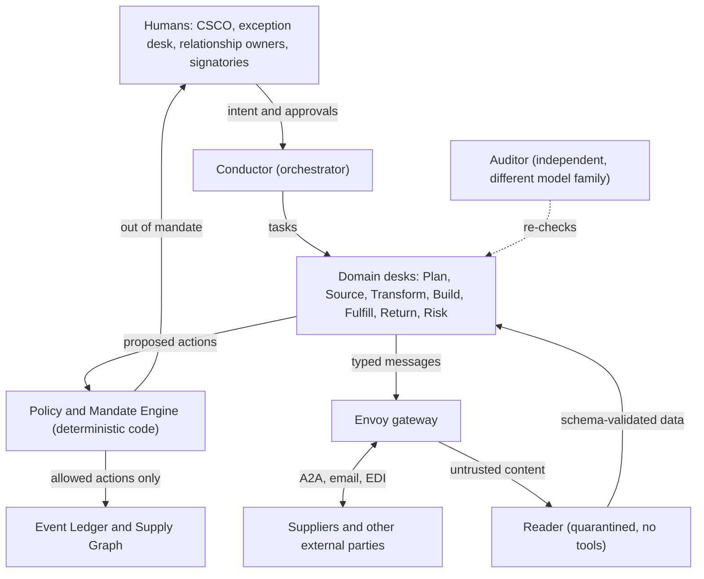
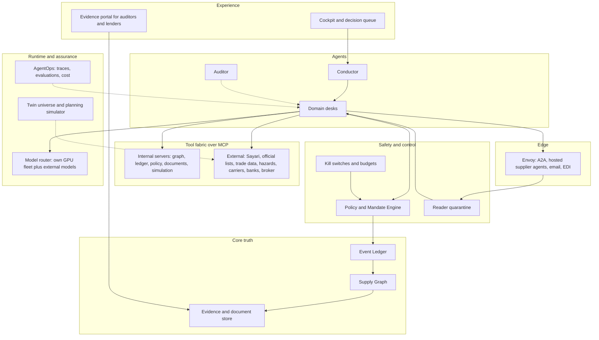
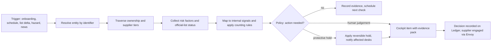
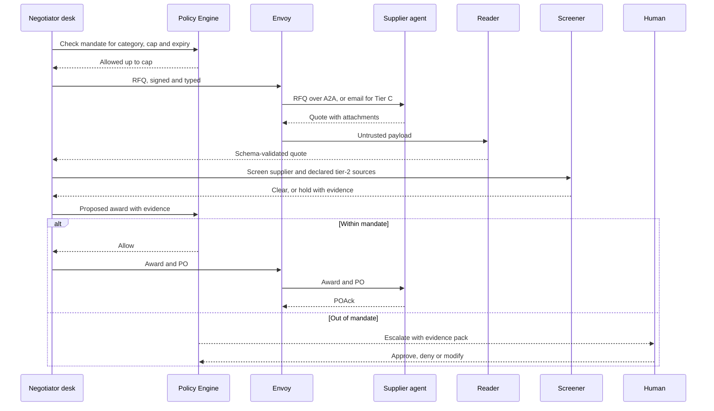

# CONCEPT-IDEA: Neocloud Supply OS

> **Purpose of this document:** capture *what* we want to exist and *why it matters*,
> before anyone argues about *how* to build it.
> **Written by:** yorkerhodes3, with GitHub Copilot as drafting partner.
> **Reviewed by:** a human, before moving on to `SPECIFICATION.md`.
>
> Format follows the Ethical Tech CoLab
> [project-startup-guide](https://github.com/Ethical-Tech-CoLab/project-startup-guide)
> template and method: **think in documents, review with a human, then build.**

| Field | Value |
| --- | --- |
| Status | `Draft` |
| Author | yorkerhodes3 |
| Reviewer(s) | _TBD: one domain reviewer (supply chain and trade compliance), one technical reviewer (agent platforms)_ |
| Created | 2026-11-02 |
| Last updated | 2026-11-02 |

### How to read this document

- **Sections 1–10** are the concept, in the CoLab template. Read these to decide whether
  the idea deserves a specification.
- **Appendices A–M** are detailed design material: capability map, agent roster,
  architecture, the Sayari-backed risk backbone, the supplier agent protocol, data model,
  flows, operating model, controls and roadmap. They exist because the brief asked for
  *every function needed*. They are **inputs** to `SPECIFICATION.md` and `PLAN.md`, not
  approved decisions.
- This is longer than the template's one-to-two-page guideline, on purpose. The concept
  itself is sections 1–4.

**Markers used throughout**

| Marker | Meaning |
| --- | --- |
| **(user)** | Stated in the brief |
| **(inferred)** | Drafted by the assistant; not yet confirmed by the author |
| **(proposed)** | A target or design choice awaiting review |
| **(verify)** | A factual claim to check against a primary source before relying on it |
| **(CoLab)** | Drawn from Ethical Tech CoLab materials; see Appendix M |

Unmarked design statements are proposals by default. CoLab prompt #1 asks the AI to
interview the author before drafting. That interview was skipped because the brief arrived
complete, so **treat every (inferred) line as a question for the author**.

---

## 1. One-sentence pitch

> **Neocloud Supply OS** helps **a GPU cloud company** turn **signed customer demand into
> powered, compliant, revenue-earning GPU capacity**, with AI agents doing the sourcing,
> building, shipping and supplier-risk work end to end, so **a small team can add capacity
> faster and more safely than a company running 140 separate applications.**

---

## 2. The problem

### Who has it

A neocloud is a company that sells GPU compute. It lives or dies on how quickly it turns
capital into running, paid-for capacity (inferred). Every step between "customer signs"
and "the customer's job runs on our racks" is a supply chain step: accelerators, servers,
networking, optics, cooling, power equipment, land, permits, construction, logistics,
installation and testing, plus the compliance checks that wrap all of it.

### How they cope today

The incumbent pattern is a **portfolio of around 140 applications** built on legacy tooling
and third-party technology stacks (user). The usual categories (inferred) are ERP,
source-to-pay suites, contract lifecycle management, third-party risk and GRC tools, trade
compliance, product lifecycle management, quality management, planning, transport and
warehouse systems, construction scheduling and project management, data center
infrastructure management, CMDB and asset management, spend analytics, BI, an EDI network,
and a dozen supplier portals.

The glue between them is integration middleware, spreadsheets, email, and meetings.

### What the pain costs

| Pain | What it looks like | What it costs (direction, not yet measured) |
| --- | --- | --- |
| **Latency** | Work waits in queues between apps, between people, and between companies. A supplier question sits in an inbox. An approval waits for a meeting. A risk alert waits for the quarterly review. | Late capacity, which means idle capital and lost revenue (inferred) |
| **Fragmentation** | No single answer to "where is GPU serial X, who made its parts, what is it pledged against, and may customer Y use it?" Each app holds a slice. | Reconciliation labour; decisions made on stale data |
| **Blind tiers** | Visibility stops at tier 1. The sanctioned shareholder, the forced-labour-linked sub-supplier, or the single-source optical part sits at tier 2, 3 or 4. | Compliance exposure; surprise shortages |
| **Rules that follow ownership** | Sanctions reach entities through ownership; OFAC's 50% rule is the best-known example. Screening names against lists is not enough. | Enforcement risk, detained shipments, reputational harm |
| **Linear people scaling** | Headcount grows with spend, supplier count and sites. | Operating cost and coordination overhead |
| **Integration tax** | Every app brings integrations, licences, upgrades and its own vendor risk. A 140-app estate is itself a large third-party risk surface. | Cost, fragility, security exposure |

### Why a neocloud's supply chain is unusually hard (inferred; verify specifics)

1. **Allocation, not purchase.** A concentrated vendor base allocates leading accelerators.
   The job is to win and protect allocation, not only to place purchase orders.
2. **Rack-scale systems.** Current GPU systems ship as integrated, often liquid-cooled racks
   assembled from thousands of parts across many tiers. One shortage of optics, cables,
   cold plates or quick-disconnects can strand an entire hall.
3. **Power is the binding constraint.** Utility interconnection, transformers, switchgear
   and on-site generation can have lead times longer than the hardware's own product
   cycle (verify per market).
4. **Fast product cycles.** Accelerator platforms refresh roughly every year (verify), so
   transitions are constant and older fleets must be redeployed or resold.
5. **Two-way compliance.** Export controls and sanctions apply to inbound hardware *and* to
   who uses the compute. Diversion risk is real.
6. **Financed assets.** GPUs are often pledged as collateral (inferred). Lenders need
   serial-level proof of existence, location and condition.
7. **High-value cargo.** GPUs are small, valuable and easy to resell, which makes them a
   target for theft and counterfeiting.
8. **Physical concentration.** Advanced packaging, high-bandwidth memory and ODM assembly
   are geographically concentrated (verify), so a regional event becomes a global shortage.

### Why now

- Agents can now use tools reliably through open protocols: **MCP** for agent-to-tool and
  **A2A** for agent-to-agent.
- Risk-data providers expose agent-ready interfaces. Sayari offers an MCP connector
  alongside its API, and teams used it to build working supplier screens in a single day at
  the CoLab's *Trace the Unseen* build day in September 2026 (CoLab).
- The brief's premise is that **tokens are effectively unlimited, while people and their
  latency are scarce** (user).
- A neocloud **owns GPUs**, so it can run its own agent fleet on its own capacity.

### How we know it is real

- (user) Direct experience of a 140-application supply chain portfolio and its
  dependencies.
- (CoLab) A documented, repeatable Sayari MCP workflow (resolve the entity, traverse its
  suppliers, map risk flags) from the *Hazard-and-Suppliers* playbook, including its known
  failure modes.
- (user, related work) Prior digital-twin work on supplier screening against Sayari and
  Tradeverifyd, and a UFLPA entity regression-testing design, in the `dtsf` repository.
- **Not yet in hand:** interviews with neocloud supply chain leaders, evidence of supplier
  willingness to connect agents, and measured baseline latencies. These are open questions
  in section 9.

---

## 3. Who it is for

| Audience | What they care about | How they meet the system |
| --- | --- | --- |
| **Primary:** Chief Supply Chain Officer and the *exception desk*, the small human team that runs the system | Capacity on time, no compliance surprises, fewer meetings | It is their operating system: a cockpit, a decision queue and a daily brief |
| **Primary:** Strategic relationship owners for accelerators, ODMs, utilities and construction | Leverage, allocation, trust | Agents prepare every interaction; humans hold the relationship |
| **Secondary:** Trade compliance officer and empowered official | Defensible decisions, evidence, audit trail | Signs licence and classification determinations; reviews evidence packs |
| **Secondary:** Data center construction and commissioning leads | Equipment on site when crews are ready | Project-controls agent; site exceptions only |
| **Secondary:** Finance (controller, treasury) and lenders | Accurate accruals, collateral evidence, cash timing | Ledger events, collateral reports |
| **Counterparty:** Suppliers, through their own agents or ours | Faster answers, faster payment, fewer portals | Agent-to-agent connection, a hosted supplier agent, or an email fallback |
| **Decides and pays:** CEO, CFO, board | Capital efficiency, risk posture, headcount | Quarterly outcomes against section 5 |
| **Checks:** auditors, regulators, customers' compliance teams | Evidence and controls | A read-only evidence portal |

---

## 4. The idea

Instead of 140 applications connected by people, build **one system**:

- **one model of the whole supply chain**, a graph plus an append-only ledger;
- **a fleet of AI agents that do the work**, organised as *desks*, one per business
  function;
- **deterministic policy gates** that bound what any agent may do;
- **a small human team** that sets intent, holds the key relationships, signs what the law
  says a person must sign, and handles exceptions.

Suppliers deal with **our agents, not our portals**, and the best-equipped suppliers connect
**their own agents** directly. Third-party risk is not a separate tool bolted on at the end.
It is a **continuous signal layer**, fed by Sayari's entity, ownership and trade graph
through MCP and checked against official lists, that every desk consults before it acts.

### Seven design commitments

1. **One graph, one ledger.** Every part, serial number, supplier, site, contract, shipment,
   permit and risk signal lives in one *Supply Graph*. Every change is an event on an
   append-only *Ledger*. There are no app-to-app integrations because there are no apps,
   only agents and views.
2. **Agents are the application layer.** Each business function is a *desk*: an agent with
   a written charter, typed tools, a mandate, KPIs and an evaluation suite. Adding a
   function means adding a desk, not buying an app.
3. **Mandates, not roles.** Authority is a signed, scoped, capped, time-boxed delegation,
   for example "book freight on approved lanes up to $X per shipment until date Y". Every
   action cites the mandate it used. The concept is borrowed from the author's
   Sovereign Agent Trust Mesh work (ERC-8226-style delegation) and implemented off-chain
   first.
4. **LLMs propose; policy disposes.** Moving money, compliance determinations and
   safety-relevant decisions pass deterministic gates written in code, not prompts. Agents
   handle ambiguity; code enforces limits.
5. **Untrusted content never touches authority.** Supplier documents, emails and agent
   messages are read by a quarantined *Reader* that has no tools. Only schema-validated data
   crosses to agents that can act. This defends against prompt injection by counterparties.
6. **Evidence-carrying decisions.** Every decision record carries its evidence: Sayari
   entity IDs, document hashes, retrieval dates, policy version, mandate, model and any
   human approver. **Risk flags are prompts to investigate, never findings** (CoLab).
7. **Earn autonomy.** Every desk starts read-only and climbs an autonomy ladder (observe,
   recommend, act with approval, act within mandate) only when its measured accuracy earns
   it. Humans manage by exception.

**One sourcing rule sits over all seven: own the brain, rent the senses and the rails.**
Build in-house the data model, agents, policy, workflows, interface and evaluations. Buy the
data we cannot create (Sayari, official lists, trade data, hazard feeds, commodity indices),
use regulated rails (banks, licensed customs brokers, insurers, e-signature), and route
across foundation models rather than training our own.

### What "all the tokens you want" buys

Unlimited tokens (user) are spent to buy down **latency** and **uncertainty**:

- **Read everything, every time.** Every contract, spec sheet, certificate, test report and
  change notice is read in full. Nothing is skimmed or sampled.
- **Re-screen the whole graph continuously.** Not once at onboarding, and not quarterly.
- **Think before acting.** Simulate a decision against the planning twin before committing.
- **Second opinions by default.** An independent *Auditor* agent, on a different model
  family, re-checks material decisions.
- **Shadow everything.** Every new desk version runs in shadow on live traffic before it is
  promoted.
- **Red-team continuously.** Adversarial agents probe for fraud, injection and policy gaps.
- **Evidence packs for every decision**, written once and readable by humans, auditors and
  lenders.

Two limits remain: tokens are unlimited, but **external data queries and rate limits are
not** (Sayari and other providers license and meter access), and **physics is not**. Agents
cannot make a transformer arrive sooner. They can see a slip earlier, find alternates, and
re-plan faster.

### A day in the life: happy path (contract to capacity)

_Illustrative. Quantities and dates are examples._

1. **07:10** Sales closes a three-year reservation for next-generation GPU capacity in two
   waves. The CRM integration posts a `ReservationSigned` event to the graph.
2. Within minutes the *Planner* converts it into racks, network fabric, megawatts, floor
   space and dates, and checks it against allocation, open orders, inventory and build
   schedules. Wave 1 fits Hall 3 at Site A. Wave 2 needs Hall 4, whose switchgear is nine
   weeks late.
3. The *Allocator* drafts an allocation request to the accelerator vendor. The human
   relationship owner reviews and sends it, because this is a strategic relationship.
4. The *Negotiator* issues RFQs for rack integration to three qualified ODMs. Two answer in
   minutes through their own agents. The third replies by email, which the *Envoy* gateway
   receives and the quarantined *Reader* turns into a structured quote. The *Negotiator*
   runs two rounds within its mandate: price inside the should-cost band, delivery,
   warranty, and liquidated damages from the template.
5. Before award, the *Screener* re-screens all three ODMs and their declared tier-2 sources
   through Sayari (resolve, traverse, risk factors) and the official lists. A tier-2 cable
   assembler shows a new `export_controls_adjacent` flag. That is routed to trade compliance
   as a prompt to investigate. The affected quote is held; the others proceed.
6. The *LLE Expeditor* escalates the Hall 4 switchgear slip. It finds two alternate units
   with matching specifications, prices expedite cost against revenue at risk, and puts
   **one decision** in the CSCO's cockpit.
7. **08:30** The CSCO approves the switchgear purchase from its evidence pack. The trade
   compliance officer clears the tier-2 flag: the Sayari match was a name-alike, and the
   evidence is recorded.
8. Purchase orders are issued and acknowledged by supplier agents. Advance ship notices
   stream in. The *Dispatcher* books secure freight, the *Customs* desk pre-classifies, the
   *Registrar* pre-creates serial records from ODM manifests, and the *Commissioner*
   schedules burn-in.
9. Weeks later, racks arrive. Dock-to-rack is tracked per serial, burn-in results are
   ingested, customer acceptance triggers billing, and the lender collateral report updates
   itself.

**Result:** two human decisions, both evidence-backed. Everything else ran within mandates,
was logged, and is auditable.

### A day in the life: risk path

1. Overnight, the monitoring sweep (Sayari re-screen, official-list deltas, GDACS hazard
   feed, cited web news) finds that the sub-tier maker of a liquid-cooling quick-disconnect
   has been acquired by an entity now on a restricted list. The exposure comes through
   ownership.
2. The *Mapper* traces the exposure: which part families, which ODMs use them, which open
   orders, racks in transit and racks in halls, and which customers' capacity depends on
   them.
3. The *Screener* splits it into a **compliance question** (do we hold new purchases?) and a
   **supply question** (what are the alternates?).
4. The *Resilience* desk simulates the options: which halls slip and by how much, the
   revenue at risk, and the qualification status of alternates on the approved vendor list.
5. The exception desk receives **one brief**:
   - *Applied automatically under the compliance mandate, reversible:* hold new orders
     containing part family X from source Y.
   - *Needs a human:* approve fast-track qualification of alternate Z.
   - *Needs legal:* decide whether installed units require any action.
6. The affected ODMs' agents receive a structured change request and reply with alternate
   source plans.

**Time from signal to first protective action: minutes, not weeks** (proposed target).

---

## 5. What success looks like

These targets are **proposals for review**. Baselines must be measured first (section 9).

| Signal | How we measure it | Target (proposed) | By when (proposed) |
| --- | --- | --- | --- |
| **Dock-to-billable time** | Median days from rack received on site to customer acceptance, per serial | 50% below measured baseline | 12 months after Phase 3 |
| **Supplier decision latency** | Median time from supplier message received to our substantive response | Under 15 minutes in mandate; under 1 business day when a human is required | Phase 2 exit |
| **Touchless rate** | Share of POs, ship notices, receipts and invoices completed with no human touch | 85% or more | 12 months after Phase 2 |
| **Tier coverage** | Active suppliers resolved to a Sayari entity by identifier; critical part families mapped to tier 3 | 100% of tier 1; 80% or more of critical families to tier 3 | Phase 1 exit; plus 6 months |
| **Time to protective action** | Risk signal ingested to hold or mitigation applied, or a human decision requested | Under 1 hour | Phase 1 exit |
| **Agent quality** | Human reversal rate of agent actions; critical-error rate in evaluation and production | Under 2% reversals; zero unmitigated critical errors | Continuous gate |
| **Portfolio collapse** | Supply chain applications in production | From 140 to 1 platform plus no more than 10 external rails and data feeds | 24 months |
| **Human leverage** | Annual hardware and build spend managed per supply chain FTE | Set once the baseline is known | 24 months |

---

## 6. Explicitly out of scope (for now)

Not building in v1 (Phases 0–2, Appendix L):

- **Not building: our own foundation model.** We route across commercial and open-weight
  models and run what we can on our own fleet.
- **Not building: our own risk data.** Sayari, official lists, trade data and hazard feeds
  are bought, not built.
- **Not building: the general ledger, payroll or treasury.** We emit accounting events;
  finance's systems book them. Supplier payments go through bank rails. There is no
  stablecoin settlement of supplier payments in v1. x402-style micropayments are considered
  only for paying for data or tools per call.
- **Not building: customs brokerage.** We classify and prepare entries; a licensed broker
  files them.
- **Not building: autonomy over decisions that legally need a named person.** That covers
  contract signature above delegated authority, export licence determinations, and
  engineering sign-offs that need a professional engineer's stamp.
- **Not building: construction tools.** No BIM authoring, CAD, building management or DCIM
  replacement in v1. We ingest from them. Live telemetry comes later.
- **Not building: customer billing or a customer KYC product.** We reuse the screening
  engine for customers in Phase 5.
- **Not building: a marketplace or a product for others.** This is our own operating
  system, not a SaaS offer.
- **Not building: on-chain anchoring.** Mandates and passports are signed documents
  off-chain first. ERC-8004 and ERC-8226 registries remain a later option.
- **Not building: warehouse robotics or other automation hardware.**

---

## 7. Constraints and realities

- **Time (inferred):** a first demonstrable slice in about 90 days and full portfolio
  collapse over about 24 months. Physical lead times do not shrink because software got
  faster.
- **Money:** tokens are effectively unlimited (user). The real costs are data licences
  (Sayari, trade data), inference at scale, a small senior team, security and audit. The
  budget is not stated; see section 9.
- **Skills:** agent-platform engineers; graph and data engineering; supply chain domain
  experts to write each desk's charter and evaluations; trade compliance expertise;
  security engineering.
- **Rules:**
  - **Export controls and sanctions.** US EAR, including the advanced-computing ECCNs such as
    3A090 and 4A090 (verify current text); OFAC including the 50% rule; and EU, UK and
    other regimes where we operate. Rules change often, so **regulation is versioned data,
    not constants in code.**
  - **Forced labour.** The UFLPA rebuttable presumption and the DHS UFLPA Entity List; the EU
    Forced Labour Regulation (verify application date and scope).
  - **Conflict minerals** reporting if publicly listed (verify).
  - **Internal controls.** SOX and ICFR if public or preparing to be. Agents are in scope for
    IT general controls.
  - **Data licensing.** Sayari fields are licensed. Keep a field-level licence clearance
    record for every Sayari-derived value shown to anyone, especially suppliers and
    customers (CoLab).
  - **Contract formation.** Agent-made commitments must be authorised by a mandate and
    attributable. Master agreements must recognise electronic agent communications.
  - **Privacy.** Corporate registries contain natural persons (owners, directors). Apply data
    minimisation and retention limits.
  - **Safety.** Electrical and mechanical commissioning stays human-supervised.
- **Physics:** see section 4. Agents improve how early we see a problem and how fast we
  respond to it, not how fast steel and copper move.

---

## 8. Alternatives considered

| Option | Why not (yet) |
| --- | --- |
| **Do nothing (140 apps plus people)** | Latency and headcount scale with growth; no single truth; permanent integration tax |
| **Buy an ERP or S2P suite and turn on vendor copilots** | Copilots live inside each app's silo; agents still cross ten or more data models; we inherit vendor roadmaps and licence costs |
| **Best-of-breed apps, integration platform, and an agent layer on top** | Better, but the agents' view of the world is a patchwork; every integration is a failure point and an attack surface |
| **Outsource to a 4PL or BPO** | Moves the latency into someone else's queue and gives up control of allocation and compliance, which are our core risks |
| **Build only the risk layer (Sayari plus screening) and keep the rest** | A good first step, and it is Phase 1, but it leaves the latency problem untouched |
| **AI-native, agent-first, one graph (this proposal)** | Chosen for leverage. Its biggest risks are agent reliability, supplier adoption and controls, addressed by the autonomy ladder, the Envoy fallback and deterministic policy gates |

---

## 9. Open questions

Each item should be answered in `SPECIFICATION.md` or become a research task in
`BACKLOG.md`.

**Business**

- [ ] Q1. What are today's baselines: dock-to-billable time, PO cycle time, supplier
      response time, supply chain headcount, and spend by category?
- [ ] Q2. What is the real list of the 140 applications, with owners, costs, and the data
      each one masters?
- [ ] Q3. What budget and team size are available for Phases 0–2?
- [ ] Q4. Public, pre-IPO or private? This decides how heavy the SOX controls on agents
      must be from day one.
- [ ] Q5. How are GPUs financed, and what serial-level evidence do the lenders require?

**Suppliers**

- [ ] Q6. Which top-20 suppliers would connect an agent (Tier A), use a hosted agent
      (Tier B), or stay on email and EDI (Tier C)?
- [ ] Q7. Will strategic suppliers, especially the accelerator vendor, accept agent-mediated
      interaction at all, and for which message types?
- [ ] Q8. What contract language makes agent-to-agent commitments binding and attributable?

**Risk data and Sayari**

- [ ] Q9. Which Sayari licence tier, and which fields may be stored, shown internally, or
      shown to suppliers and customers?
- [ ] Q10. What is the current Sayari MCP tool list? Are entity-change notifications or
      watchlists available, or must we schedule our own re-screening?
- [ ] Q11. Are the issues seen in the CoLab reference build fixed: HS product filters
      returning nothing through MCP, and `get_upstream_supply_chain` timing out without a
      filter?
- [ ] Q12. Which second trade-data source (for example Tradeverifyd) complements Sayari for
      shipment-level evidence?

**Regulatory**

- [ ] Q13. In which jurisdictions do we buy, build and sell? That sets the list regimes and
      export-control scope.
- [ ] Q14. What do customer-side ("know your customer" for compute) obligations currently
      require, and when do we need them (verify current US rule status)?
- [ ] Q15. Who is the empowered official for export-control decisions, and what may agents
      prepare versus decide?

**Technical**

- [ ] Q16. Which foundation models, and which share runs on our own fleet versus external
      APIs?
- [ ] Q17. Graph store and ledger technology (decided in `PLAN.md`, not here).
- [ ] Q18. What evaluation thresholds promote a desk up the autonomy ladder?

**People**

- [ ] Q19. What is the target human team, and what is the transition plan for anyone whose
      role changes?
- [ ] Q20. Who owns each desk's charter and evaluations?

---

## 10. Assumptions

- 🔴 We assume **suppliers will engage with agents** directly or through a hosted agent. If
  most stay on email, the Envoy fallback still works, but the latency gains shrink.
  *(risky: tests Phase 2)*
- 🔴 We assume **agents can reach under 2% reversal rates** on transactional desks within
  months of shadow running. If not, the human team must be larger.
  *(risky: tests Phase 1–2)*
- 🔴 We assume **a single graph can model hardware, construction and risk** without becoming
  an unmaintainable monolith. *(risky: tests Phase 0)*
- 🔴 We assume **Sayari's licence permits the storage and reuse we need**, including
  persistent entity IDs on our graph and some supplier-facing displays.
  *(risky: tests before Phase 1)*
- 🟡 We assume regulators and auditors will accept **agent-prepared, human-signed** decisions
  backed by evidence packs.
- 🟡 We assume tokens are effectively unlimited (user), but **external query budgets are
  not**.
- 🟡 We assume the neocloud can run a meaningful share of agent inference **on its own GPUs**
  without starving revenue workloads.
- 🟡 We assume one strategic accelerator vendor dominates supply, so allocation management
  is a first-class function (inferred).
- 🟢 We assume MCP and A2A remain the dominant open protocols for tool and agent
  interoperability.
- 🟢 We assume the official sanctions and export-control lists stay machine-readable.

---

## Reviewer sign-off

Reviewer: fill this in. Do **not** proceed to specification until the boxes are checked.
The appendices that follow are reference material for the specification stage. Review them
for errors, but they do not need to be approved here.

- [ ] The problem is real and clearly stated, independent of the solution
- [ ] The audience is specific (not "everyone")
- [ ] Success criteria are measurable
- [ ] Out-of-scope list is honest and meaningfully limits v1
- [ ] Risky assumptions are identified
- [ ] Open questions are captured, not hidden

**Verdict:** `Approved` / `Approved with changes` / `Needs rework`

**Reviewer notes:**

>

---

# Appendices: design material for the specification stage

## Appendix A — Capability map: every function, aligned to SCOR DS

The brief asks for the whole of "SCORM (supply chain ops mgmt)" (user). We read that as
supply chain operations management organised by **ASCM's SCOR Digital Standard (SCOR
DS)** process types (inferred): **Orchestrate, Plan, Order, Source, Transform, Fulfill,
Return.** A neocloud adds a lane SCOR spreads across several processes: **Build**, the
capital projects that create data centers. Third-party risk sits under Orchestrate in
SCOR DS. Here it gets its own lane because it is a continuous signal layer for every other
lane.

**Autonomy levels** (defined in Appendix I): **L0** observe · **L1** recommend · **L2** act
with human approval · **L3** act within mandate and notify · **L4** act within mandate,
audited, no notification.
The *Autonomy* column is the proposed **steady state**. Every desk starts at L0 or L1.

### A1. Orchestrate: strategy, rules, performance

| # | Function | Desk | Human role | Autonomy | Replaces (legacy category) |
| --- | --- | --- | --- | --- | --- |
| 1 | Supply chain strategy and network design: site mix, ODM mix, dual-sourcing, make-or-buy for integration | Category Strategist, Resilience | CSCO decides | L1 | Strategy decks, consultants |
| 2 | Delegation of authority, policy and mandate administration, as code | Policy Engine (deterministic), Conductor | CSCO and CFO approve changes | L2 | GRC tools, spreadsheets |
| 3 | Master data and Supply Graph stewardship: entity resolution, de-duplication, lineage | Registrar, Librarian | None routinely | L4 | MDM |
| 4 | Performance management: KPIs, daily decision brief, anomaly detection | Conductor | Reads and steers | L4 | BI, dashboards |
| 5 | Contract and obligations management: clause library, obligation extraction, renewals | Contract Steward | Legal for non-standard terms | L3 | CLM |
| 6 | ESG and carbon: embodied carbon of hardware and construction (Scope 3), energy mix, supplier disclosures | Sustainability | Sustainability lead signs disclosures | L2 | ESG platforms |
| 7 | Continuous control monitoring, audit evidence, records retention | Auditor | Internal audit | L4 (monitoring) | GRC, audit tools |
| 8 | Third-party risk of *our own* platform dependencies: model providers, data providers, cloud, banks | Watchtower | CISO, CFO | L3 | Vendor risk tools |

### A2. Plan

| # | Function | Desk | Human role | Autonomy | Replaces |
| --- | --- | --- | --- | --- | --- |
| 9 | Demand sensing: pipeline, reservations and usage into GPU demand by platform, region and date | Planner | Revenue leader reviews | L3 | APS, IBP |
| 10 | Capacity planning: demand into racks, fabric, MW, floor space and dates | Planner | CSCO reviews weekly | L3 | Spreadsheets, APS |
| 11 | Accelerator allocation management: track, request, convert allocation into orders | Allocator | Relationship owner sends | L2 | Email, spreadsheets |
| 12 | Supply planning and MRP for rack BOMs: components, optics, cables, cooling parts | Materials | None | L3 | ERP MRP |
| 13 | Continuous S&OP and IBP: event-driven replans, weekly human review | Planner, Conductor | Exec team | L2 | IBP suites |
| 14 | Technology transition planning: platform N to N+1, redeploy or resell the older fleet | Planner, Decommissioner | CTO and CSCO | L1 | — |
| 15 | Capex and financing linkage: capex curve, lender drawdowns tied to deliveries | Treasury Aide | CFO | L2 | FP&A spreadsheets |
| 16 | Inventory and spares policy: stock levels, forward-stock locations | Materials | None | L3 | APS, EAM |

### A3. Order: the customer side, where it touches supply

| # | Function | Desk | Human role | Autonomy | Replaces |
| --- | --- | --- | --- | --- | --- |
| 17 | Capacity promise dates (available- and capable-to-promise for capacity) | Planner | Sales owns the customer | L3 | ERP, CPQ |
| 18 | Customer end-use and end-user screening for compute (Phase 5) | Screener | Compliance officer | L2 | Trade compliance suite |
| 19 | Customer acceptance and handover, triggering billing | Deployer | Customer success | L3 | — |

### A4. Source

| # | Function | Desk | Human role | Autonomy | Replaces |
| --- | --- | --- | --- | --- | --- |
| 20 | Category strategy: accelerators and systems; CPUs, memory, storage; switching, NICs and DPUs; optics and cables; liquid cooling; rack power; electrical; mechanical; construction services; logistics; field services; energy | Category Strategist | Human lead for the top three categories | L1 | Consultants |
| 21 | Supplier discovery and market scan using Sayari, trade data and cited web search | Scout | None | L3 | Sourcing intelligence tools |
| 22 | Supplier onboarding and know-your-supplier: identity, verified banking, certificates, Sayari resolution | Onboarder | Only when flagged | L3 | Supplier portals, TPRM |
| 23 | Supplier qualification, commercial and technical: audit packs, samples, first-article tests | Quality Sentinel | Quality engineer for technical | L2 | QMS |
| 24 | RFx: author, distribute, answer questions, evaluate | Negotiator | None within mandate | L3 | E-sourcing |
| 25 | Negotiation: multi-round, within mandate bands, anchored on should-cost | Negotiator | Human for strategic suppliers | L3 (L2 strategic) | — |
| 26 | Should-cost and commodity intelligence: BOM cost models; DRAM, NAND, copper and freight indices | Negotiator | None | L4 | Analytics tools |
| 27 | Contract authoring and execution: templates within delegated authority; authorised human signs above thresholds | Contract Steward | Legal and signatories | L2–L3 | CLM |
| 28 | Purchase-to-pay: requisition, PO, change orders, PO acknowledgement | Buyer | None within mandate | L4 | ERP, S2P |
| 29 | Receipt and three-way match (deterministic) | Payables | None | L4 | ERP |
| 30 | Invoice processing, payment scheduling, dynamic discounting | Payables | Treasury approves payment runs | L3 | AP automation |
| 31 | Supplier performance and scorecards: on-time delivery, quality, responsiveness, risk | Quality Sentinel, Buyer | Business reviews with strategic suppliers | L4 | SRM |
| 32 | Supplier collaboration: forecast sharing, commits, capacity reservations | Buyer, Envoy | None | L4 | Portals, EDI |
| 33 | Indirect and services procurement: field services, remote hands, consultants | Buyer | None | L3 | S2P |

### A5. Transform: hardware engineering interface, integration, quality

| # | Function | Desk | Human role | Autonomy | Replaces |
| --- | --- | --- | --- | --- | --- |
| 34 | Configuration and BOM management: engineering and manufacturing BOMs, approved vendor and manufacturer lists | Configurator | Hardware engineering approves | L2 | PLM |
| 35 | Engineering change control: supplier change and end-of-life notices, impact across serials | Configurator | Engineering approves | L2 | PLM |
| 36 | Rack integration (L10/L11) orchestration at ODMs: build schedules, factory tests, burn-in data | Integrator | None | L3 | ODM portals |
| 37 | Hardware provenance and security: hardware BOM, firmware hashes, attestation, counterfeit screening | Provenance | Security reviews exceptions | L3 | Spreadsheets |
| 38 | Incoming and source inspection, nonconformance reports | Quality Sentinel | Quality engineer | L3 | QMS |
| 39 | Failure analysis, corrective action (SCAR, 8D), fleet reliability analytics for GPUs, NICs and optics | Quality Sentinel | Quality engineer | L2 | QMS, BI |
| 40 | Depot repair and refurbishment orchestration | Returns | None | L3 | — |

### A6. Build: data center capital projects

| # | Function | Desk | Human role | Autonomy | Replaces |
| --- | --- | --- | --- | --- | --- |
| 41 | Site selection and land: power, fibre, water, hazard, incentives, permitting climate | Site Hunter | Executives decide | L1 | Consultants, brokers |
| 42 | Power procurement: utility interconnection applications and queue tracking, PPAs, on-site generation, batteries | Power Broker | Power lead negotiates | L2 | Spreadsheets |
| 43 | Long-lead equipment: transformers, switchgear, generators, UPS, chillers, CDUs, busway; slot reservations; factory witness tests | LLE Expeditor | CSCO for large commitments | L2 | ERP plus email |
| 44 | Design management: reference designs, variants, checking submittals against specifications | Project Controller | Engineer of record | L2 | BIM and design tools |
| 45 | Construction project controls: CPM schedule, cost, change orders, RFIs, submittals, earned value | Project Controller | Project director | L3 | Scheduling and construction PM tools |
| 46 | Contractor and labour management: EPC, GC and subcontractor prequalification, safety record, labour availability | Project Controller | Project director | L2 | Prequalification tools |
| 47 | Permits and regulatory filings, including environmental and generator air permits | Project Controller | Permit specialist | L2 | Spreadsheets |
| 48 | Commissioning levels 1–5: scripts, witness tests, punch lists, turnover | Commissioner | Commissioning authority | L2 | Commissioning tools |
| 49 | Colocation and powered-shell leasing | Site Hunter | Real estate lead | L2 | Brokers |
| 50 | Site logistics: laydown areas, delivery windows, crane schedules | Project Controller | Site lead | L3 | — |

### A7. Fulfill: logistics, customs, deployment

| # | Function | Desk | Human role | Autonomy | Replaces |
| --- | --- | --- | --- | --- | --- |
| 51 | Freight procurement and booking by air, ocean and road, under lane mandates | Dispatcher | None | L4 | TMS |
| 52 | High-value cargo security: route risk, sealed and tracked containers, chain of custody, cargo insurance | Dispatcher | Security lead for incidents | L3 | — |
| 53 | Customs and trade: HTS classification, origin, duty and tariff planning (FTZ, drawback), entry preparation for the broker, ECCN classification support | Customs | Trade compliance officer | L2 | Trade compliance suite |
| 54 | Warehousing, staging and kitting | Deployer | None | L3 | WMS |
| 55 | Dock-to-rack: receiving, install scheduling, cabling plans, burn-in, acceptance | Deployer, Commissioner | Site lead | L3 | DCIM, spreadsheets |
| 56 | Serial-level asset registry for every GPU, NIC, optic, PSU and transformer | Registrar | None | L4 | CMDB, EAM, DCIM |
| 57 | Collateral and financing evidence: lender reports, covenant tracking | Treasury Aide, Registrar | Treasury | L3 | Spreadsheets |

### A8. Return: reverse flows

| # | Function | Desk | Human role | Autonomy | Replaces |
| --- | --- | --- | --- | --- | --- |
| 58 | RMA and warranty: detect failures from telemetry, open an RMA with the supplier's agent, cross-ship | Returns | None | L4 | Supplier portals |
| 59 | Spares replenishment and forward stocking | Materials | None | L4 | EAM |
| 60 | Decommissioning, data sanitisation to NIST SP 800-88, IT asset disposition | Decommissioner | Security signs sanitisation certificates | L2 | ITAD vendor portals |
| 61 | Redeploying or reselling prior-generation GPUs: pricing, and buyer screening for export controls | Decommissioner, Screener | CFO above threshold | L2 | Brokers |
| 62 | Recycling, e-waste compliance, take-back programmes | Sustainability | Sustainability lead | L3 | — |

### A9. Third-party risk and resilience: a continuous signal layer backed by Sayari

| # | Function | Desk | Human role | Autonomy | Replaces |
| --- | --- | --- | --- | --- | --- |
| 63 | Entity resolution and know-your-supplier | Onboarder | None | L4 | TPRM |
| 64 | Multi-tier (n-tier) supply chain mapping | Mapper | None | L4 | Supply chain mapping SaaS |
| 65 | Sanctions and restricted-party screening, including through ownership | Screener | Compliance officer for true matches | L3 to hold, L2 to clear | Restricted-party screening tools |
| 66 | Export-control classification, end-use and end-user checks | Screener, Customs | Empowered official | L2 | Trade compliance suite |
| 67 | Forced labour and human rights due diligence: UFLPA, EU regulation, audits | Screener | Compliance officer | L2 | TPRM, audit firms |
| 68 | Financial health monitoring of suppliers and contractors | Watchtower | CFO for strategic suppliers | L3 | Credit risk tools |
| 69 | Cyber and hardware supply chain security: vendor security posture, firmware integrity, SBOM and HBOM | Provenance | CISO | L2 | Vendor security tools |
| 70 | Geopolitical, hazard and disruption monitoring: GDACS, weather, ports, cited news | Watchtower | None | L4 | Risk monitoring SaaS |
| 71 | Concentration and single-point-of-failure analysis | Resilience | CSCO | L3 | — |
| 72 | Resilience simulation, scenario war-gaming and playbooks | Resilience | Exec team | L1 | Consultants |
| 73 | Insurance (cargo, builder's risk, property) and claims | Treasury Aide | Risk manager | L2 | Broker portals |

### A10. Platform enablers

| # | Function | Component | Human role | Autonomy | Replaces |
| --- | --- | --- | --- | --- | --- |
| 74 | Supplier engagement gateway for A2A, hosted agents, email, EDI and portals | Envoy | Supplier asks for a human | L4 | EDI network, portals, shared inboxes |
| 75 | Quarantined document and message reading | Reader | None | L4 | OCR and IDP tools |
| 76 | Knowledge and memory: retrieval over contracts, specs and history | Librarian | None | L4 | Intranets, file shares |
| 77 | AgentOps: evaluation, monitoring, model routing, cost | Platform team | Platform engineers | — | — |
| 78 | Identity, mandates and signing for agents and humans | Policy Engine | CSCO, CFO, CISO | — | IAM add-ons |
| 79 | Evidence store and audit portal | Auditor, Ledger | Auditors read | L4 | GRC evidence tools |
| 80 | Cockpit and exception desk interface | Conductor | Everyone | — | Dashboards, email, meetings |

---

## Appendix B — Agent roster and topology

### B1. Topology

One **Conductor** turns human intent and incoming events into tasks for **domain desks**.
Desks act through typed tools, and **every action passes the deterministic Policy and
Mandate Engine** before it reaches the Ledger. An independent **Auditor** re-checks
material decisions. All external content enters through the **Envoy** gateway and is
read only by the quarantined **Reader**.

The Conductor never parses raw data itself. It reasons over typed, structured returns from
desks and tools. This keeps its context clean and its reasoning explainable, a pattern
also used in public Sayari-based OSINT designs (Appendix M).

### B2. Desk roster

36 agent desks. The Policy Engine and Ledger are deterministic services, not agents.

| Desk | Functions (Appendix A) | Key tools | Example mandate (proposed) | Starts at |
| --- | --- | --- | --- | --- |
| **Conductor** | 2, 4, 13, 80 | All desk interfaces, cockpit | Route and decompose; no direct commitments | L1 |
| **Planner** | 9, 10, 13, 14, 17 | Graph, simulator, sales pipeline feed | Publish plan versions; no purchasing authority | L1 |
| **Allocator** | 11 | Graph, vendor allocation feed, Envoy | Draft only; strategic messages go out via a human | L1 |
| **Materials** | 12, 16, 59 | Graph, BOMs, inventory | Release spares replenishment up to a per-SKU cap | L1 |
| **Category Strategist** | 1, 20 | Graph, Sayari, market data, simulator | Recommend only | L1 |
| **Scout** | 21 | Sayari `search_entities`, trade data, cited web search | Invite suppliers to RFI | L1 |
| **Onboarder** | 22, 63 | Sayari, official lists, bank-account verification | Activate suppliers with no open flags | L0 |
| **Negotiator** | 24, 25, 26 | Envoy, should-cost models, commodity indices | Award within ±X% of should-cost up to $Y on approved-vendor parts | L1 |
| **Contract Steward** | 5, 27 | Clause library, document store, e-signature rail | Execute standard templates below the authority threshold | L1 |
| **Buyer** | 28, 32, 33 | Graph, Envoy | Issue POs against awarded quotes and frame agreements | L1 |
| **Payables** | 29, 30 | Ledger, bank rail (read and stage) | Stage payment runs; cannot change bank details | L1 |
| **Configurator** | 34, 35 | BOM store, supplier change notices | Propose ECOs; no approval authority | L0 |
| **Integrator** | 36 | ODM agents, factory test data | Accept factory test results that pass spec | L1 |
| **Quality Sentinel** | 23, 31, 38, 39 | Telemetry, inspection data, Envoy | Open NCRs and SCARs; hold lots | L1 |
| **Provenance** | 37, 69 | Firmware hash registry, HBOM, attestation service | Quarantine units that fail attestation | L1 |
| **Site Hunter** | 41, 49 | GIS, utility data, hazard feeds | Recommend only | L0 |
| **Power Broker** | 42 | Utility portals through Envoy, PPA models | Prepare filings; humans submit | L1 |
| **LLE Expeditor** | 43 | Graph, Envoy, factory test schedules | Reserve production slots with refundable deposits up to $Z | L1 |
| **Project Controller** | 44, 45, 46, 47, 50 | Schedules, cost, RFIs, submittals | Approve change orders below a threshold | L1 |
| **Commissioner** | 48, 55 | Commissioning scripts, telemetry | Schedule tests; humans witness | L1 |
| **Dispatcher** | 51, 52 | Carrier APIs, route risk, insurance | Book freight on approved lanes up to $X per shipment | L1 |
| **Customs** | 53, 66 | HTS and ECCN tables, origin rules, broker interface | Prepare entries; broker files; empowered official decides ECCN | L1 |
| **Registrar** | 3, 56, 57 | Graph, manifests, DCIM ingest | Create and update asset records | L2 |
| **Deployer** | 19, 54, 55 | Graph, site schedules | Schedule installs, open acceptance tests | L1 |
| **Returns** | 40, 58 | Telemetry, Envoy, warranty terms | Open RMAs and cross-ships within warranty | L1 |
| **Decommissioner** | 14, 60, 61 | Graph, ITAD partners, resale market data | Schedule decommission; sales go to a human | L0 |
| **Mapper** | 64 | Sayari `traverse_network`, `get_upstream_supply_chain`, trade data | Write tier edges to the graph | L2 |
| **Screener** | 18, 65, 66, 67 | Sayari risk factors, official lists, FLSRI | **Place** holds automatically; **clearing** needs a human | L2 |
| **Watchtower** | 8, 68, 70 | GDACS, financial data, cited news | Raise signals | L2 |
| **Resilience** | 1, 71, 72 | Simulator, graph | Recommend; run approved playbooks | L1 |
| **Sustainability** | 6, 62 | Supplier disclosures, emission factors | Draft disclosures | L1 |
| **Treasury Aide** | 15, 57, 73 | Ledger, lender reports, insurance | Prepare reports | L1 |
| **Auditor** | 7, 79 | Read-only access to everything | Raise findings; can trigger kill switches | L2 |
| **Envoy** | 74 | A2A, email, EDI, portals | Send and receive on behalf of desks | L2 |
| **Reader** | 75 | **None**; text in, schema out | — | L4 |
| **Librarian** | 76 | Retrieval index | Answer with citations | L4 |

### B3. The desk charter: a desk is defined as code

Each desk is a versioned, reviewed artefact. Changes go through pull request, evaluation
gate and human approval, the same as software.

| Charter field | Content |
| --- | --- |
| Purpose | One paragraph: what this desk is accountable for |
| Owner | The named human accountable for the desk's outcomes |
| Inputs and triggers | Events, schedules, and requests that wake the desk |
| Tools | An allowlist of MCP tools, with per-tool rate and cost budgets |
| Mandates | The authority the desk may exercise, as references to signed mandate documents |
| Output schemas | Typed outputs only; free text is for humans, never for other agents' actions |
| Escalation rules | When to hand to a human, and to whom |
| KPIs | Outcome metrics (Appendix A) and quality metrics (Appendix I) |
| Evaluation suite | Golden cases, adversarial cases, twin-based scenarios |
| Autonomy level | The current rung, with its promotion history |

---

## Appendix C — Platform architecture

### C1. Components

| Component | What it is | Notes |
| --- | --- | --- |
| **Supply Graph** | One property graph of every entity and relationship (Appendix F) | The single truth. Views and reports are queries, not copies. |
| **Event Ledger** | Append-only, signed log of every state change: who (agent or human), under which mandate, with what evidence | The graph is a projection of the ledger, so any state can be replayed and audited. |
| **Evidence store** | Content-addressed documents, Sayari responses, list snapshots, model inputs and outputs | Every decision references evidence by hash and retrieval date. |
| **Policy and Mandate Engine** | Deterministic rules: delegation of authority, mandates, holds, budgets, separation of duties | Policies are code with unit tests. Agents cannot bypass it; it sits on the write path. |
| **Conductor and desks** | The agent runtime (Appendix B) | Stateless between tasks; memory comes from the graph and the Librarian. |
| **Tool fabric** | Internal MCP servers per domain, plus external MCP servers and APIs | One protocol for everything an agent can touch. |
| **Envoy** | The only path in or out for counterparties | Enforces identity, signatures, information barriers and rate limits. |
| **Reader** | A quarantined model with no tools, turning untrusted content into schema-validated data | Its output is data, never instructions. |
| **Simulator** | Monte Carlo planning twin of demand, supply, lead times and build schedules | Used before material decisions and for resilience war-games. |
| **Twin universe** | DTSF behavioural clones of external APIs: Sayari, carriers, supplier agents, banks | Lets every desk be tested offline with fault injection and no per-query cost (Appendix D8). |
| **Model router** | Chooses a model per task by capability, cost, latency and diversity rules | Runs on the neocloud's own fleet where possible, with external fallback. |
| **AgentOps** | Tracing, evaluation, drift detection, cost and token accounting, replay | Every tool call is traced end to end. |
| **Cockpit** | The human interface: decision queue, daily brief, "why?" on any record | Replaces most dashboards, inboxes and status meetings. |

### C2. The write path: how anything changes

1. A desk proposes an action as a typed command, with its mandate reference and evidence.
2. The Policy Engine evaluates delegation of authority, the mandate's scope, cap and expiry,
   holds, separation of duties and budget. The result is **allow**, **deny**, or
   **escalate to a named human**.
3. On allow, the command becomes a signed event on the Ledger. The graph projection
   updates, and subscribed desks wake.
4. On escalate, the cockpit shows the human the recommendation, alternatives, evidence,
   reversibility and deadline. The human's decision is itself a signed event.
5. The Auditor samples events, all of them for high-value or high-risk classes, and
   re-checks them independently.

### C3. Latency budget (proposed)

| Step | Budget |
| --- | --- |
| Inbound supplier message acknowledged | Under 1 minute |
| Reader extraction and validation | Under 1 minute |
| Desk decision within mandate, including policy check | Under 10 minutes |
| Auditor pre-check, for classes that require it | Under 5 minutes |
| Human-gated decision surfaced in the cockpit | Immediately, with a deadline |
| Human decision | Under 1 business day, or by the deadline if sooner |

### C4. Technical stances (proposed; final choices belong in `PLAN.md`)

- Event sourcing for the Ledger. A property graph for the Supply Graph. Every message and
  tool payload has a JSON Schema.
- MCP for agent-to-tool. A2A for agent-to-agent, internally and with suppliers.
- Signed messages and verifiable credentials (W3C VC style) for passports and attestations.
- OpenTelemetry-style tracing across agents, tools and humans.
- No vendor-specific workflow engine: the desks, Ledger and Policy Engine are the workflow.

---

## Appendix D — Risk and resilience backbone with Sayari MCP

### D1. Sayari's role

Sayari maps global corporate ownership and supply chain relationships across more than 250
jurisdictions (CoLab: Sayari partner description). In this design it is the **backend
signal layer** for third-party risk and resilience. It answers four questions for every
counterparty and every part family:

1. **Who is this, really?** Entity resolution to a canonical record, by identifier.
2. **Who owns and controls it?** Ownership and control graph, including beneficial owners.
3. **Who supplies whom?** Trade-derived supplier relationships, tier by tier.
4. **What risk is attached?** A catalogue of risk factors on the entity and its network.

Sayari is **not** the system of record for our decisions. The decision, its evidence and
its approver live in our Ledger. Sayari IDs and responses are stored as evidence with
retrieval dates, within licence terms.

### D2. Tool mapping

Tool names come from the CoLab *Trace the Unseen* reference build documented in the
*Hazard-and-Suppliers* playbook (Appendix M). **Verify them against the current Sayari MCP
tool list and our licence before building** (Q10).

| Need | Sayari MCP tool | Used by | Notes from the reference build |
| --- | --- | --- | --- |
| Find candidate records | `search_entities` (name plus country); run `search_entity_facets` first for broad names | Onboarder, Scout | Choose the record whose **identifiers** match (LEI, national registry number, etc.). Never pick by name alone. |
| Read a profile | `get_entity_profile` | Onboarder, Mapper | Includes relationships such as `receives_from`, useful for tier-2 reads |
| Tier-1 to tier-n suppliers | `traverse_network(entity_id, relationships=["receives_from"], max_depth, limit)` | Mapper | Label the tier on every edge we write to the graph |
| Upstream product chains | `get_upstream_supply_chain` | Mapper | Timed out without a filter in the reference build, and HS product filters returned nothing through MCP. **Use the API directly for filtered calls** (Q11). |
| Risk factor definitions | `lookup_risk_factors` | Screener | The catalogue changes. Sync definitions on a schedule and version them. |

Practical rules carried over from the playbook:

- Large groups fragment across many trade-record name variants. When a parent has few
  trade links, resolve the **importer of record**, the subsidiary named on customs
  filings, and link it to the parent.
- Sayari sometimes types factories as "person" because of how trade records are parsed.
  Treat supplier type as unconfirmed unless a source says "manufacturing facility".
- Do not geocode addresses into map points. Use the country in the address text, or
  Sayari coordinates where the licence returns them, and record which basis was used.
- Remove non-suppliers from tier edges: freight forwarders and logistics firms, the
  company's own group entities, natural persons, records with no country, and goods
  outside the category being screened.

### D3. Signal taxonomy: from Sayari risk factors to internal signals and default actions

| Internal signal | Sayari risk factors (ids or prefixes) | Default policy action (proposed) |
| --- | --- | --- |
| **Sanctions exposure** | `sanctioned`, `sanctioned_adjacent` | Hold new commitments and payments automatically; route to the compliance officer |
| **Export-control proximity** | `export_controls_adjacent` | Hold pending classification and end-use review |
| **Forced labour** | `forced_labor_uflpa_*`, `forced_labor_sheffield_hallam_*`, `forced_labor_aspi_*`, `forced_labor_xinjiang_*`, `forced_labor_wro_*`, `exports_ilab_forced_labor`, `*_forced_labor_reports_entity_adjacent` | Request supplier due-diligence evidence; customs admissibility review for affected goods |
| **Opaque ownership** | `controlled_by_mass_business_registration`, `mass_address_usage`, `owned_by_tcsp_keyword_risk` | Confirm the ultimate owner before onboarding or payment |
| **State influence** | `soe_adjacent` | Context for strategic sourcing and concentration decisions |
| **Regulatory history** | `regulatory_action` | Context; Watchtower follow-up |
| **Child labour** | `exports_ilab_child_labor` | Due-diligence request |

Counting and interpretation rules (CoLab playbook):

- Count only flags on the **entity's own record**.
- Flags prefixed `psa_` ("possibly same as") are borrowed from a similar record. Treat them
  as prompts to investigate, never as counts.
- The country indices `basel_aml`, `cpi_score` and `eu_high_risk_third` are **country
  context**, not entity flags.
- **Flags are prompts to investigate, never findings.** A hold is a reversible protective
  action, not a conclusion.
- Use `lookup_risk_factors` to keep definitions current.

### D4. Complementary sources

Sayari is the backbone, but no single source decides:

| Source | Adds | Rule |
| --- | --- | --- |
| **Official lists**: OFAC (SDN and non-SDN), BIS Entity List and related lists, DHS UFLPA Entity List, EU and UK consolidated lists | The authoritative legal status | **Re-check the authoritative list at decision time** before any hold is cleared or any payment is released (proposed) |
| **Tradeverifyd** (CoLab partner) or another trade-data source | Shipment-level evidence: resources, routes, weights, declared values | Corroborates or contradicts Sayari trade edges (Q12) |
| **GDACS** hazard feeds (CoLab playbook), plus national sources such as NOAA for US sites | Floods, cyclones, earthquakes near supplier and our sites | Match by country for context and by polygon for site exposure. Never draw your own buffer around a point event. |
| **FLSRI**, the CoLab Forced Labor Structural Risk Index | Country-level structural conditions for forced labour, with uncertainty bands | Read in **tiers, not ranks**. A country signal, never an entity finding. |
| **Cited web search** (for example Tavily) | Recent news, filings, notices | Every claim carries its source URL and date |
| **Supplier attestations** | Certificates, audits, conflict-minerals templates, as verifiable credentials | Verified, expiry-tracked, reusable (Appendix E5) |
| **Commodity and freight indices** | Cost and lead-time signals | Feed should-cost and the Simulator |

### D5. Workflow

**Re-screening cadence (proposed):** suppliers on critical part families daily; high
criticality weekly; everyone else monthly. In addition, every official-list update
triggers a delta check across the whole graph, and every new order, award or payment
re-checks the counterparty at decision time.

### D6. From signals to decisions: exposure, not a single score

We do not average flags into one opaque supplier score. For each supplier and each part
family the Resilience desk shows the components side by side:

- **Criticality:** what stops if this source stops (halls, customers, revenue at risk)?
- **Signals:** which flags, from which source, on which tier, with what confidence?
- **Substitutability:** how many qualified alternates, how long to qualify a new one?
- **Risk-adjusted lead time:** quoted lead time adjusted for signals and history.

Each finding carries a confidence tag (high, medium or low) based on data freshness,
source agreement and graph completeness. We also mark **where the graph goes dark**:
opaque jurisdictions where ownership cannot be resolved. That pattern comes from public
Sayari-based OSINT designs (Appendix M), and it matches the CoLab FLSRI approach of
showing uncertainty rather than hiding it.

### D7. Licensing, privacy and publication

- Keep a **field-level licence clearance register**: for every Sayari-derived field, may it
  be stored, shown internally, shown to suppliers, shown to customers or lenders?
- Supplier-facing and customer-facing outputs show only cleared fields. Aggregate views
  outside the company show **counts only**, checked by script before release (CoLab
  playbook).
- Ownership data includes natural persons. Minimise it, restrict access to it, and set a
  retention limit.

### D8. Testing without spending queries

- The author's `dtsf` framework already includes a **traceability twin pack with
  Sayari-entity endpoints**. Every desk that calls Sayari is tested first against the twin,
  with fault injection for timeouts, throttling and partial results, at no per-query cost.
- The `dtsf` **UFLPA regression suite** design (backlog item ER-AUTO-001) becomes a
  continuous evaluation for the Screener: every UFLPA Entity List name and alias is
  re-screened on a schedule and on each list update, with alerts on lost matches or score
  drift.
- An **efficacy lab** compares twin and live responses on a small, budgeted sample so the
  twin stays honest.

### D9. Known limits to design around

| Limit | Mitigation |
| --- | --- |
| Name-alike false positives | Resolve by identifier; route ambiguous matches to a human with both records side by side |
| Parent groups fragmented across trade-name variants | Resolve the importer of record and link it to the parent |
| Factories typed as persons | Treat type as unconfirmed; corroborate from a second source |
| Coverage gaps in opaque jurisdictions | Mark the gap explicitly; lower confidence; ask the supplier for evidence |
| MCP filter and timeout issues seen in the reference build | Use the API for filtered and deep traversals; add retries and caching |
| Catalogue drift in risk factor definitions | Scheduled `lookup_risk_factors` sync with versioning |
| Licence limits on display and reuse | Field-level clearance register (D7) |

---

## Appendix E — Agent-first supplier engagement

### E1. Principle

Suppliers talk to agents, not portals. Routine questions get substantive answers in
minutes. Humans hold relationships and make judgement calls. **We never require a supplier
to adopt our technology to do business with us**: the long tail stays on email and EDI,
and our agents absorb the difference.

### E2. Connectivity tiers

| Tier | Supplier capability | How we connect | Likely fit (inferred) |
| --- | --- | --- | --- |
| **A: native agent** | The supplier runs its own agent | A2A with mutual authentication, signed typed messages, and mandate references on both sides | Large ODMs and OEMs, logistics carriers with APIs |
| **B: hosted agent** | No agent of its own | We provide a free **hosted supplier agent**, configured and controlled by the supplier, connected to its mailbox, ERP exports or spreadsheets | Mid-tier component and services suppliers |
| **C: Envoy fallback** | Email, EDI, portal or PDF only | Envoy sends and receives in the supplier's existing channel; the Reader parses inbound content | The long tail, utilities, public bodies |

### E3. Message types

All typed and schema-validated, and all recorded on the Ledger:

| Family | Messages |
| --- | --- |
| Identity | `Hello`, `CapabilityCard`, `MandateDisclosure` |
| Sourcing | `RFI`, `RFQ`, `Quote`, `Counter`, `Award`, `Decline` |
| Ordering | `PurchaseOrder`, `POAck`, `POChange`, `Cancel` |
| Collaboration | `ForecastShare`, `CommitUpdate`, `CapacityReservation`, `AllocationNotice` |
| Logistics | `ASN`, `ShipmentEvent`, `ProofOfDelivery` |
| Finance | `Invoice`, `CreditNote`, `PaymentAdvice`, `EarlyPaymentOffer` |
| Quality and change | `QualityNotice` (NCR or SCAR), `ChangeNotice` (PCN or EOL), `RMARequest`, `RMAAuthorization` |
| Risk and compliance | `RiskInquiry`, `Attestation` (verifiable credential), `EvidenceRequest` |
| Exceptions | `DisputeOpen`, `EscalateToHuman` |

**Any party can send `EscalateToHuman` at any time**, and it is honoured within the
human-gated latency budget.

### E4. Trust between agents

- **Identity:** each supplier agent is bound to a legal entity through its Sayari entity ID,
  registry identifiers, verified domain and a signing key. Onboarding establishes the
  binding. Key rotation and revocation are Ledger events.
- **Authority on both sides:** every message declares the mandate it acts under, for
  example "may commit up to X units at up to Y per unit until date Z". Our agents only
  accept commitments within a counterpart's declared authority, and the reverse holds too.
- **Non-repudiation:** messages are signed and replay-protected.
- **Later option:** the author's **Sovereign Agent Trust Mesh** binding (network identity
  to on-chain agent identity to scoped mandates) for trust between agents with **no prior
  relationship**. It is out of scope for v1 (section 6).

### E5. Supplier Passport

A set of **verifiable credentials** a supplier holds once and presents to us, and
potentially to other buyers. It replaces questionnaires:

- quality, environmental and security certificates (for example ISO 9001, ISO 14001,
  ISO 27001, SOC 2), with issuer and expiry;
- audit outcomes, such as RBA-style social audits;
- conflict-minerals reporting templates;
- insurance certificates;
- verified banking details, changeable only through out-of-band verification (Appendix I);
- our Sayari resolution reference and screening status, within licence (D7).

This reuses the signed-passport pattern from the CoLab's Digital Passport for Artworks and
the *arts-provenance-agent* work: claims carry sources, signatures are verifiable by
anyone, and tampering is evident.

### E6. Hardware Passport

One signed record **per serialised asset** (GPU, NIC, optic, PSU, transformer, and so on):

- origin, manufacturer, country of origin, ECCN and HTS classification;
- firmware and configuration hashes, and attestation results;
- factory test and burn-in results;
- chain of custody: every handoff from factory to rack;
- pledges and liens (financing), warranty and RMA history;
- decommissioning and sanitisation certificate, then the next owner on resale.

Lenders, customs, customers' compliance teams and resale buyers each get the view they
are entitled to.

### E7. Why suppliers will join

| Supplier benefit | Mechanism |
| --- | --- |
| Faster payment | Straight-through matching; early-payment offers |
| Better forecasts | Rolling `ForecastShare` with confidence, straight from our plan |
| Fewer questionnaires | Supplier Passport reused across requests |
| Faster decisions | Minutes, not weeks, for in-mandate questions |
| One integration | One protocol, or none at all for Tier C |
| Transparency | Suppliers see their own scorecard and open issues |

### E8. Negotiation guardrails

- Agents disclose that they are AI agents and name the mandate they act under.
- Walk-away points come from should-cost and policy, never from improvisation.
- **No deceptive tactics.** Negotiation transcripts can be reviewed by humans and the
  Auditor.
- **Information barriers:** one supplier's quote, price or terms are never revealed to
  another supplier. Envoy enforces this as a hard rule (antitrust and confidentiality).
- Strategic suppliers have a named human owner. Agents prepare; humans negotiate.

### E9. Sequence: an RFQ through to a PO

---

## Appendix F — Canonical data model: the Supply Graph

### F1. Core entities (nodes)

| Domain | Entities |
| --- | --- |
| Parties | `LegalEntity`, `Site` (facility), `Person` (minimised), `Agent` (ours or a counterparty's), `Customer` |
| Product | `PartFamily`, `Part` (manufacturer part number), `Configuration` (for example a rack configuration), `BOM`, `FirmwareImage` |
| Assets | `Serial` (any tracked asset), `Lot` |
| Commercial | `RFQ`, `Quote`, `Contract`, `Clause`, `Obligation`, `PurchaseOrder`, `POLine`, `Invoice`, `Payment`, `Reservation`, `Allocation`, `Forecast` |
| Logistics | `Shipment`, `ASN`, `Receipt`, `CustomsEntry` |
| Build | `DataCenter`, `Hall`, `Rack`, `PowerFeed`, `Equipment` (long-lead), `Project`, `Milestone`, `Permit`, `ChangeOrder` |
| Risk and governance | `RiskSignal`, `RiskFactor`, `Regulation` (versioned), `ListEntry`, `Decision`, `Evidence`, `Mandate`, `Policy`, `Hold` |

### F2. Key relationships (edges)

| Edge | Meaning | Carries |
| --- | --- | --- |
| `OWNS` / `CONTROLS` | Ownership and control between parties | Percentage, source, as-of date |
| `SUPPLIES` | Trade relationship (inverse of Sayari `receives_from`) | Tier, part family, source, confidence |
| `MANUFACTURES_AT` | A party makes a part at a site | Source |
| `CONTAINS` | BOM structure, configuration to part | Quantity, alternates |
| `INSTANTIATES` | A serial is an instance of a part | — |
| `INSTALLED_IN` | Serial in rack, rack in hall, hall in data center | From and to dates |
| `PLEDGED_TO` | Asset pledged to a lender | Facility, dates |
| `GOVERNED_BY` | Order or contract governed by a contract or clause | — |
| `AUTHORIZED_BY` | Action or decision under a mandate | Mandate version |
| `EVIDENCED_BY` | Decision or signal backed by evidence | Hash, retrieval date |
| `FLAGGED_BY` | Party or part flagged by a risk signal | Source, own record or borrowed |
| `DEPENDS_ON` | Capacity, reservation or project depends on supply | Criticality |
| `LOCATED_AT` | Party, site or asset at a geography | Basis (address text or coordinates) |

### F3. Identity strategy

- **Legal entities:** our own ID, plus the Sayari entity ID as the primary external key,
  plus registry identifiers (LEI and national numbers).
- **Items:** manufacturer part numbers, and GS1 identifiers where suppliers provide them.
- **Assets:** manufacturer serial numbers, plus our asset ID.
- **Classifications:** ECCN and HTS codes as versioned references to `Regulation`.
- **Everything:** stable IDs that never change. Merges and splits are Ledger events.

### F4. Event naming

Past-tense facts: `ReservationSigned`, `SupplierResolved`, `RiskSignalRaised`, `HoldApplied`, `HoldCleared`,
`QuoteReceived`, `AwardIssued`, `POAcknowledged`, `ShipmentDeparted`, `SerialReceived`,
`SerialInstalled`, `AcceptancePassed`, `RMAOpened`, `MandateIssued`, `MandateRevoked`,
`RegulationVersionPublished`, `DecisionRecorded`, and so on.

---

## Appendix G — End-to-end neocloud flows

Each flow lists its steps, the desks involved, and where a human is required. These flows
are the candidate user stories for `SPECIFICATION.md`.

### G1. Contract to capacity

Reservation recorded, then Planner (racks, fabric, MW, dates), then Allocator (vendor
allocation; **human sends**), then Negotiator and Buyer (systems and integration), then
Screener (all counterparties and declared tier-2 sources), then LLE Expeditor and Project
Controller (power and space readiness), then Dispatcher and Customs, then Registrar
(pre-registered serials), then Deployer and Commissioner (install, burn-in, acceptance),
then billing trigger and collateral update.
**Humans:** allocation messages, out-of-mandate awards, flag clearance, acceptance
witness.

### G2. Allocation to purchase order

Vendor allocation notice parsed, then Planner maps allocation to demand by site and wave,
then the gap or surplus is shown, then the Allocator drafts requests or swaps, then the
Buyer converts confirmed allocation into POs under the frame agreement.
**Humans:** the relationship owner for every vendor-facing allocation message.

### G3. Long-lead electrical equipment

Build schedule shows a need date, then the LLE Expeditor works back through lead time to a
latest order date, then RFQs go to qualified makers, then production slots are reserved
under deposit mandates, then factory witness tests are scheduled, then delivery is tracked
against the site's laydown and crane windows.
**Humans:** large commitments, witness tests, design deviations.

### G4. Dock to billable

ASN received, then the Registrar pre-creates serials, then Customs clears, then
high-value secure transport, then receipt scan checked against the ASN and Hardware
Passport, then staging and kitting, then install, then burn-in, then acceptance test, then
customer handover, then billing starts.
**Humans:** site lead for physical exceptions.

### G5. RMA loop

Telemetry shows a failure signature, then Quality Sentinel classifies it, then Returns
opens an RMA with the supplier's agent within warranty, then a spare is pulled and
cross-shipped, then the failed unit is sanitised if it holds data and returned, then fleet
reliability analytics update, then a SCAR is raised if a trend appears.
**Humans:** none routinely; quality engineer for trend investigations.

### G6. Refresh and resale

Planner flags an end-of-service fleet, then the Decommissioner prices redeploy against
resale, then buyer screening for sanctions and export controls on the **buyer and end
use**, then sanitisation to NIST SP 800-88 with certificates, then the Hardware Passport
transfers, then recycling for the remainder.
**Humans:** CFO above threshold; security signs sanitisation.

### G7. A new supplier in a day

Scout or a requester proposes a supplier, then the Onboarder resolves it by identifier
through Sayari and checks official lists, then traverses ownership, then requests Supplier
Passport credentials, then verifies banking out of band, then activates with a starter
mandate (low cap), then the cap rises with performance.
**Humans:** only if flagged.

### G8. A regulation changes

A new rule or list version is published, then a `RegulationVersionPublished` event is
recorded with an effective date, then affected classifications, counterparties, open
orders, serials in transit and customers are found by graph query, then protective holds
are applied where policy says so, then the compliance officer receives one brief with the
impact and the proposed actions.
**Humans:** the compliance officer interprets the rule; legal for ambiguity.

---

## Appendix H — Human operating model

### H1. What humans do

Humans **set intent, hold relationships, make judgement calls, sign what the law requires a
person to sign, and own outcomes.** They do not move data between systems, chase status,
or re-key documents.

### H2. Illustrative team (proposed hypothesis, not benchmarked)

| Role | Count | Accountable for |
| --- | --- | --- |
| Chief Supply Chain Officer | 1 | Intent, mandates, autonomy promotions, outcomes |
| Exception desk operators (follow the sun) | 4–6 | Clearing the decision queue within its deadlines |
| Strategic relationship owners | 3–4 | Accelerators and systems; network and optics; power and utilities; construction and EPC |
| Trade compliance officer and empowered official | 1–2 | Classification, licensing, flag clearance, regulator contact |
| Quality and reliability engineers | 2–3 | Physical failure analysis, qualification, supplier audits |
| Construction and commissioning leads | 1 per active site | Safety, physical progress, witness tests |
| Controller and treasury liaison | 1 | Accounting events, payment runs, lender reporting |
| Agent platform team | 6–10 | Platform, desks, evaluations, AgentOps |
| Red team and model risk | 1–2 | Adversarial testing, model risk management |

That is roughly **25–35 people, plus site leads**, for the whole supply chain, build and
risk function. Every desk also has a named human owner drawn from these roles. Whether the
number holds is an open question (Q19), tested phase by phase.

### H3. The cockpit

- **The decision queue** is ordered by value at risk multiplied by urgency. Each item shows
  the recommendation, alternatives, evidence, the policy that requires a human,
  reversibility, and a deadline.
- **One-tap decisions:** approve, deny, modify, or ask "why?". Every answer is a signed
  Ledger event.
- **Daily brief:** what changed, what was decided automatically, and what needs attention.
- **Weekly:** an IBP review of plan versions and scenario results.
- **Monthly:** an autonomy review to promote or demote desks on their evidence.

### H4. Exception taxonomy

| Exception | Example | Routed to |
| --- | --- | --- |
| Out of mandate | Award above the cap | The mandate's issuer or the DoA signatory |
| Low confidence | Ambiguous entity match | Desk owner |
| Conflicting evidence | Sayari and trade data disagree | Desk owner, with the Auditor |
| Novel situation | No precedent or playbook | Exception desk |
| Human required by law or policy | Licence determination, PE stamp | Named role |
| Counterparty request | `EscalateToHuman` | Relationship owner or exception desk |
| Safety | Anything physical with injury potential | Site lead, immediately |

### H5. The skills shift

Work moves from **doing transactions** to **writing charters, policies, mandates and
evaluations**, and to judging the hard cases. That needs a transition plan and training
for anyone whose role changes (Q19).

---

## Appendix I — Governance, safety and controls

### I1. The autonomy ladder

| Level | Name | The desk may | Promotion criteria (proposed) |
| --- | --- | --- | --- |
| L0 | Observe | Read, and propose in shadow | — |
| L1 | Recommend | Put recommendations in the cockpit | Shadow agreement with human decisions of 95% or more over at least N cases |
| L2 | Act with approval | Execute after a human approves | Approval-without-change rate of 95% or more; zero critical errors |
| L3 | Act within mandate, notify | Execute within mandate; humans are told | Reversal rate under 2%; Auditor sign-off; red-team pass |
| L4 | Act within mandate, audited | Execute within mandate; audited by sampling | Sustained L3 performance for one quarter |

Demotion is automatic on a critical error, a red-team failure, or drift in the evaluation
suite.

### I2. Core controls

- **LLMs propose, policy disposes.** Money movement, holds, clearances and commitments go
  through the deterministic Policy Engine on the write path.
- **Separation of duties between agents.** The desk that creates or edits a supplier
  cannot pay it. The Buyer cannot approve its own PO above threshold. **Payables cannot
  change bank details**: bank changes need out-of-band verification, the classic defence
  against business email compromise.
- **Model diversity.** The Auditor runs on a different model family from first-line desks,
  so errors are less likely to be correlated.
- **Information barriers.** These are enforced in Envoy and the graph's access layer, not
  in prompts.
- **Budgets.** Every desk has token, tool-call, external-query and spend budgets, enforced
  by the platform.

### I3. Untrusted content and prompt injection

- All counterparty content (emails, PDFs, spreadsheets, agent messages, web pages) goes
  to the **Reader**, which has no tools and produces schema-validated data only.
- Desks never receive raw counterparty text as instructions. Free-text fields are carried
  as data with provenance labels.
- Tool allowlists are per desk. The most dangerous combination, reading the internet and
  writing to systems or moving money, is never held by the same component (CoLab MCP
  safety rule 6).
- Red-team suites include injection inside invoices, quotes, certificates and A2A
  messages.

### I4. Fraud and abuse

Covers duplicate-supplier detection, invoice anomaly detection, impersonation of supplier
agents (prevented by identity binding, E4), bank-detail changes (out-of-band
verification), split purchasing to dodge thresholds (detected by aggregation rules), and
collusion patterns (detected by the Auditor).

### I5. Kill switches and reversibility

- Kill switches exist per desk, per mandate, per counterparty, and globally ("read-only
  mode"). Mandate revocation propagates in seconds.
- Holds are reversible by design. Irreversible actions, such as payments, signatures and
  non-refundable deposits, need the highest assurance class.
- Fallback mode: if a model or provider fails, desks degrade to recommend-only and the
  exception desk takes the queue.

### I6. Change management

Charters, prompts, tools, policies and mandates are versioned. Every change goes through a
pull request, then the evaluation gate, then human approval, then a canary on a share of
traffic, then rollout, with rollback ready.

### I7. Evaluation

| Layer | What |
| --- | --- |
| Golden sets | Per-desk cases with known correct outcomes, drawn from real history once it exists |
| Adversarial | Injection, fraud, social engineering, malformed documents |
| Simulation | Twin-universe scenarios with fault injection (D8) |
| Production sampling | Auditor re-checks: all high-risk classes, plus a random sample of the rest |
| Regression | Every incident becomes a permanent test case |

### I8. Audit and compliance

- Agents are treated as **identities with access reviews**, change control and evidence,
  in line with IT general controls.
- Every decision can be replayed: inputs, evidence, model and version, policy and version,
  mandate, outcome, and any human approval.
- Records retention and legal hold are applied at the Ledger and evidence store.

### I9. Ethics and transparency

- Counterparties always know they are dealing with an agent, and can always reach a human.
- No manipulative negotiation tactics (E8).
- Flags are never presented as findings about a person or company (D3).
- Workforce transition is planned, not discovered (H5).

---

## Appendix J — Legacy portfolio collapse map

Vendor names are **illustrative examples of each category**, not an inventory of the actual
140 applications (Q2).

| Legacy category (examples) | Replaced by | What stays external (a rail or a feed) |
| --- | --- | --- |
| ERP procurement, MRP and inventory (SAP, Oracle) | Graph, Ledger, Buyer, Payables and Materials desks | General ledger stays with finance in v1 |
| Source-to-pay and e-sourcing (Coupa, Ariba, Zip) | Negotiator, Buyer, Envoy | — |
| Contract lifecycle management (Icertis, Ironclad) | Contract Steward, document store | E-signature provider |
| TPRM and GRC (Archer, ProcessUnity, OneTrust) | Onboarder, Screener, Watchtower, Auditor | Sayari and official lists (data) |
| Supply chain risk monitoring (Everstream, Resilinc, Interos) | Watchtower, Mapper, Resilience | Sayari, hazard and news feeds |
| Trade compliance (SAP GTS, Descartes, E2open) | Customs, Screener | Licensed customs broker; official lists |
| PLM (Windchill, Agile, Arena) | Configurator | — |
| QMS (MasterControl, ETQ) | Quality Sentinel | — |
| Planning and IBP (Kinaxis, o9, Blue Yonder) | Planner, Simulator | — |
| Transport and visibility (TMS, project44, FourKites) | Dispatcher | Carrier APIs and visibility data feeds |
| Warehouse management | Deployer, Registrar | — |
| Construction scheduling and PM (Primavera P6, Procore, Autodesk Construction Cloud) | Project Controller | BIM authoring by the EPC |
| DCIM and building management (Nlyte, Sunbird; BMS) | Registrar ingests telemetry | BMS and OT control systems stay separate for safety |
| CMDB, ITSM and EAM (ServiceNow, Maximo) | Registrar, Returns | — |
| Spend analytics and BI (Tableau, Power BI) | Cockpit views generated on demand | — |
| EDI network and supplier portals | Envoy | EDI translation where suppliers require it |
| Supplier risk questionnaires | Supplier Passport credentials | — |
| Insurance and broker portals | Treasury Aide | Insurers and brokers |
| Banking and payment portals | Payables (staging) | Banks |

**Target:** one platform plus no more than ten external rails and data feeds (section 5).

---

## Appendix K — Resilience scenario library

Each scenario gets a **pre-approved playbook**: the protective actions the platform may
take automatically under mandate, and the decisions reserved for humans. The Simulator
runs each scenario quarterly against the current graph. Signals and playbooks below are
starting points (proposed).

| # | Scenario | Early signals | Automatic, under mandate | Human decision |
| --- | --- | --- | --- | --- |
| 1 | Accelerator allocation cut or platform slip | Allocation notices, ODM build-schedule drift, vendor communications | Re-plan waves; protect committed customers first; notify affected desks | Customer communications; allocation negotiation |
| 2 | Upstream memory or advanced-packaging constraint (tier 3–4) | Mapper tier signals, commodity indices, news | Raise risk-adjusted lead times; pull forward orders within mandate | Pre-buy commitments |
| 3 | Optical transceiver or cable shortage | Quote lead-time drift, ASN slips | Activate qualified alternates; rebalance stock across sites | Qualify new sources |
| 4 | Transformer or switchgear slip | Factory test-schedule changes, supplier `CommitUpdate` | Search alternates and secondary market; re-sequence halls | Expedite or premium purchases |
| 5 | Utility interconnection delay | Utility queue status, filings | Re-plan hall energisation; evaluate interim generation | Interim power investment |
| 6 | Export-control rule change | `RegulationVersionPublished` | Holds on affected items, counterparties and customers | Interpretation; licence applications |
| 7 | Tariff change on servers or components | Regulation and news | Re-cost open orders; model origin and routing options | Re-sourcing; contract renegotiation |
| 8 | Sanctions designation in a supplier's ownership chain | Sayari re-screen, list delta | Hold commitments and payments | Clear or exit; legal review |
| 9 | Forced-labour detention at port | Customs status, Sayari forced-labour flags | Hold shipments of affected part families; request evidence | Admissibility response; re-sourcing |
| 10 | Regional disruption at a concentration point | Watchtower geopolitical and hazard signals | Activate the regional playbook; protect in-flight shipments | Strategic re-allocation |
| 11 | Cargo theft or counterfeit | Route anomalies, seal breaks, attestation failures | Quarantine units; alert carrier and insurer | Law enforcement; supplier action |
| 12 | ODM or integrator financial distress | Financial signals, payment-term requests | Limit exposure; secure work-in-progress and tooling | Support or exit |
| 13 | Liquid-cooling quality escape (leaks) | Field telemetry, NCR trends | Hold affected lots; increase inspection | Field retrofit programme |
| 14 | Cyber incident at a supplier, or firmware compromise | Supplier notice, attestation drift | Quarantine affected firmware; block updates | Customer notification; forensics |
| 15 | Skilled-labour shortage at a site | Contractor reports, schedule drift | Re-sequence work; widen contractor pool | Premium labour |
| 16 | Natural hazard at our own site | GDACS, national hazard feeds | Protect equipment in transit; re-route deliveries | Site safety decisions |

---

## Appendix L — Roadmap: earn autonomy, phase by phase

Durations are first estimates **with no buffer**. Following CoLab planning guidance, add
50% before committing (`PLAN.md`). Every phase ends with a demo a person can see in under
a minute.

| Phase | Scope | Autonomy reached | Exit demo |
| --- | --- | --- | --- |
| **0. Foundations** (weeks 0–8) | Graph schema v0, Ledger, Policy Engine, agent runtime, Reader, Sayari connector with the `dtsf` twin, evaluation harness, cockpit skeleton | L0–L1 | A supplier resolved, screened and recorded with an evidence-carrying decision, in the twin |
| **1. Know-your-supplier and the risk backbone** (months 2–4) | Every supplier resolved by identifier; tier mapping for critical families; continuous monitoring; holds | Screener and Mapper at L2–L3 | The risk-path day in the life (section 4), end to end, with live Sayari |
| **2. Source-to-pay for hardware** (months 3–8) | RFQ to PO to ASN to receipt to invoice to payment; Envoy Tiers B and C; negotiation within mandates; serial pre-registration | Buyer and Payables at L3 | RFQ to PO in under an hour with three suppliers, one of them by email |
| **3. Asset lifecycle and dock to billable** (months 6–12) | Registrar, Deployer, Returns, Hardware Passport, collateral reporting | L3 | One rack traced from factory to billing, with its lender report |
| **4. The build lane** (months 6–15) | Long-lead equipment, project controls, power, commissioning | L2 | A transformer slip detected, re-planned and escalated with options |
| **5. Continuous IBP and network scale-out** (months 9–18) | Simulator-driven IBP, scenario library, customer-side screening, Tier A supplier agents | L2–L3 | A war-game of scenario 10 with a recommended playbook |
| **6. Circularity and full collapse** (months 12–24) | Decommissioning, resale, recycling; retire the last legacy apps | L3–L4 where earned | The portfolio count hits its target (section 5) |

**Why this order:** Phase 1 is mostly read-only. It delivers value early with little
authority risk, and it builds the graph that every later phase needs. Transactional
autonomy (Phase 2) comes only after the risk backbone is trusted.

**If legacy systems exist:** run each desk in shadow beside the incumbent app, compare the
outcomes, and retire the app when the desk is promoted (a strangler pattern). This is a
greenfield build (user), so the default is no migration.

---

## Appendix M — Sources and materials used

**Ethical Tech CoLab**

- [project-startup-guide](https://github.com/Ethical-Tech-CoLab/project-startup-guide):
  the `CONCEPT-IDEA.md` template, the four-document workflow, the human review gate, MCP
  setup and safety rules (sections 1–10; I3).
- CoLab website and the September 2026 newsletter: the *Trace the Unseen* build day, where
  teams built on Sayari's entity and beneficial-ownership graph, Tradeverifyd trade data
  and Tavily. Also Sayari's partner description: coverage of more than 250 jurisdictions
  (D1).
- [forced-labor-structural-risk-index](https://github.com/Ethical-Tech-CoLab/forced-labor-structural-risk-index):
  country-level structural risk, read in tiers with uncertainty bands (D4, D6).
- [arts-provenance-agent](https://github.com/Ethical-Tech-CoLab/arts-provenance-agent) and
  [DPA](https://github.com/Ethical-Tech-CoLab/DPA): the signed, tamper-evident passport
  pattern, and x402 pay-per-tool (E5, E6, section 6).

**Trace the Unseen builds and related public work**

- [isislcn/Hazard-and-Suppliers — supplier-risk-screening-playbook.md](https://github.com/isislcn/Hazard-and-Suppliers/blob/main/docs/supplier-risk-screening-playbook.md):
  Sayari MCP tool names, the risk-factor mapping, counting rules, GDACS usage, licensing
  and publication rules, and known issues (D2, D3, D7, D9).
- [zglyn/The-Forest](https://github.com/zglyn/The-Forest): Tradeverifyd MCP plus Sayari as
  agent tools for supply chain tracing (D4).
- [BaileyM7/economic-warfare-osint](https://github.com/BaileyM7/economic-warfare-osint)
  (archived plan): an orchestrator over typed MCP tool agents, confidence tags, and marking
  where ownership graphs go dark (B1, D6).

**The author's related repositories**

- [sovereign-agent-trust-mesh](https://github.com/yorkerhodes3/sovereign-agent-trust-mesh):
  agent identity binding, scoped and capped mandates (ERC-8004 and ERC-8226) (section 4,
  E4).
- `dtsf` (Digital Twin Systems Framework, private): behavioural API twins, including a
  traceability pack with Sayari-entity endpoints and the UFLPA regression-testing design
  (D8).

**Standards and protocols**

- ASCM SCOR Digital Standard process types (Orchestrate, Plan, Order, Source, Transform,
  Fulfill, Return), confirmed through secondary sources. Verify against ASCM before the
  specification.
- Model Context Protocol: <https://modelcontextprotocol.io>
- Agent2Agent (A2A) protocol for agent-to-agent interoperability.
- NIST SP 800-88, Guidelines for Media Sanitization.

**Not yet verified**

Statements marked **(verify)** throughout, especially regulatory specifics and lead-time
characterisations, and every **(inferred)** statement about the business.

---

_Next step in the CoLab workflow: human review of sections 1–10 using the sign-off box
above. Then run CoLab prompt #2 with this file attached to draft `SPECIFICATION.md`._
