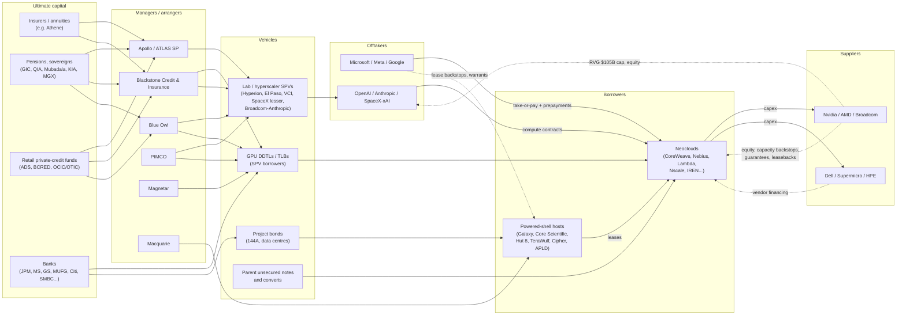

# CONCEPT-IDEA: Neocloud Capital Flows (financing dashboard)

> **Purpose of this document:** capture *what* we want to exist and *why it matters*,
> before anyone argues about *how* to build it.
> **Written by:** yorkerhodes3, with GitHub Copilot as drafting and research partner.
> **Reviewed by:** a human, before moving on to `SPECIFICATIONS.md`.
>
> Format follows the Ethical Tech CoLab
> [project-startup-guide](https://github.com/Ethical-Tech-CoLab/project-startup-guide)
> template and method: **think in documents, review with a human, then build.**

| Field | Value |
| --- | --- |
| Status | `Draft`: feature proposal plus research due diligence; not reviewed |
| Author | yorkerhodes3 |
| Reviewer(s) | _TBD: one credit or leveraged-finance reviewer, one supply chain reviewer (Supply OS), one legal or compliance reader for publication_ |
| Created / research as-of | 2026-11-21 |
| Parent concept | [Neocloud Supply OS](../../../CONCEPT-IDEA.md) (unchanged by this proposal) |
| Sibling feature | [Proposed Regulation simulation](../proposed-regulation/CONCEPT-IDEA.md) |
| Feature specification | Not started. Next step after review: `SPECIFICATIONS.md` in this folder |
| Demo | None. Concept only. The existing dashboard is **not** changed; Appendix K lists suggested changes for later |

> **Not investment advice, not a credit rating, not a valuation.** This document summarises
> public information as of 2026-11-21 for a product concept. Several items are allegations,
> reports or rumours and are labelled so. No wrongdoing is asserted by any company or person.
>
> **"Goldman Sachs style".** The brief asked for Goldman Sachs style due diligence. Part II
> borrows the shape of an investment-bank diligence memo: key findings, red flags, risk
> matrix, request list, and a conflicts register. It is not produced by, affiliated with or
> endorsed by Goldman Sachs. Note that Goldman Sachs itself appears in the findings as an
> arranger, structuring agent and investor in several of these deals.

### How to read this document

- **Part I (sections 1–10)** is the concept in the CoLab template: should a financing
  dashboard exist next to the Neocloud Supply OS demo, and for whom?
- **Part II (Appendices A–J)** is the research and the diligence on that research, written
  as an investment-bank-style memo under the working name **Project Backstop**. It covers
  the market, the brand-name neoclouds and their supply partners, the debt stack and money
  flows, Nvidia as financier, Apollo and the other lenders, collateral economics, risk
  transmission, and a diligence of the evidence itself.
- **Part III (Appendices K–N)** evaluates whether and how to connect this to the existing
  Supply OS dashboard (suggested changes only, none applied), proposes a data model, credits
  related projects, and lists every source.
- The concept itself is sections 1–4. The rest exists because the brief asked for detailed
  research and diligence, and those findings are the evidence that the problem is real.

**Markers used throughout** (same as the parent concept, plus evidence vocabulary)

| Marker | Meaning |
| --- | --- |
| **(user)** | Stated in the brief |
| **(inferred)** | Drafted by the assistant; not yet confirmed by the author |
| **(proposed)** | A target or design choice awaiting review |
| **(verify)** | A factual claim to check against full primary text before relying on it |
| **(CoLab)** | Drawn from Ethical Tech CoLab or the author's related projects; see Appendix M |
| **(calc)** | Arithmetic on cited figures, done for this document |

| Evidence field | Values |
| --- | --- |
| **Status** | `announced`, `signed`, `priced`, `closed`, `drawn`, `reported` (attributed press), `rumoured`, `disputed`, `allegation` |
| **Confidence** | **H** primary excerpt, or two consistent sources; **M** one reputable secondary source or a transcript; **L** aggregator, single anonymous source, or conflicting data |
| **Source type** | **P** primary (SEC filing, company IR, regulator, rating agency, index provider); **S** secondary press; **T** tertiary aggregator or blog |

Source IDs in square brackets, such as `[CW1]`, resolve in [Appendix N](#appendix-n--source-register).

**How the research was done (read before relying on any number).** Five parallel research
passes ran on 2026-11-21. In that environment, direct page fetches, `curl` and the browser
failed with DNS errors, so **every figure comes from search-indexed excerpts of the cited
pages**. No filing was read end to end. Five headline facts were then spot-checked against
primary excerpts (Appendix J2). Treat every number as **(verify)** until a human checks
the full primary document. This limit is the main reason the dashboard proposed here puts
evidence status ahead of coverage.

---

# Part I — The concept

## 1. One-sentence pitch

> **Neocloud Capital Flows** helps **people who build, finance or study GPU clouds** see
> **who is really paying for neocloud capacity, on whose credit, and what breaks first**,
> so they can **plan, price and question AI-infrastructure deals with the money in view,
> instead of discovering it in a covenant, a downgrade or a cancelled contract.**

---

## 2. The problem

### Who has it

A neocloud rents GPU computing capacity. It is a capital-intensive business with
little operating history. One firm in our universe guides to $37–39B of capex in 2026
against $13.0–13.3B of revenue [CW1]. That money comes through a stack that is hard
to see from outside, and sometimes from inside:

- delayed-draw term loans secured on GPUs and one customer's contract;
- project bonds on data centres, backstopped by a hyperscaler;
- unsecured notes and convertibles at the parent;
- vendor and OEM financing;
- customer prepayments;
- chipmaker equity, capacity backstops and guarantees;
- off-balance-sheet SPVs funded by insurers and private-credit funds.

Each of these people asks a different question of the same stack:

| Who | Their question |
| --- | --- |
| Neocloud CFO and treasury (and the Supply OS **Treasury Aide** desk, functions 15 and 57 in the parent concept) | What does our next draw depend on? Which delivery slip becomes a financing problem? |
| Supply chain and build leads | Which delays carry penalties, termination rights or draw-window deadlines? |
| Credit analysts, lenders and investment committees | Whose credit am I really taking: the neocloud's, the offtaker's, the vendor's or the guarantor's? |
| Equity analysts, students and researchers | Is demand real, or partly financed by suppliers ("circular")? |
| Policy staff and regulators | Where does AI-infrastructure risk sit, and how does it reach insurers, banks and retail funds? |

### How they cope today

- Reading 10-K, 10-Q, 8-K, 6-K and S-1 footnotes one company at a time.
- Paid terminals and deal databases, which are costly and closed and do not grade evidence.
- Free web trackers (Appendix J3), which are useful leads of uneven quality and unclear licensing.
- Press coverage, which mixes announced, priced, closed and rumoured deals.
- Spreadsheets that go stale within weeks.

The coping pattern looks like the parent concept's 140-application problem: fragments,
latency and reconciliation by hand (inferred).

### What the pain costs (evidence from the diligence in Part II)

| Pain | What it looks like | Example (sources in Part II) |
| --- | --- | --- |
| **Opaque contingent exposure** | Large guarantees and commitments with unnamed beneficiaries | Nvidia discloses $118B of maximum guarantee exposure and $32B of contingent neocloud commitments. Beneficiaries of the $13B neocloud guarantees are not named [NV1] |
| **Wrong credit, wrong price** | The same GPU asset prices at very different spreads depending on whose contract backs it | SOFR+2.25% for CoreWeave's A3-rated, single-contract DDTL 4.0 vs SOFR+5.50% for DDTL 5.5 on ~3-year contracts; parent unsecured notes yielding >15% [CW3][CW5][CW13] |
| **Headline inflation** | "Up to", total contract value, backlog and announced capex quoted as if they were revenue or cash | Nscale's reported ~$103.4B TCV, with ~$2.6B active (T, verify) [NS9]; Anthropic's "$50B" US build is Anthropic's capex plan, not Fluidstack backlog [FS1] |
| **Supply slips become financing events** | Delivery dates drive draws, penalties and termination rights | Microsoft can terminate affected Nebius capacity after a grace period if dates are missed [NB9]. CoreWeave's DDTL 5.0 draw period closed with ~$0.35B undrawn [CW10]. Microsoft terminated Nscale's Loughton agreement over grid-power delay [NS6] |
| **Circularity** | Suppliers fund their customers, and customers fund their suppliers | Nvidia is supplier, investor, customer and guarantor to the same counterparties (Appendix F) |
| **Hidden concentration** | Many lenders and landlords, few real credits | Microsoft, Meta, OpenAI, Anthropic and Google sit behind most investment-grade neocloud debt (Appendix E) |

### Why now

November 2026 compressed these risks into a fortnight:

- CoreWeave 5-year CDS traded around 1,100–1,290 bp in October and November. Its unsecured notes yielded more than 15% [CW12][CW13][RK14].
- Microsoft was reported to be consolidating its neocloud partners and tightening oversight of Nebius, IREN and Nscale projects [RK13].
- Nvidia's CEO resigned on 12 Nov [NV7]. Nvidia shares fell about 14% on 20 Nov on reports of an SEC accounting review; that is reported, not a finding [NV19].
- Anthropic priced a ~$93.5B IPO on 18 Nov [NV22].
- Apollo and Goldman Sachs priced ~$44B of SpaceX GPU notes on 20 Nov [AP8].
- A bipartisan Senate bill, the AUDIT AI Act, would require disclosure of AI-related JVs, SPVs, VIEs and major debt arrangements [RK9].

The official sector has warned all year. In the Fed's survey, AI was the most cited risk
[RK2]; the IMF, Bank of England, ECB and BIS each flag circular financing, opacity or
private-credit liquidity mismatch [RK1][RK3][RK4][RK5].

### How we know it is real

- (user) The brief: map the brand-name neoclouds, their supply partners and the debt money flows, and test two premises: "Apollo is on a high", and "Nvidia was backstopping or financing many of its deals".
- (CoLab) The author's [`nvidia-knowledge-graph`](https://github.com/yorkerhodes3/nvidia-knowledge-graph) seed already traces financing edges: Lancium's $600M debt, Newmark's $7.1B Abilene construction loan, the IREN–Nvidia contract and right to invest. It shows how quickly announced, closed and conditional get conflated.
- Part II: about 200 sourced claims across five research passes, with the conflicts and gaps documented in Appendix J.
- **Not yet in hand:** interviews with neocloud treasury teams, lenders or analysts about how they work today; and a full read of the primary filings. Both are open questions (section 9).

---

## 3. Who it is for

| Audience | What they care about | How they meet the system |
| --- | --- | --- |
| **Primary (v1): diligence analysts and CoLab student researchers** | A traceable answer to "who funds this and on whose credit?" | The dashboard plus exportable, evidence-linked diligence notes |
| **Primary (v1): Supply OS reviewers and the Treasury Aide desk design** | How supply delays translate into financing outcomes | A one-way bridge from the synthetic simulation (Appendix K) |
| **Secondary: neocloud CFO, treasury and strategy** | Benchmarks of peer pricing, structures and covenants | Read-only public benchmarks; private-terms mode is out of scope for v1 |
| **Secondary: lenders and investment committees** | Concentration, collateral and guarantor exposure | Backstop register, offtaker-concentration view, collateral monitor |
| **Secondary: policy and teaching** | Where risk sits, and the circular-financing debate presented fairly | Teaching mode, after the CoLab Resilience Atlas (Appendix M) |
| **Decides and pays** | The author, and any CoLab sponsor | Section 5 success signals |
| **Checks** | Legal or compliance reader, domain reviewers | Evidence status, source register and the publication checklist (section 7) |

---

## 4. The idea

**Neocloud Capital Flows** is a static, source-graded dashboard. It sits beside the
Neocloud Supply OS demo, shares its shell and design system, and keeps its own data
domain. **Every number on it is a public claim with a source, a status, a date and a
confidence.** The Supply OS simulation stays synthetic.

### What a person does with it

| View | Question it answers |
| --- | --- |
| **Money-flow map** | Where does the money come from: insurance balance sheets, pensions and sovereigns, retail private-credit funds, banks, chipmakers, hyperscalers and labs? Which vehicles carry it (funds, SPVs, DDTLs, project bonds)? Which borrowers and suppliers does it reach, and which customer prepayments and vendor backstops loop back? |
| **Deal ledger** | Every transaction as one record: borrower entity, instrument, size versus drawn, status, lenders and roles, pricing, tenor, collateral, credit enhancement, rating, source and confidence |
| **Capital stack per company** | Secured non-recourse, secured recourse, OEM financing, unsecured notes, converts, leases and prepayments, plus the maturity ladder and interest burden |
| **Credit-of-whom view** | Pricing plotted against the credit that actually backs the deal: investment-grade offtaker, non-investment-grade customer, hyperscaler backstop, or the parent alone |
| **Backstop and guarantee register** | Who promised what to whom: equity, right to invest, capacity backstop, lease guarantee, residual-value guarantee, leaseback, prepayment or warrant. Each shows its trigger and whether it has been exercised |
| **Offtaker concentration** | Choose Microsoft, Meta, OpenAI, Anthropic or Google and see every neocloud contract, the debt secured on it and the lenders behind it |
| **Collateral monitor** | GPU rental indices, residual-value evidence, depreciation lives, advance rates and the new futures and residual-value products |
| **Reverse stress lab** | Start from a failure (DSCR below 1.0x, a non-renewal or a missed draw window) and work backward to the combinations of rental price, utilisation, delay and rate that cause it. This follows the CoLab Resilience Atlas method |
| **Signals feed** | Rating actions, CDS and bond moves, filings, official-sector warnings, each dated and graded |
| **Diligence workbench** | Claim register, conflicts, gaps and a request list that exports to a memo like Part II |

### Seven design commitments (proposed)

1. **A number without a source is not shown.** Each claim carries a source ID, source type, access level (`full_text`, `indexed_excerpt`, `not_retrieved`), status, as-of date and confidence. The schema reuses the author's `nvidia-knowledge-graph` v3 conventions (Appendix L).
2. **Never sum unlike things.** Facility size is not drawn amount. Contract value is not revenue, and revenue is not cash. A right to invest is not an investment, an announcement is not a close, and "up to" is not a commitment. Computed values carry **(calc)**.
3. **Real and synthetic never mix.** Capital Flows shows only public, sourced data. Supply OS shows only synthetic data. They meet through labelled, illustrative bridges (Appendix K).
4. **The data provider is a variable.** `FINANCE_DATA_PROVIDER` defaults to free public sources (EDGAR and company IR), mirroring the parent's `RISK_PROVIDER` pattern. Entity resolution of SPVs, lenders and sovereign investors goes through `RISK_PROVIDER`'s canonical capabilities (`resolve_entity`, `get_ownership`, `screen_entity`).
5. **No advice, ratings or targets.** The dashboard shows evidence and stress paths. It shows no buy or sell views, no price targets and no proprietary scores of a company's creditworthiness.
6. **No guilt by graph.** Proximity, timing or family ties never become an edge. Allegations and probes stay labelled as such. People appear only in public officer roles.
7. **Disagreement is data.** When sources conflict, both values are shown with their sources, and the conflict appears in the register. It is never averaged away.

### A day in the life: analyst path

1. An analyst is asked: *"How exposed is the neocloud credit market to Microsoft
   consolidating its partners?"*
2. In **Offtaker concentration** they choose Microsoft. The view lists the contracts:
   Nebius ($17.4B, up to $19.4B), IREN ($9.7B; ~48% of IREN backlog), Nscale (up to $43.8B
   per the S-1 as reported; the Loughton site was terminated), Lambda ("multibillion") and
   CoreWeave (>$10B as reported). Each figure carries its status and confidence.
3. The **Deal ledger** shows the debt secured on those contracts: IREN's $3.65B A-rated
   facility, Nebius's $775M MUFG-led loan, Lambda's $926M Baa2 term loan B, and others,
   with lenders and roles.
4. The **Reverse stress lab** asks: if a contract is not renewed at expiry, what re-lease
   rate keeps the facility's coverage at or above 1.0x? The inputs are labelled assumptions.
5. They export a two-page note. Every number links to Appendix N-style sources, and the
   open items flow into the request list.

### A day in the life: risk path

1. On 20 Nov the **Signals feed** shows Nvidia down about 14% on a reported SEC review
   (reported, not a finding) and CoreWeave CDS above 1,000 bp.
2. The **Backstop register** answers "how much does Nvidia stand behind neoclouds?":
   - $32B of contingent neocloud commitments, conditional on financing, deployment and acceptance, falling due from fiscal 2028;
   - $13B of neocloud guarantees, with no named beneficiaries;
   - $105B capped residual-value guarantees, which are for OpenAI's Ohio campus and are not neocloud exposure.
3. The analyst records the unnamed beneficiaries as a request-list item. They note that
   Nvidia says it has made no guarantee payments [NV1].

### A day in the life: supply-to-finance path (integration preview, illustrative)

1. In the synthetic Supply OS simulation, an optics shortage delays a GB300 hall by three
   weeks.
2. A labelled bridge shows what that pattern has meant in public deals: draw windows,
   delivery-date termination rights, penalties and the cost of capital by credit tier. It
   never shows a real company's terms applied to the synthetic world.
3. The exception desk sees "late rack-days" next to an illustrative financing consequence,
   and the Treasury Aide desk's design gains a requirement.

---

## 5. What success looks like

| Signal | How we measure it | Target (proposed) | By when (proposed) |
| --- | --- | --- | --- |
| Coverage | Brand-name neoclouds (9) plus listed hosts (7) each have a capital stack, top offtakers, backstops and supply partners | 16 of 16; at least 80% of disclosed debt principal itemised by instrument | Specification review |
| Traceability | Automated test: every displayed number resolves to a source record with status, confidence and as-of date | 100% | First build |
| Verification | A human checks the top 50 headline figures against full primary text | At least 90% confirmed or corrected; the rest labelled | Before any external demo |
| Usefulness | Two reviewers (credit, supply chain) answer three standard diligence questions | Each answered in under 30 minutes with sources | First review session |
| Freshness | Records older than 90 days in a "current" view are flagged | 100% flagged | Ongoing |
| Integration safety | Supply OS tests and same-seed KPIs are unchanged by any bridge | 0 differences unless a preset is explicitly chosen | Every integration PR |

---

## 6. Explicitly out of scope (for now)

- **Not building:** investment advice, buy or sell views, price targets, proprietary credit scores or ratings.
- **Not building:** a live market-data feed or a trading tool. CDS and bond levels appear as dated, sourced observations only.
- **Not building:** a private-terms mode for a real neocloud's confidential facility documents. Never ingest material non-public information.
- **Not building:** redistribution of licensed or paywalled content (terminal data, full articles, licensed risk-provider records). Store summaries, figures and links only.
- **Not building:** automated EDGAR scraping in v1. Records are curated by hand and reviewed. A later `FINANCE_DATA_PROVIDER` can automate this.
- **Not building:** wrongdoing inference, allegation amplification or personal-conduct coverage of individuals.
- **Not building:** any change to the existing Supply OS pages, engine, scenarios, brand kit or tests in this phase (user). Appendix K lists suggestions only.
- **Not building:** real company data inside the synthetic simulation, or brand presets that load real financials.

---

## 7. Constraints and realities

- **Time and money (inferred):** the same static, no-build, no-dependency approach as the parent site; free sources by default.
- **Skills:** credit structures (DDTL, TLB, 144A, RVG, DSCR) need a domain reviewer; the build itself is the parent's ES-module pattern.
- **Rules:**
  - Publishing a dashboard that names real companies' credit stress needs a legal or compliance read before going public (section 9, Q2).
  - Label allegations, probes and lawsuits exactly.
  - Respect source licences.
  - Keep `RISK_PROVIDER` vendor names out of site HTML, JS and CSS. The parent's `test/providers.test.mjs` enforces this.
  - Personal data is limited to public officer roles.
- **Research environment:** page fetches were DNS-blocked during this research, so a full primary-document verification pass is a precondition of any build (Appendix J).
- **Data half-life:** the numbers moved weekly in Oct–Nov 2026. A curated dataset without an owner and a refresh cadence will mislead (section 9, Q5).

---

## 8. Alternatives considered

| Option | Why not (yet) |
| --- | --- |
| Do nothing; read filings and press as needed | This is the coping pattern in section 2. It is slow and error-prone and has no shared evidence standard |
| Paid terminals and deal databases | Costly and closed. No evidence grading, no link to supply operations, not usable for CoLab teaching |
| Free web trackers (CCIR, Savrn Data Center Capital Atlas, InfraCompute, AmCompute, sec-api) | Valuable leads, used in Part II. Quality is uneven, licensing is unclear, statuses are not distinguished, and they have no supply-chain coupling. Possible inputs, not substitutes |
| Extend `nvidia-knowledge-graph` | Best schema fit (we reuse it), but it is scoped to one investigation and its licensed-data rules. Capital Flows needs a market-wide ledger and views |
| Put financing directly into the Supply OS simulation now | Breaks the "all simulated" truth label and the user's no-change instruction. It would also mix real and synthetic data |
| A one-off diligence memo only (Part II) | Useful but perishable. The ledger and views make it maintainable and reusable |

---

## 9. Open questions

Each item should be answered in `SPECIFICATIONS.md` or become a research task.

- [ ] **Q1 (blocking).** Who is the v1 user: public-data analysts and students, or a neocloud treasury with private terms? This document assumes the former.
- [ ] **Q2 (blocking).** Is the dashboard public on GitHub Pages? Naming real companies' credit stress, allegations and probes needs a legal or compliance read and a takedown and correction path.
- [ ] **Q3 (blocking).** Licensing: may we store figures summarised from paywalled outlets cited through secondary sources (Bloomberg, FT, WSJ)? May we store aggregator-derived figures (CCIR, sec-api)?
- [ ] **Q4.** Should `FINANCE_DATA_PROVIDER` default to EDGAR and IR only? Which licensed providers, if any, are allowed?
- [ ] **Q5.** Who owns refreshes, and how often? What triggers an out-of-cycle update (rating action, 8-K, default)?
- [ ] **Q6.** Should Capital Flows live in this repo (`docs/finance.html`) or a sibling repo, like `nvidia-knowledge-graph`, linked from the shell?
- [ ] **Q7.** Does the reverse stress lab use only synthetic parameters, or public deal terms as labelled presets?
- [ ] **Q8.** How should charts show disputed numbers: ranges, both values, or the primary value with a flag?
- [ ] **Q9.** Is entity resolution of SPVs, lenders and sovereign investors through `RISK_PROVIDER` in scope? Under which licence may outputs be shown?
- [ ] **Q10.** Where is the inclusion boundary? GPU renters only, or also powered-shell landlords (IREN, Applied Digital, Cipher, TeraWulf, Galaxy, Core Scientific, Hut 8), lab SPVs (SpaceX/xAI, Anthropic, OpenAI sites) and hyperscaler SPVs (Meta Hyperion and El Paso)?
- [ ] **Q11.** Should the brand kit stay fully independent of Capital Flows? This document recommends yes (Appendix K).
- [ ] **Q12.** Which rate conventions apply for illustrative all-in yields (the SOFR fixing date, fixed versus floating)?
- [ ] **Q13.** Which interviews validate the problem: neocloud treasury, a private-credit lender, a rating analyst?

---

## 10. Assumptions

- 🔴 **Public filings and press are enough to reconstruct material capital stacks.** This is weak for private firms: Together AI, Vultr, Voltage Park/Lightning AI and Fluidstack disclose little (Appendix C).
- 🔴 **The search excerpts reflect the full documents.** Unverified until the Appendix J pass. Excerpts can drop qualifications.
- 🔴 **Users value evidence grading and supply linkage over the raw coverage and speed of commercial trackers.** If not, the product is pointless.
- 🟡 **The supply-to-finance coupling is material enough to justify integration.** Delivery delays become draw, penalty and termination events. Supported by the Nebius, Nscale, IREN and CoreWeave examples in Part II.
- 🟡 **A static site can carry a few hundred records and the views without a build step.**
- 🟡 **Market conditions keep changing fast enough that freshness, not schema, is the main operating cost.**
- 🟢 **The existing shell, theme and design system can host a new page without changing simulation behaviour** (Appendix K).
- 🟢 **The CoLab method (concept, then specification, then plan) applies unchanged.**

---

## Reviewer sign-off

Reviewer: fill this in. Do **not** proceed to specification until the boxes are checked.

- [ ] The problem is real and clearly stated, independent of the solution
- [ ] The audience is specific (not "everyone")
- [ ] Success criteria are measurable
- [ ] Out-of-scope list is honest and meaningfully limits v1
- [ ] Risky assumptions are identified
- [ ] Open questions are captured, not hidden
- [ ] **Diligence-specific:** every headline number in Part II has a source, status and confidence. Allegations and probes are labelled. The research-method limit is stated

**Verdict:** `Approved` / `Approved with changes` / `Needs rework`

**Reviewer notes:**

>

---

# Part II — Project Backstop: due diligence on the neocloud financing market

## Appendix A — Diligence memo summary

### A0. Basis of preparation

| Item | Detail |
| --- | --- |
| Purpose | Test whether a financing dashboard is warranted, and diligence the research that would populate it |
| Coverage universe | **Brand-name neoclouds (9):** CoreWeave, Nebius, Lambda, Crusoe, Together AI, Nscale, Fluidstack, Vultr, Voltage Park (now Lightning AI). These match the parent site's brand presets. **Listed hosts (7):** IREN, Applied Digital, Cipher Digital, TeraWulf, Galaxy (Helios), Core Scientific, Hut 8. **Adjacent:** Firmus, Volta, Cerebras, and the lab and hyperscaler SPVs that compete for the same credit |
| Counterparties diligenced | Nvidia, AMD and Broadcom (vendors); Microsoft, Meta, OpenAI, Anthropic, Google and SpaceX/xAI (offtakers and backstoppers); Apollo, Blackstone, Blue Owl, PIMCO, Magnetar, BlackRock/GIP/HPS, KKR, Brookfield, Macquarie, Neuberger and Fortress (capital providers); JPMorgan, Morgan Stanley, Goldman Sachs, MUFG, Citi, SMBC, Mizuho and others (banks); Dell, Supermicro, HPE and others (suppliers) |
| As-of | 2026-11-21. Market data are dated where given |
| Evidence basis | Search-indexed excerpts of cited pages, with five primary spot-checks. See Appendix J |
| Limitations | No full filings read; no management access; no licensed data; no interviews. Several late-period items (12–20 Nov 2026) surfaced only through press and are marked so |

### A1. Key findings

1. **Pricing follows the credit of the offtaker or guarantor, not the neocloud.**
   - GPU loans backed by an investment-grade offtaker's contract price at SOFR+2.1–3.0%. Examples: IREN's Microsoft-backed $3.65B rated A by Fitch at a 6.00% blended cost; Lambda's Baa2 term loan B at S+3.00%; Nscale's US loans at S+2.375%; CoreWeave's A3-rated DDTL 4.0 at S+2.25% [IR2][LB1][NS7][CW3].
   - Loans on non-investment-grade customer contracts price at S+4.5–5.5% (CoreWeave DDTL 5.0, DDTL 5.5) [CW4][CW5].
   - An unrated, newly formed borrower (Volta) cleared at S+650 with an original-issue discount of 95 [VO1].
   - CoreWeave's parent unsecured notes carry 9.0–9.75% coupons and traded at yields above 15% in Oct–Nov 2026 [CW12][CW13]. **Confidence H on terms; M on market levels.**
2. **Customers and vendors have become quasi-lenders.**
   - Microsoft prepaid 20% (~$1.94B) of IREN's $9.7B contract [IR5]. IREN's newest contract has 90% of GPU capex prepaid [IR1].
   - Nebius says prepayments covered more than 100% of the capex associated with its Q3 contracts [NB2]. CoreWeave expects ~$9B of prepayments and deposits within three months [CW1].
   - On the vendor and backstop side: Broadcom backs up to $29B of the $35B Apollo-led Anthropic financing [AP4][AP6]. Google backstops roughly $15.2B (calc) of project debt on Fluidstack-leased sites [FS3–FS8]. Nvidia's support is covered in finding 8.
   - The practical effect: much of the "neocloud" credit risk is really hyperscaler, lab or vendor credit risk. **H.**
3. **CoreWeave is the system's pressure gauge.**
   - Principal debt is $47.5B, up from $21.4B at end-2025 [CW10]. Q3 net interest was $846M on $3,661M revenue, ~23% (calc), against $379M of adjusted operating income and $2.3B of adjusted EBITDA [CW1][CW15].
   - Interest therefore exceeded adjusted operating income by ~2.2x (calc), while adjusted EBITDA covered it ~2.7x (calc).
   - $10.97B of principal falls due in 2027, mostly DDTL amortisation [CW10]. Backlog is $132.5B [CW1].
   - **H on reported figures; M on the CCIR-derived maturity ladder.**
4. **A two-tier credit market.** CoreWeave's CFO says asset-level secured loans still trade around par, while parent unsecured and CDS trade at distressed levels [CW12][CW13]. A secondary tracker records no public default on a GPU-backed loan as of Oct 2026 [RK12]. **M.**
5. **Concentration in five credits.** Microsoft, Meta, OpenAI, Anthropic and Google sit behind most investment-grade neocloud debt.
   - Microsoft was 67% of CoreWeave's FY2025 revenue. In Q3 2026 its two largest customers were 30% and 24% [CW15].
   - Microsoft and Anthropic are ~85% of Nscale's reported total contract value [NS9]. Microsoft is ~48% of IREN's backlog [CW14].
   - Microsoft is reportedly consolidating its neocloud partners [RK13]. **M–H.**
6. **Delivery risk is financing risk.** Missed dates have become termination rights, penalties, undrawn commitments and guidance cuts:
   - Nebius's New Jersey slip carries Microsoft termination rights after a grace period [NB9];
   - Microsoft terminated Nscale's Loughton agreement over grid-power delay [NS6];
   - IREN's operational date moved to 31 Jan 2027 [IR1];
   - CoreWeave's DDTL 5.0 draw period closed with ~$0.35B undrawn [CW10];
   - CoreWeave's Nov 2025 guidance cut tied to a third-party developer was followed by a securities class action (allegation) [CW17].

   This is the bridge to the Supply OS. **H/M.**
7. **Collateral value is the unresolved variable.**
   - Rental prices rose through 2026: the Silicon Data H100 index went from $2.00 (9 Dec 2025) to $3.08 (20 Nov 2026), +54% (calc) [MK6][MK8]. That supports near-term collateral.
   - Residual-value evidence ranges from ~8% to ~85% of new, depending on the source and on whether it measures ask, executed or forecast prices [MK13][MK14][MK15].
   - Depreciation lives (CoreWeave 6 years, Nebius 5) exceed the 3–4 years banks reportedly underwrite [MK12][MK16].
   - New hedges (CME and ICE compute futures, residual-value swaps) are announced but unproven [MK9][MK10][MK11]. **M.**
8. **Nvidia premise: directionally right, overstated as phrased.** See A2 and Appendix F.
9. **Apollo premise: right about deal flow, wrong about the stock, and Apollo lends around neoclouds rather than to them.** See A2 and Appendix G.
10. **Risk reaches insurers, banks and retail funds.**
    - The Fed counts >$680B of advanced-computing debt issuance in 2026 to October, ~31% of non-financial investment-grade issuance [RK2].
    - Athene (Apollo) reports ~61% of net invested assets in private credit on its broad definition [AP17]. NAIC is reviewing insurers' data-centre holdings [RK8].
    - Retail private-credit funds gated redemptions in 2026: Apollo's ADS, Blackstone's BCRED and Blue Owl's OTIC and OCIC. The stated driver was software-loan fears, not AI-infrastructure loans [AP16][PE4][PE14]. **H on facts; M on attribution.**
11. **Supplier balance sheets are carrying the build.**
    - One customer was 44% of Supermicro's Q1 FY27 revenue, and two customers held 66% of its $9.7B of receivables [SP2].
    - Dell's AI backlog is $95B, and debt in its financing arm rose ~41% in six months [SP5][SP7].
    - Two Supermicro employees and a contractor are charged with diverting servers to China. These are allegations, and Supermicro is not a defendant [SP3][SP4]. **M–H.**

### A2. Verdicts on the brief's premises

| Premise (user) | Verdict | Evidence | Confidence |
| --- | --- | --- | --- |
| **"Apollo is on a high."** | **Partly true.** True of deal flow and earnings. Not true of the share price or the retail fund. Apollo's AI exposure is mostly *around* neoclouds (investment-grade lab, hyperscaler and chip-vendor structures), not direct neocloud credit | Q3 2026: record origination of $114B, record fee-related earnings of $802M, AUM ~$1.07T [AP1][AP2]. Led the $35B Broadcom/Anthropic platform (Jun 2026) [AP4]. Priced the ~$44B SpaceX GPU notes with Goldman (20 Nov; spot-checked) [AP8]. **Against:** APO closed at $111.16 on 20 Nov, −12% over one year and ~29% below its $157.28 high (calc) [AP14][AP15]. ADS capped redemptions at 5% for three quarters [AP16]. Q3 GAAP loss from mark-to-market on Athene [AP1]. Securities suit pending (allegation) [AP18]. **No direct Apollo loan found** to CoreWeave, Nebius, Lambda, Crusoe, Nscale or Fluidstack. Apollo's neocloud link is indirect: Broadcom-backed Anthropic capacity at Fluidstack-operated sites [AP5] | H (facts); M (characterisation) |
| **"Nvidia was backstopping or financing many of its deals with the neoclouds it worked with."** | **Directionally supported, but narrower and more conditional than it sounds, and now being dialled back.** The largest Nvidia support goes to labs (OpenAI, Anthropic, xAI), not neoclouds. The largest neocloud contracts are carried by hyperscaler and lab credit | Named neocloud capacity commitments ≈ $11.2B (calc): CoreWeave $6.3B unsold-capacity purchase to 2032 [CW20], IREN $3.4B [IR6], Lambda ~$1.5B leaseback (reported) [LB6]. Aggregate contingent neocloud commitments $32B, down from $36B [NV1]. Neocloud guarantees $13B ($3.5B land, power and shell plus $9.5B power and systems credit support; beneficiaries unnamed; no payments made) [NV1]. Disclosed neocloud equity ≈ $4.35B (CoreWeave ~$2.35B cumulative, Nebius $2B), plus undisclosed stakes in Crusoe, Nscale, Together, Firmus, Lambda and Lancium. IREN right to invest up to $2.1B, unexercised as far as found [IR6]. By contrast: the $105B residual-value guarantee cap for OpenAI's Ohio campus [NV6], $30B OpenAI equity, ~$10B Anthropic placement [NV22]. Interim CEO Kress (17 Nov): future support will be "disciplined" [NV11] | H (filings); M (reported deals) |

### A3. Red flags

| # | Red flag | Why it matters | Where |
| --- | --- | --- | --- |
| 1 | CoreWeave Q3 interest ($846M) exceeded adjusted operating income ($379M) | Equity value depends on continued refinancing and growth | E5 |
| 2 | Nvidia's $13B of neocloud guarantees have no named beneficiaries | Contingent exposure cannot be mapped to borrowers | F1 |
| 3 | Duration mismatch: DDTL 5.5 is a ~5-year loan against ~3-year average contracts | Lenders are explicitly underwriting renewal risk | E4, H3 |
| 4 | Headline inflation: Nscale's ~$103.4B TCV with ~$2.6B active (T); Crusoe's ">$140B" (company claim); the "$50B" Anthropic programme (capex, not backlog) | "Up to" and TCV figures are not revenue or cash | C |
| 5 | Off-balance-sheet structures and a failed sale-leaseback: the xAI/Valor lease was recorded as ~$13.3B of SpaceX debt | SPV accounting can reverse onto the sponsor's balance sheet | E4 |
| 6 | Hosts' GAAP revenue inflated by tenant fit-out (Applied Digital: fit-out $183.5M vs base rent $65.8M in one quarter) and non-cash gains (TeraWulf $709.9M, Core Scientific $1,178.1M net income from warrant fair-value changes) | Headline profits overstate recurring cash | C3 |
| 7 | Nvidia recorded $1.85B of Q3 impairments and unrealized losses on non-marketable equity (cause not found). Its CoreWeave stake was bought at $87.20; CoreWeave closed at $39.51 on 20 Nov | Equity-for-demand loops are now marked against Nvidia | F1 |
| 8 | Microsoft consolidation; the Nscale Loughton termination; the reported Texas non-renewal | The best credit in the system is rationalising suppliers | C, I |
| 9 | Legal and governance events: Nvidia CEO resignation; reported SEC review (not a finding); CoreWeave class action (allegation); Supermicro indictment (allegation; company not a defendant); Apollo securities suit (allegation) | Headline risk and possible disclosure changes | C, D, F, G |
| 10 | A material share of figures rests on aggregators | The dataset can be confidently wrong | J |

### A4. Risk matrix (judgement, inferred; to be calibrated)

| Risk | Mechanism | Likelihood | Impact | Mitigants observed | Leading indicators for the dashboard |
| --- | --- | --- | --- | --- | --- |
| Offtaker rationalisation | Microsoft or another anchor consolidates, does not renew, or invokes delivery-date termination | Elevated | High for single-anchor neoclouds | Take-or-pay terms, prepayments, contract assignment to lenders | Non-renewals, termination notices, delivery slips, backlog changes |
| Renewal and re-lease price | Contracts shorter than the debt (DDTL 5.5) reprice at lower rental rates | Moderate | Medium–High | Rental indices up in 2026; amortisation schedules | H100, B200 and B300 indices; contract renewal disclosures |
| Collateral obsolescence | Blackwell-to-Rubin transition lowers Hopper and Blackwell residuals faster than amortisation | Moderate | High in a forced-sale scenario | Full amortisation over the contract term; vendor residual-value guarantees (rare) | Used-GPU executed prices; futures; appraisal bands |
| Refinancing wall | Parent-level unsecured market closed at 15–16% yields; 2027 maturities of $10.97B (CoreWeave) | Elevated | High | Secured DDTL market still open; converts; prepayments | Bond yields and CDS; new-issue spreads; undrawn commitments |
| Vendor-support pullback | Nvidia "disciplined and selective"; banks reluctant even with backstops (Reuters, 9 Nov) | Elevated | Medium | Other capital (insurers, sovereign funds, Apollo platforms) | Nvidia 10-Q commitment tables; deal announcements without vendor support |
| Lender liquidity mismatch | Retail private-credit redemptions; insurer capital charges after downgrades | Moderate | Medium (systemic channel) | 5% gates; insurer liability profiles | BDC tender results; NAIC actions; rating actions on SPVs |
| Construction and power delay | Grid, turbines, transformers, permits (Loughton; New Jersey generator fine) | Elevated | Medium–High | Behind-the-meter power; equipment-backed loans | Interconnection news; turbine backlogs; site energisation dates |
| Export control and provenance | Diversion cases implicate OEM channels | Low–Moderate | High (license, reputation) | Compliance programmes; investigations | Indictments, BIS actions, OEM disclosures |
| Accounting and disclosure change | AUDIT AI Act; SEC reviews; SPV consolidation | Moderate | Medium | Existing 10-Q tables | Bill status; restatements; new footnotes |

### A5. Signposts: what would change the view

- **Better:**
  - CoreWeave unsecured yields fall back toward single digits.
  - Renewals at or above prior rates are disclosed.
  - Microsoft names the neocloud partners it retains.
  - Nvidia names guarantee beneficiaries and still reports no payments.
  - Rental indices hold through the Rubin ramp.
  - A first investment-grade facility clears without a vendor or hyperscaler wrap.
- **Worse:**
  - Any GPU-backed loan default or covenant waiver.
  - An offtaker termination.
  - A residual-value guarantee or lease guarantee called.
  - Redemption gating spreads to infrastructure-debt funds.
  - Downgrades of Meta, Oracle or the large SPVs.
  - A further leg down in used-GPU executed prices.

### A6. Diligence request list (DRL)

| # | Request | Why | Where to obtain | Priority |
| --- | --- | --- | --- | --- |
| 1 | CoreWeave Q3 2026 10-Q, debt note and principal schedule, in full | Confirm $47.5B principal, recourse split, 2027 ladder and covenants | EDGAR, accession 0001769628-26-000465 [CW2] | P1 |
| 2 | CoreWeave DDTL 4.0, 5.0 and 5.5 credit agreements | DSCR and LTV tests, draw conditions, customer identity, cross-default | EDGAR 8-K exhibits | P1 |
| 3 | Nvidia Q3 FY27 10-Q, commitments and guarantees note | Beneficiaries of $3.5B and $9.5B; reconcile the $102B and $74B lease and cloud figures | EDGAR (not located at research time) | P1 |
| 4 | Nscale S-1/A, primary text | TCV, customer concentration, Nvidia $860M lease guarantee, lender lists | EDGAR / BamSEC | P1 |
| 5 | Nebius 6-K, Microsoft agreement terms | Termination and penalty mechanics for late delivery | EDGAR 6-K (8 Sep 2025) | P1 |
| 6 | SpaceX 8-K and offering documents, ~$44B GPU notes | Tranches, lessor structure, ratings, accounting treatment | EDGAR / Apollo IR | P2 |
| 7 | Broadcom filing on Anthropic backstop | Size, trigger and floor of the support | EDGAR 8-K | P2 |
| 8 | Athene 10-Q, investment schedules | Whether Apollo's AI paper sits on the insurance balance sheet | EDGAR | P2 |
| 9 | Supermicro 10-Q, customer concentration | Identity and credit of the 44% customer | EDGAR | P2 |
| 10 | Lambda $926M TLB documents | Resolve the arranger conflict (Morgan Stanley vs JPMorgan) | Lender or company | P3 |
| 11 | Google credit-support agreements (TeraWulf, Cipher, Hut 8) | Caps, triggers, novation rights | EDGAR 8-K exhibits | P2 |
| 12 | Rating-agency presales (Moody's, Fitch, S&P, KBRA) for GPU and data-centre deals | Advance rates, stresses, residual assumptions | Agency sites | P2 |

---

## Appendix B — Market overview

### B1. Size estimates (they disagree on scope)

| Source | Claim | Date | Conf |
| --- | --- | --- | --- |
| Synergy Research | Neocloud revenue **> $25B in 2025** ($9B in Q4 2025, +223% y/y). Forecast **~$400B by 2031** (58% CAGR). Broad scope: GPU-as-a-service, generative-AI platforms and high-density capacity [MK1] | ~Apr 2026 | H |
| Synergy Research | Q2 2026 cloud infrastructure services $143.4B (+43% y/y); nine neoclouds among the top 40 providers [MK2] | 30 Jul 2026 | H |
| ABI Research | Neocloud GPU-as-a-service revenue **$42B (2025) → > $250B (2030)** (revised up from $65B); inference ~80% of neocloud revenue by 2030 [MK3] | Oct–Dec 2025 | H |
| Gartner | **> 80% of neocloud providers cease independent operation by 2030**; > $3.5T of AI-infrastructure spend could be exposed to impairment by end-2030 [RK11] | 14 Oct 2026 | H |
| Dell'Oro | Data-centre capex +92% y/y in Q2 2026; tracks neoclouds as a separate segment [MK4] | 16 Sep 2026 | M |
| Low-quality market reports | GPUaaS figures far below Synergy's 2025 actual. **Disregarded** | 2025–26 | L |

The Synergy ($25B+) and ABI ($42B) figures for 2025 differ by definition, so the dashboard
must show the scope next to any market-size number.

### B2. Hyperscaler and lab outsourcing

- **Microsoft:** more than $60B committed to neoclouds by Nov 2025, and more than $80B per Bloomberg in Nov 2026 (definitions differ). It is now reported to be consolidating partners. It terminated Nscale's Loughton agreement and was reported (FT) not to be renewing a Texas contract [RK13][NS6].
- **Meta:**
  - Nebius: up to ~$27B ($12B dedicated plus up to $15B that Meta buys only if Nebius cannot resell it) [NB3].
  - CoreWeave: $14.2B, plus a reported ~$21B expansion. Whether the $21B is incremental or a new total is unresolved [CW15].
- **Anthropic:**
  - Fluidstack: "$50B" programme (Anthropic's capex plan) [FS1].
  - Nscale: up to $44.6B (S-1 as reported) [NS9].
  - Lambda: $35B (reported, anonymous source) [LB7].
  - TeraWulf: ~$19B lease, with Google credit support [TW2].
  - Volta: six-year agreement [VO1].
- **OpenAI:** CoreWeave up to $22.4B. Oracle and Crusoe's Abilene expansion was reportedly dropped [CR4].
- **Share outsourced:** no neocloud-specific figure found. Proxy (Jefferies): leased facilities are ~21% of installed hyperscaler capacity but ~47% of future plans [MK17] (M).

### B3. GPU rental prices

| Series | Value | Date | Conf |
| --- | --- | --- | --- |
| Silicon Data H100 (SDH100RT) | **$3.08/GPU-hr** (+6.9% 7-day); $2.00 on 9 Dec 2025 → **+54% (calc)** [MK6][MK8] | 20 Nov 2026 | H / M |
| Ornn OCPI H100 SXM | **$2.90** (30-day range $2.78–3.53) [MK7] | 20 Nov 2026 | H |
| SemiAnalysis 1-year H100 contract | Low $1.70 (Oct 2025) → $2.35 (Mar 2026) (relayed) [MK8] | 2025–26 | M |
| Silicon Data B200 / Ornn B200 | $7.10 / $9.10 (definitions differ) [MK6][MK7] | 20 Nov 2026 | H |
| Posted list prices | Lambda $3.99, CoreWeave $4.76, Azure $12.29 per H100-hour | Jul 2026 | M |

**Trend:** prices fell through 2024–25, bottomed in Oct–Dec 2025 and rose through 2026.
Volatility is high, and the indices are not like-for-like.

### B4. Bull and bear (as of late Nov 2026)

| Bull | Bear |
| --- | --- |
| Contracted visibility: CoreWeave $132.5B backlog; Nebius plans for 75–85% of 2027 capex funded by prepayments and asset-backed debt; IREN contract with 90% of GPU capex prepaid [CW1][NB2][IR1] | Leverage: CoreWeave $47.5B principal and ~23% interest-to-revenue (calc); Nebius 2027 capex of $40–45B [CW10][NB2] |
| Pricing power: rental indices up 40–54% in 2026 [MK6] | Cost of capital: CoreWeave unsecured above 15%; Volta at S+650 with an original-issue discount of 95 [CW13][VO1] |
| Diversification: CoreWeave's top customer fell from 67% to 30% [CW15] | Concentration: Nscale ~85% from two customers; Microsoft consolidating [NS9][RK13] |
| Stronger counterparties: Anthropic raised ~$91.6B net in its IPO [NV22] | Delivery and power risk: New Jersey, Loughton, IREN slip, Denton [NB9][NS6][IR1][CW17] |
| Investment-grade structures work: CoreWeave A3 DDTL, IREN A, Lambda Baa2 [CW3][IR2][LB1] | Industry structure: Gartner expects > 80% of neoclouds to cease independent operation by 2030 [RK11] |
| Outsourcing trend: ~47% of future hyperscaler capacity is leased (proxy) [MK17] | Circularity, and a vendor stepping back ("disciplined") [NV11] |

---

## Appendix C — Company diligence: brand-name neoclouds and hosts

Statuses and confidence are per item. Market values are dated snapshots from tertiary
aggregators (M) unless marked otherwise. "TCV" means total contract value, which is
multi-year and mostly not yet delivered. It is **not revenue**.

### C1. Snapshot

| Company | Model | Status | Latest value (date) | Contracted / backlog | Latest revenue | Debt headline |
| --- | --- | --- | --- | --- | --- | --- |
| **CoreWeave** (CRWV) | Bare-metal and managed GPU cloud; Nvidia-only | Public (IPO Mar 2025 at $40) | ~$21.7–22.0B market cap; EV ~$84B (20 Nov) | $132.5B backlog (30 Sep) [CW1] | Q3 $3.661B (+168%) [CW1] | $47.5B principal [CW10] |
| **Nebius** (NBIS) | Full-stack AI cloud | Public | ~$23.8B (20 Nov) | Microsoft up to $19.4B; Meta up to ~$27B [NB3][NB4]; $12B TCV signed in Q3 (reported, M) [NB11] | Q3 $980.8M (+571%); ~$325M non-recurring [NB1] | ~$14.2B; $9.75B 2026 converts [NB1][NB7] |
| **Lambda** | GPU cloud | Private; IPO targeted 2027 | Raising up to $4B at $14.5B pre-money (reported) [LB4] | Not disclosed | FY26 > $1.5B expected (reported; L–M) | ~$2.9B of 2026 facilities [LB1–LB3] |
| **Crusoe** | Energy, campus developer and cloud | Private | $30.9B post-money (17 Sep) [CR1] | "> $140B TCV" (company claim) [CR1] | ~$2B 2026 (reported; L–M) | Abilene JV construction loans; $700M equipment facility [CR5][CR7] |
| **Together AI** | Inference platform for developers | Private | $8.3B post-money (1 Jul) [TG1] | "> $1.15B annual bookings" (claim) [TG1] | Not found | None found |
| **Nscale** | Full-stack AI cloud | Private; S-1 filed 18 Sep, possible delay to 2027 [NS3][NS5] | $14.6B (Mar); IPO talk $30–35B [NS1][NS3] | ~$103.4B TCV, ~$2.6B active (T) [NS9] | Revenue $307.5M, net loss $1.69B; **period unresolved** (Q3 per CNBC vs 9M per other coverage) [NS4][NS11] | $5.52B at 30 Sep [NS4] |
| **Fluidstack** | Operator on leased powered shells; Google-backstopped | Private | $7.5B (Jul, H); $18B (Sep, reported, L–M) [FS2][FS9] | Anthropic "$50B" programme (capex) [FS1] | 2024 audited $66.2M (T) | No corporate debt disclosed in the sources reviewed; ≈ $15.2B of Google-backed project debt on its leases (calc) |
| **Vultr** | Independent cloud; AMD-heavy | Private | $3.5B (Dec 2024) [VU1] | Not found | Not found | $329M bank line (2025; lenders disputed; L) |
| **Voltage Park / Lightning AI** | GPU cloud and dev platform | Private; merged Jan 2026 [VP1] | > $2.5B (reported) [VP2] | n/a | > $500M ARR (claim) [VP1] | None found; grant-funded origin |
| IREN | Bare-metal AI cloud and mining | Public | ~$5.0B (20 Nov; disputed vs ~$8.1B on 11 Nov) | $20.3B backlog [IR1] | Q1 FY27 $228M [IR1] | $3.65B A-rated; $2.4B Blue Owl; $3.0B converts [IR2][IR3][IR4] |
| Applied Digital | Powered-shell lessor | Public | ~$3.5B (20 Nov) | ~$36B base term [AD1] | FQ1 FY27 $341.9M (fit-out heavy) [AD1] | $2.35B 9.25%; $1.59B 7.00%; Macquarie preferred up to $5B [AD2][AD3][PE15] |
| Cipher Digital | Landlord (AWS, Fluidstack) | Public | ~$2.5B | $16.6B over ~20 years [CI1] | Q3 $27M [CI1] | ~$6.7B incl. $2.0B 6.125% (AWS site) [CI2] |
| TeraWulf | Landlord (Fluidstack, Anthropic) | Public | ~$5.0B | ~$19B Anthropic lease plus Fluidstack [TW2] | Q3 $76.2M [TW1] | $3.2B 7.75%; $1.275B JV notes [FS8] |
| Galaxy (Helios) | Diversified plus CoreWeave lessor | Public | ~$4.3B | Helios II $10.4B of minimum lease payments [GX2] | Data-centre adjusted EBITDA $69M in Q3 [GX1] | $1.4B construction loan; $3.507B 9.875% [GX2][GX3] |
| Core Scientific | Colocation for CoreWeave and AMD | Public | ~$3.65B | $24B+ (CoreWeave plus AMD) [CZ1] | Q3 $232.9M [CZ1] | $3.3B 7.75% [CZ2] |
| Hut 8 | Landlord (Fluidstack; unnamed investment-grade tenant) | Public | ~$5.5B | ~$27B across 949 MW [HT1] | Q3 $71.1M | $3.25B 6.192% (River Bend) [FS7] |

### C2. Company cards (brand-name neoclouds)

**CoreWeave (Livingston, NJ).**
- **Customers:**
  - Microsoft was 67% of FY2025 revenue. In Q3 2026 the top two customers were 30% and 24% [CW15].
  - OpenAI up to $22.4B [CW23]; Meta $14.2B plus a reported ~$21B; Jane Street ~$6B plus a $1B equity investment [CW18]; Anthropic (value undisclosed).
- **Nvidia:** $2B equity at $87.20 (26 Jan 2026) [CW7]; $6.3B unsold-capacity purchase through 13 Apr 2032 [CW20]. Nvidia is described as the "key sole supplier" [NV15].
- **Capacity:** > 1.7 GW active, > 4.6 GW contracted [CW1].
- **Landlords:** Core Scientific (~590 MW), Galaxy Helios (526 MW critical IT), Applied Digital Polaris Forge 1 (400 MW) [CZ1][SP14][AD1].
- **Events:**
  - Core Scientific merger rejected by shareholders and terminated (30 Oct 2025) [CW16].
  - Nov 2025 guidance cut and Jan 2026 class action (allegation) [CW17].
  - Oct 2026 stock −36% and CDS above 1,000 bp [CW12].
- **Ratings:** Moody's Ba3; S&P B+; Fitch BB-, Positive outlook [CW11][CW19].
- **Diligence flags:** interest above adjusted operating income; the 2027 maturity bump; renewal risk in DDTL 5.5.

**Nebius (Amsterdam).**
- **Revenue:** Q3 $980.8M, of which ~$325M is non-recurring revenue from its asset-light partner rollout [NB1]. 2026 guidance narrowed to $3.0–3.2B. 2027 plan: $12–13B revenue and $40–45B capex [NB2].
- **Customers:**
  - Microsoft $17.4B (up to $19.4B). Capacity is delayed: only just over half is planned by year-end, and Microsoft holds termination rights after a grace period [NB4][NB9].
  - Meta up to ~$27B [NB3].
- **Nvidia:** $2B via a pre-funded warrant for 21,065,936 shares. Reported stakes are ~7–8.3% depending on the share base [NB8].
- **Debt:**
  - $4.0B converts (Mar) and $5.75B converts including options (Aug) [NB7];
  - $775M MUFG-led loan at S+250 [NB5];
  - $3.5B Citi 364-day bridge at S+275, stepping up to S+350 (announced 22 Oct; a 17 Oct date also appears) [NB6].
- **Depreciation life** moved from 4 to 5 years in 2026 [NB10].
- **Diligence flags:** delivery-linked termination rights; heavy reliance on prepayments; ARR guidance withdrawn.

**Lambda (San Francisco).**
- **Customers:** Microsoft "multibillion" (Nov 2025) [LB5]; Anthropic $35B (reported, anonymous source) [LB7].
- **Nvidia:** ~$1.5B four-year leaseback of ~18,000 of Lambda's GPUs (reported) [LB6].
- **Debt, 2026:** $1B syndicated secured facility (May) [LB3]; $926M Baa2 TLB at S+300, issued at 99.5 (Aug) [LB1]; $1B investment-grade fixed-rate DDTL sold to insurers (Oct) [LB2].
- **Equity:** Series E of more than $1.5B (Nov 2025) [LB8]; raising up to $4B (reported) [LB4].
- **Leadership:** new CEO Michel Combes (May 2026) [LB10].
- **Supply:** Supermicro racks [LB9].
- **Diligence flags:** unaudited revenue; arranger conflict on the TLB; the S-1 claim is disputed.

**Crusoe (Denver).**
- **Equity:** $3.9B Series F at $30.9B (Nvidia participated) [CR1].
- **Abilene (Oracle/OpenAI):** JV with Blue Owl and Primary Digital, with JPMorgan construction loans ($2.3B Phase 1 at S+250; $7.1B Phase 2 at S+225) [CR6][CR7]. The expansion was reportedly dropped [CR4].
- **New customers and sites:** a new 900 MW Microsoft campus at Abilene [CR2]. The Wyoming project was sold to Google [CR3].
- **Other debt:** $700M equipment facility from Neuberger Specialty Finance, secured on gas generators [CR5].
- **Diligence flags:** the TCV claim is unverified; revenue is estimated; the platform is equity-funded while debt sits at project level.

**Together AI (San Francisco).**
- **Equity:** $800M Series C at $8.3B (Nvidia participated) [TG1].
- **Capacity:** > 500 MW of commitments "capitalized independently by our new investors", i.e. off its balance sheet [TG4].
- **Partners:** HUMAIN 250 MW. Its "> $5B gross annualized revenue" is a projection [TG2]. IBM $240M [TG3].
- **Debt:** none found.
- **Diligence flags:** opaque off-balance-sheet capacity funding.

**Nscale (London).**
- **IPO:** S-1 for NYSE: NSCL filed 18 Sep; a delay to 2027 is under consideration [NS3][NS5].
- **Customers:** Microsoft up to $43.8B and Anthropic up to $44.6B (S-1 as reported; T) [NS9]. Microsoft's original 2025 deal was ~$14B or ~$23B depending on the source [NS10]. Loughton was terminated [NS6].
- **Equity:** Series C $2B at $14.6B (Aker, 8090, Nvidia, Dell, Lenovo and others) [NS1]. $3.36B pre-IPO convertible including a $1B Nvidia commitment whose funding is unconfirmed [NS8].
- **Nvidia:** reportedly guarantees up to $860M of a Texas lease (S-1 via CNBC) [NS3].
- **Debt:** $1.4B European DDTL (PIMCO, Blue Owl, LuminArx) [NS2]; $3.05B US DDTLs at S+237.5 arranged by JPMorgan and Goldman with a nine-bank lead-arranger group [NS7]; $900M revolver [NS4].
- **Diligence flags:** TCV versus active revenue; customer concentration; net losses.

**Fluidstack (London / US).**
- **Equity:** Series A $830M at $7.5B (or $750M per another source) [FS2]; $1.5B at $18B (reported, L–M) [FS9].
- **Leases:** tenant behind TeraWulf, Cipher, Hut 8 and Meridian Arc sites, with Google backstops and Google warrants in the landlords [FS3–FS8].
- **Capacity:** the first ~1 GW for Anthropic is funded by the $35B Apollo/Blackstone/Broadcom vehicle [AP5].
- **Diligence flags:** owns little or no hardware (T); its credit is effectively Google and Anthropic.

**Vultr (West Palm Beach).**
- **Equity:** $333M at $3.5B (LuminArx, AMD Ventures; Dec 2024) [VU1].
- **Capacity:** 24,000 AMD MI355X in Ohio (> $1B) [VU3]. HPE's first AMD Helios order, worth $1.2B [VU2]; GB300 via HPE [VU4].
- **Diligence flags:** no current revenue; lenders disputed.

**Voltage Park, now Lightning AI.**
- **Merger:** completed 21 Jan 2026. More than 35,000 owned H100, B200 and GB300 GPUs; > $500M ARR (claim) [VP1].
- **Funding:** originally grant-funded, with no debt found [VP2].
- **Diligence flags:** limited disclosure.

### C3. Hosts and adjacent

| Company | What matters for financing | Src |
| --- | --- | --- |
| IREN | Model investment-grade GPU structure: SPV, Microsoft cash flows, 100% equity pledge, A / A(low), 6.00% blended; debt plus prepayment fund 96% of $5.81B capex. Nvidia $3.4B contract and right to invest up to $2.1B. Operational date slipped to Jan 2027. 1.00% converts due 2033 | [IR1][IR2][IR3][IR6] |
| Applied Digital | Fit-out revenue $183.5M versus base rent $65.8M (FQ1 FY27). Project-note spreads tightened: 9.25% at 97 (Nov 2025) to 7.00% at par (Jun 2026). Macquarie preferred up to $5B | [AD1][AD2][AD3] |
| Cipher Digital | AWS-backed Black Pearl notes at 6.125%; Google-backed Barber Lake notes at 7.125%; Cipher absorbs the first $359.3M of Barber Lake overruns | [CI1][CI2][FS5] |
| TeraWulf | $19B Anthropic lease (20 years) with Google credit support (4 Nov 2026); Q3 net income $709.9M was mostly non-cash | [TW1][TW2] |
| Galaxy | Helios II $3.507B at **9.875%**, a CoreWeave lease with no hyperscaler backstop. Compare Google-backed peers at ~6.1–6.25% | [GX2] |
| Core Scientific | $3.3B at 7.75% on CoreWeave leases; AMD warrant deal; Q3 net income includes a $1.18B non-cash warrant gain | [CZ1][CZ2] |
| Hut 8 | River Bend $3.25B at 6.192%, 16.5-year fully amortising, Google backstop with springing Alphabet guarantee; Beacon Point $19.6B base term (tenant unnamed; Lambda/Anthropic and Nvidia links reported) | [FS7][HT1][NV18] |
| Firmus | $2B round with Nvidia follow-on; ASX IPO withdrawn 9 Oct 2026 | [FM1][FM2] |
| Volta | $5.0B leveraged loan at S+650 with an original-issue discount of 95, priced 15–16 Oct 2026: the cautionary marginal deal | [VO1] |

---

## Appendix D — Supply partner diligence

### D1. Partner map ("NF" = not found; partners are never inferred)

| Neocloud | Accelerators | Server OEM / ODM / integrator | Landlord or developer | Power and cooling | Src |
| --- | --- | --- | --- | --- | --- |
| CoreWeave | 100% Nvidia, required by customer contracts. Top three suppliers were 23%, 20% and 17% of FY25 purchases (unnamed) | Dell and Supermicro (secondary reading of filings, M) | Core Scientific, Galaxy Helios, Applied Digital; Lancaster PA (Blue Owl and others; target 2027); Poolside Horizon role unresolved | NF | [CW21][CZ1][SP14][AD1] |
| Nebius | Nvidia (> 100,000 GB300 for Microsoft; Vera Rubin for Meta) | NF | DataOne (New Jersey operator); Kansas City; Independence, MO 1.2 GW | Bloom Energy fuel cells in New Jersey | [NB9] |
| Lambda | Nvidia (GB300 NVL72) | Supermicro | Kansas City; Cologix; Hut 8 Beacon Point (reported) | NF | [LB9][HT1] |
| Crusoe | Nvidia GB200; AMD MI355X | Supermicro (investor) | Abilene JV (Lancium site); Microsoft Abilene campus; Wyoming site sold to Google | GE Vernova aeroderivative turbines (M); behind-the-meter gas; Neuberger loan secured on generators | [CR2][CR3][CR5] |
| Together AI | Nvidia (GB200 with Hypertec; HGX B300 at IBM Cloud) | Hypertec; Pegatron is an investor | Partner-capitalised (> 500 MW) | NF | [TG1][TG3][TG4] |
| Nscale | Nvidia GB300 and Vera Rubin | Dell and Lenovo (investors; Dell named a server provider, M) | Start Campus (Sines); Aker JV (Narvik); Ward County TX; North Carolina | Hydro (Norway) | [NS1][NS7] |
| Fluidstack | Google TPUs and Nvidia (reported) | NF | TeraWulf, Cipher, Hut 8, Meridian Arc (Indiana) | Entergy (River Bend) | [FS3–FS8] |
| Vultr | AMD MI355X; Helios racks; Nvidia GB300 | HPE ($1.2B Helios order) | NF | NF | [VU2][VU4] |
| Voltage Park / Lightning | Nvidia H100, B200, GB300 | Penguin (original H100 fleet, M) | Six sites, ~60 MW (M) | NF | [VP1] |
| IREN | Nvidia GB300 | **Dell ~$5.8B** (Nov 2025) | Own Childress TX campus (750 MW); Sweetwater | Liquid cooling; power hedged with Goldman/J. Aron (M) | [IR5] |

### D2. Supplier-side exposure

| Supplier | Exposure | Date | Conf |
| --- | --- | --- | --- |
| **Supermicro** | Q1 FY27 net sales $19.9B; gross margin 12.7%. One data-centre customer is **44%** of revenue (unnamed). Two customers are 49% and 17% of **$9.7B** receivables. FY27 guide $72–82B [SP1][SP2] | 3–4 Nov 2026 | H / M |
| **Dell** | AI orders **$60.9B** and AI revenue $16.4B in Q2 FY27; **AI backlog $95B**. One customer was 12% of FY26 revenue (first time above 10%). Dell Financial Services debt **$20.66B**, +41% in six months. IREN order ~$5.8B [SP5][SP6][SP7][IR5] | Q2 FY27 (to 31 Jul 2026) | H / M |
| **Nvidia** | Q3 FY27 revenue **$115.8B**; Q4 guide $130.0B ±3% [NV2]. Top three direct customers 14%, 11% and 11% (M). Roles in Appendix F | 17 Nov 2026 | H |
| **HPE** | $1.2B AMD Helios order from Vultr [VU2] | 30 Sep 2026 | H |
| **Foxconn** | Q3 revenue NT$3.02T (+46%), AI racks driving growth; neocloud share NF [SP13] | 12 Nov 2026 | H |
| **GE Vernova** | Gas backlog plus slot reservations 116 GW (Q2 2026); data-centre electrification orders > $5B year to date [SP8] | 22 Jul 2026 | H |
| **Bloom Energy** | Q3 revenue $1,235.8M (+138%); FY26 guide $4.4–4.6B; Nebius New Jersey fuel cells [SP9][NB9] | 22 Oct 2026 | H |
| **Vertiv** | Q3 sales $4,313M (+61%); organic orders > 100% up [SP10] | 28 Oct 2026 | H |

### D3. Concentration chokepoints (from the supply side, they bind financing timelines)

- **TSMC CoWoS packaging:** reported fully booked. TSMC's CEO said on 16 Jul 2026 it is "limiting my customers' growth" [SP11] (M).
- **HBM:** share is SK hynix ~50%, Samsung ~33%, Micron ~18% (Q2 2026, Counterpoint via secondary) [SP11] (M).
- **Turbines, transformers and switchgear:** GE Vernova output was 20 GW a year in Q3 2026 against a 116 GW+ backlog [SP8]. Transformer and switchgear lead times in weeks were not found.
- **AMD as a second source:** Helios customers include Vultr, TensorWave and Cirrascale [SP12].

### D4. Supermicro diversion case (read-across)

- **Charges:** SDNY unsealed an indictment on 19 Mar 2026 against a co-founder, an employee and a contractor. They are alleged to have sold ~$2.5B of servers to a Southeast Asian company, ~$510M of which allegedly went on to China without licences [SP4]. **Allegations only.**
- **Company position:** Supermicro is not a defendant. Its independent investigation found no evidence that current senior management knew [SP3].
- **Read-across:** no neocloud is named. The relevance is OEM-channel provenance and export-control risk, which the parent concept already models through `RISK_PROVIDER` and the Hardware Passport.

---

## Appendix E — Money flows and the debt stack

### E1. How the money moves (as found; simplified)



Dashed edges are the "circular" flows: a supplier or customer supports the borrower that
buys from it or sells to it. The diagram shows *types* of flow. Amounts are in E4 and F.

### E2. Instrument taxonomy (what the dashboard must distinguish)

| Instrument | Typical borrower | Credit really relied on | Example terms |
| --- | --- | --- | --- |
| Investment-grade GPU DDTL or private placement | Bankruptcy-remote SPV holding GPUs and one contract | Offtaker (Microsoft, Meta) | CoreWeave DDTL 4.0 S+225, A3; IREN 5.96% fixed plus S+225, A |
| Non-investment-grade GPU DDTL | SPV with parent guarantee | Customer mix plus renewal plus parent | CoreWeave DDTL 5.0 S+450 (Ba2/BB+); DDTL 5.5 S+550 |
| Term loan B (rated) | GPU SPV | Investment-grade offtaker | Lambda $926M S+300, Baa2, fully amortising to Dec 2030 |
| Leveraged loan | Young operator | Lab contract plus sponsor | Volta $5.0B S+650, original-issue discount 95 |
| Project bond (144A) | Data-centre SPV | Tenant plus hyperscaler backstop | Hut 8 6.192% (Google); Galaxy 9.875% (CoreWeave, no backstop) |
| Construction loan | Data-centre JV | Lease to an investment-grade or near-investment-grade tenant | Abilene $7.1B S+225 (JPMorgan; Oracle lease) |
| Hyperscaler SPV bonds | JV (80% investor / 20% hyperscaler) | Hyperscaler lease plus residual-value guarantee | Meta Beignet $27.3B 6.581%, A+ (outlook negative) |
| Lab GPU lease SPV | Lessor owned by a manager | Lab or parent credit | SpaceX ~$44B notes (A3 tranche 8.259%, reported) |
| Parent unsecured notes / converts | Holding company | The neocloud itself | CoreWeave 9.0–9.75%; converts 1.75–2.875% |
| Vendor and OEM financing | Neocloud | Vendor balance sheet | CoreWeave OEM financing $7.4B outstanding |
| Customer prepayment | Neocloud | Offtaker | Microsoft 20% of IREN's contract |
| Vendor support | Neocloud, landlord or lessor | Vendor | Nvidia capacity backstops and guarantees; Broadcom backstop |

### E3. Pricing ladder: "whose credit?" (H on terms; levels dated)

| Credit backing | Example | Price | Src |
| --- | --- | --- | --- |
| AWS lease | Cipher Black Pearl notes | 6.125% | [CI2] |
| Google-backstopped Fluidstack lease | Hut 8 notes; Meridian Arc notes | 6.192%; 6.25% | [FS7][FS6] |
| Microsoft contract (A-rated SPV) | IREN $3.65B | 6.00% blended | [IR2] |
| Single investment-grade customer (A3) | CoreWeave DDTL 4.0 | S+2.25% / ~5.9% fixed | [CW3] |
| Investment-grade customer (Baa2 TLB) | Lambda TLB | S+3.00% | [LB1] |
| Investment-grade offtaker (bank DDTL) | Nscale US; Nebius | S+2.375%; S+2.50% | [NS7][NB5] |
| Non-investment-grade customers | CoreWeave DDTL 5.0 | S+4.50% | [CW4] |
| Short contracts (renewal risk) | CoreWeave DDTL 5.5 | S+5.50% | [CW5] |
| CoreWeave lease, no backstop | Core Scientific; Galaxy Helios II | 7.75%; 9.875% | [CZ2][GX2] |
| Unrated new operator, lab contract | Volta | S+6.50%, original-issue discount 95 | [VO1] |
| Neocloud parent unsecured | CoreWeave notes | 9.0–9.75% coupons; > 15% yields in Oct–Nov 2026 | [CW8][CW12][CW13] |

### E4. Master transaction table (selected; status and confidence per row)

| # | Borrower / vehicle | Instrument | Size (facility → drawn) | Date / status | Lenders / roles | Pricing / tenor | Collateral / enhancement | Conf | Src |
| --- | --- | --- | --- | --- | --- | --- | --- | --- | --- |
| 1 | CoreWeave DDTL 1.0 SPV | GPU DDTL | ~$2.3B | Aug 2023, closed | Blackstone and Magnetar led | S+8.75% | GPUs plus revenue | M | [MK18] |
| 2 | CoreWeave (2024 facility) | GPU DDTL | $7.5B | May 2024, closed | Blackstone led; Magnetar co-lead; Coatue, Carlyle, CDPQ, BlackRock and others | n/f | GPUs plus contracts | H | [PE1] |
| 3 | CoreWeave Compute Acquisition Co. VII | DDTL 3.0 | $2.6B → $2.32B | Closed 31 Jul 2025 | n/f | S+4.00%; to Aug 2030 | Borrower's assets; OpenAI contract | H | [CW6] |
| 4 | CoreWeave Compute Acquisition Co. VIII | DDTL 4.0 (investment-grade, non-recourse) | $8.5B → $4.58B | Closed 31 Mar 2026 | MUFG and Morgan Stanley co-structurers; GS and JPM coordinating arrangers; anchored by Blackstone Credit & Insurance | S+2.25% / ~5.9% fixed; Mar 2032 | Borrower's assets plus one customer contract (Meta per secondary, L) | H | [CW3] |
| 5 | CoreWeave Financing DDTL V | DDTL 5.0 | $3.1B → $2.75B (draw closed ~$0.35B undrawn) | Closed 18 May 2026 | Morgan Stanley, MUFG | S+4.50%; ~5.5 years | Two non-investment-grade contracts; parent guarantee | H | [CW4][CW10] |
| 6 | CoreWeave Financing DDTL V-V | DDTL 5.5 | $2.6B → $1.56B | Closed 10 Aug 2026 | JPMorgan agent; JPMorgan and MUFG leads | S+5.50%; ~5 years vs ~3-year contracts | Renew or re-lease option | H (spot-checked) | [CW5] |
| 7 | CoreWeave, Inc. | Senior unsecured notes | 9.25% 2030 $2.0B; 9.00% 2031 $1.75B; 9.75% 2031 $2.75B; 9.625% 2032 $1.25B plus €2.0B at 8.50% | 2025–Jun 2026, closed | Initial purchasers n/f | As stated | Unsecured | H/M | [CW8][CW10] |
| 8 | CoreWeave, Inc. | Converts | $2.25B 1.75% 2031; $3.5B 1.75% 2032; $3.7B 2.875% 2033 | Dec 2025 – Sep 2026 | n/f | As stated | Unsecured; capped calls | H | [CW9] |
| 9 | Nebius asset vehicle | Secured GPU term loan | $775M | Jul 2026, closed | MUFG led; Citi senior lead arranger | S+2.50%; to Oct 2030 | GPUs plus Microsoft cash flows | H | [NB5] |
| 10 | Nebius Group (three borrowers) | Senior secured bridge | $3.5B | Oct 2026 | Citibank | S+2.75% stepping to S+3.50%; 364 days | Substantially all assets of the borrowers | H/M | [NB6] |
| 11 | Nebius Group | Converts | $4.0B (Mar) plus $5.75B (Aug) | Closed | n/f | 0.50–4.50% | Unsecured | H | [NB7] |
| 12 | Lambda | Syndicated secured facility | $1.0B | May 2026, closed | n/f | n/f | GPU fleet | H | [LB3] |
| 13 | Lambda GPU SPV | TLB (Baa2) | $926M | Closed 27 Aug 2026 | Morgan Stanley per company; JPMorgan per Bloomberg (**disputed**) | S+3.00%, issued at 99.5; to Dec 2030, fully amortising | GPUs plus an investment-grade customer | H/M | [LB1] |
| 14 | Lambda | Investment-grade fixed-rate DDTL | $1.0B | 1 Oct 2026, closed | Sold to insurers and fixed-income investors | Fixed (coupon n/f) | Two investment-grade offtakers | H | [LB2] |
| 15 | Abilene DC (Crusoe / Blue Owl / Primary Digital) | Construction loans | $2.3B (Phase 1) plus $7.1B (Phase 2) | Dec 2024; May 2025 | JPMorgan; Newmark arranged Phase 2 | S+2.50%; S+2.25% | Oracle lease (OpenAI end user) | M | [CR6][CR7] |
| 16 | Crusoe power subsidiary | Equipment facility | $700M | 22 Oct 2026 | Neuberger Specialty Finance | n/f | Gas generators and engines | H | [CR5] |
| 17 | Nscale European GPU SPVs | GPU DDTL | $1.4B | 12 Feb 2026, signed | PIMCO, Blue Owl, LuminArx | n/f | GPUs under contract | H | [NS2] |
| 18 | Nscale Ward County SPV (TX) plus NC | GPU DDTLs | $1.85B plus $1.2B | Aug 2026 | JPMorgan and GS joint lead arrangers; Crédit Agricole, Deutsche Bank, Mizuho, MUFG, RBC, SMBC, BBVA, OCBC | S+2.375% / swap+2.375% | GPUs plus contract; share pledges | M/H | [NS7] |
| 19 | Meridian Arc HoldCo (Fluidstack JV) | 144A senior secured bonds | $5.7B | Apr 2026, priced | Morgan Stanley | 6.25%, 5 years | Fluidstack lease, Google-guaranteed | M/H | [FS6] |
| 20 | Hut 8 DC LLC (River Bend) | Senior secured notes due 2042 | $3.25B | 30 Apr 2026, closed | n/f | 6.192%, 16.5-year amortising | Fluidstack lease; Google backstop; springing Alphabet guarantee | M/H | [FS7] |
| 21 | WULF Compute (TeraWulf) | 144A senior secured notes | $3.2B | Oct 2025, priced | n/f | 7.75%, 2030 | Fluidstack lockbox; Google backstop | H | [FS8] |
| 22 | Cipher Black Pearl | 144A senior secured notes | $2.0B | Feb 2026, closed | n/f | 6.125%, 2031 | AWS 15-year lease | H | [CI2] |
| 23 | IE US Hardware 3 (IREN) | Private placement plus DDTL | $3.65B ($2.10B plus $1.55B) | 1 Jun 2026, closed | GS and JPM on DDTL (M) | 5.96% fixed; S+2.25%; 6.00% blended | SPV assets, Microsoft cash flows, 100% equity pledge; A / A(low) | H | [IR2] |
| 24 | IREN (Mackenzie) | Secured term loan plus notes | $2.4B | 28 Aug 2026 | Blue Owl funds led | n/f | Blackwell Ultra GPUs | H | [IR4] |
| 25 | IREN | Converts | $3.0B | May 2026, closed | n/f | 1.00%, 2033 | Unsecured | H | [IR3] |
| 26 | Applied Digital (Polaris Forge 1) | 144A notes | $2.35B at 97 | Nov 2025 | Refinanced SMBC loan | 9.25%, 2030 | Project assets | H | [AD3] |
| 27 | APLD ComputeCo 3 | 144A notes | $1.59B | Jun 2026 | Refinanced GS bridge | 7.00%, 2031 | First lien; completion guarantee | H | [AD2] |
| 28 | Galaxy Helios Phase I | Construction financing | $1.4B at 80% loan-to-cost | Aug 2025, closed | n/f | n/f; 36 months | Phase I assets; CoreWeave lease | H | [GX3] |
| 29 | Galaxy Helios Data Centers II | 144A notes | $3.507B | Jul 2026, priced | n/f | 9.875%, 2031 | CoreWeave lease; **no** hyperscaler backstop | H | [GX2] |
| 30 | Core Scientific Finance I | 144A notes | $3.3B at 99.25 | May 2026, closed | n/f | 7.75%, 2031 | Six CoreWeave projects (~590 MW) | H/M | [CZ2] |
| 31 | Volta Infrastructure (Bitdeer; Anthropic end user) | Leveraged loan | $5.012B | Priced 15–16 Oct 2026 | JPMorgan and GS | S+650 at 95 | Anthropic six-year contract; GPUs | M | [VO1] |
| 32 | Beignet Investor (Meta Hyperion) | 144A amortising notes | $27.294B | Oct 2025, priced | Morgan Stanley; PIMCO anchor (~$18B, L) | 6.581%, T+225, 2049 | Meta lease plus residual-value guarantee; A+ (outlook negative 30 Oct 2026) | H/M | [PE5][PE6] |
| 33 | Sopaipilla Investor (Meta El Paso) | 144A amortising notes | $12.547B | Jul 2026, placed | JPMorgan and Morgan Stanley; BlackRock GIP/HPS sponsor | 7.534%, T+287.5 | Meta lease | M | [PE7] |
| 34 | Vantage Frontier and Wisconsin (Oracle/Stargate) | Construction loans | $38B | 2025; syndication ongoing Oct 2026 | JPMorgan and MUFG; > 24 lenders | n/f | Oracle leases | M | [PE11] |
| 35 | Related / Blackstone (Michigan, Oracle) | Bonds plus equity | ~$16B | ~Apr 2026, closed | BofA structuring; PIMCO ~$10B; Blue Owl exited Dec 2025 | n/f | Oracle lease | M | [PE13] |
| 36 | Valor Compute Infrastructure (xAI) | GPU purchase-and-lease SPV | $3.5B (Apollo-led) of $5.4B | 7 Jan 2026, announced | Apollo; Nvidia anchor LP | n/f | Triple-net lease to an xAI subsidiary. CCIR's reading of SpaceX's Q2 filing: $13.329B recorded as debt at 30 Jun 2026 (failed sale-leaseback; M) [XA1] | H/M | [AP3][XA1] |
| 37 | Broadcom AI XPV platform (Anthropic; Fluidstack sites) | Investment-grade private credit | $35B | 9 Jun 2026, announced | Apollo led; Blackstone; banks | n/f | Broadcom backstop up to $29B | H (PR) / M | [AP4][AP5] |
| 38 | Anthropic follow-on (Broadcom chips) | First and second lien | ~$63B | 26 Oct 2026, committed (reported) | BofA, Citi, Morgan Stanley first lien; Blackstone sole second lien | n/f | Broadcom support with a 72.5% floor (L) | M | [AP6] |
| 39 | SpaceX GPU lessor (Apollo-managed) | Senior and subordinated notes | ~$44B (lease principal ~$40B) | Priced 20 Nov 2026 | Apollo and Goldman; BlackRock, GSAM and KKR accounts anchored | A3 tranche $25.17B at 8.259% due 2033 (reported) | Vera Rubin GPUs; SpaceX lease | H (spot-checked) / M | [AP7][AP8][AP9] |
| 40 | Lancium (Abilene) | Debt financing | $600M | 16 Oct 2025 | Cantor Fitzgerald and Santander named | n/f | Campus development | H | [NK1] |

**Derived (calc):**
- Project debt on Fluidstack-leased, Google-backstopped sites ≈ **$15.2B** (rows 19–21, the $1.275B Abernathy JV notes and Cipher Barber Lake $1.73B).
- Disclosed 2026 GPU-backed lending is ~$35–42B depending on the tally (InfraCompute $42.2B across 19 loans to 22 Oct; our bottom-up ~$35–37B) [MK18] (L/M).

### E5. CoreWeave capital stack (30 Sep 2026) [CW10][CW1]

| Layer | Amount | Notes |
| --- | --- | --- |
| Non-recourse secured | DDTL 4.0 $4.58B drawn (of $8.5B) | Investment-grade rated |
| Recourse secured GPU loans | ~$13.1B principal (DDTL 1.0, 2.0, 3.0, 5.0, 5.5) | Parent-guaranteed |
| OEM and software financing | ~$7.7B | Includes $7.4B OEM |
| Senior unsecured notes | ~$10.0B | 9.0–9.75% coupons |
| Convertible notes | ~$9.45B base | 1.75–2.875% |
| Revolver | $2.5B commitment | Redrawn after Q1 |
| **Total principal** | **$47.5B** (carrying ~$46.9B) | ~$42.2B recourse; ~$5.4B non-recourse |
| Leases | $18.7B operating plus $0.6B finance | Debt plus leases ≈ $66.9B |

**Maturity ladder (principal; M):**

| Period | Principal due |
| --- | --- |
| Rest of 2026 | $2.43B |
| 2027 | **$10.97B** |
| 2028 | $5.48B |
| 2029 | $4.73B |
| 2030 | $4.25B |
| 2031 and later | $19.64B |

**Coverage (calc):**
- Q3 interest ÷ revenue ≈ 23%.
- Interest ÷ adjusted operating income ≈ 2.2x.
- Adjusted EBITDA ÷ interest ≈ 2.7x.
- Principal ÷ backlog ≈ 0.36x.

**Ratings:** Moody's Ba3 (stable); S&P B+; Fitch BB- (Positive). Fitch forecast 2026 gross EBITDA leverage of 6.6x and negative FCF through FY27 [CW11][CW19].

### E6. Market-level statistics

| Metric | Figure | Source | Conf |
| --- | --- | --- | --- |
| Advanced-computing debt issuance, 2026 to Oct | > $680B (vs $130B in all of 2023); ~31% of non-financial investment-grade issuance; outstanding public debt > $1.1T | Fed Financial Stability Report, 13 Nov 2026 [RK2] | H |
| Circular AI financing | "A little over $1 trillion, two-thirds debt" | IMF Managing Director, 16 Nov 2026 [RK10] | H (quote) |
| Financing gap | ~$2.9T of global data-centre spend through 2028; ~$1.5T financing gap; ~$800B potential private-credit role | Morgan Stanley (Jul 2025, relayed; URL not captured) | M (verify) |
| Data-centre ABS/CMBS | ABS roughly doubled and CMBS roughly tripled in two years; digital-infrastructure securitisations expected to grow > 40% in 2026 | Fitch, 13 Jul 2026 [RK6] | H |
| GPU-backed lending, disclosed | $2.5B (2023) → $8.0B (2024) → $18.6B (2025) → $42.2B (2026 to 22 Oct) | InfraCompute [MK18] | L/M |

### E7. Credit signals through Nov 2026

- **CoreWeave:**
  - 5-year CDS was 1,145 bp on 21 Oct, above 1,289 bp on 5 Nov and ~1,155 bp on 6 Nov.
  - Unsecured yields were above 15–16%.
  - The stock fell 36% in October [CW12][CW13][RK14].
  - Secured loans are "around par" per its CFO.
- **Oracle:** 5-year CDS ~296–341 bp; Moody's Baa2 negative.
- **Meta:** S&P cut its outlook to negative on 30 Oct 2026, and Beignet's A+ outlook went negative with it [PE6].
- **Banks:** some are reluctant to finance more deals "even when they involve guarantees" from marquee names (Reuters, 9 Nov) [PE12].
- **Defaults:** none found for GPU-backed loans (tracker, Oct 2026) [RK12].
- **Customer side:** Character.AI filed Chapter 11 on 12 Oct 2026 (same tracker; L).

---

## Appendix F — Nvidia as financier: testing the backstop premise

### F1. Reconciliation by bucket (as of 25 Oct 2026; calc where marked)

| Bucket | Size | Neocloud-specific? | Status | Src |
| --- | --- | --- | --- | --- |
| Direct neocloud equity (disclosed) | CoreWeave ~$2.35B cumulative (~$0.1B 2023 + ~$0.25B IPO + $2B Jan 2026); Nebius $2B → **≈ $4.35B (calc)** | Yes | Closed (Nebius closing confirmed by 6-K copy) | [CW7][NB8][NV15] |
| Undisclosed neocloud equity | Crusoe (Series F), Nscale (Series C plus pre-IPO), Together (Series C), Firmus, Lambda, Lancium | Yes | Closed or announced; amounts unknown | [CR1][NS1][TG1][FM2][NV24] |
| Right to invest | IREN: up to 30M shares at $70 (up to $2.1B) | Yes | Issued; not exercised in sources | [IR6] |
| Named capacity commitments | CoreWeave $6.3B unsold-capacity purchase to Apr 2032; IREN $3.4B five-year cloud contract; Lambda ~$1.5B leaseback (reported) → **≈ $11.2B (calc)** | Yes | Executed (CoreWeave, IREN); reported (Lambda) | [CW20][IR6][LB6] |
| Aggregate neocloud commitments | **$32B** (from $36B in Q2): $6B FY28, $7B FY29, $6B FY30, $5B FY31, $8B FY32+. Contingent on the neocloud securing financing, deploying, going operational and Nvidia's acceptance | Yes | Disclosed | [NV1] (spot-checked) |
| Neocloud guarantees | **$13B**: $3.5B land, power and shell lease guarantees plus $9.5B power and systems credit support (new in Q3). Beneficiaries unnamed. Nscale's $860M Texas lease guarantee (reported) is a candidate | Yes | Outstanding; **no payments made** | [NV1][NS3] |
| OpenAI / SB Energy residual-value guarantees | **$105B cap**, ~4.25 GW, 20-year leases; effective per building from fiscal 2029; ends early if OpenAI reaches a satisfactory credit rating; OpenAI indemnifies Nvidia | **No** (lab) | Executed 17 Aug 2026 | [NV6] |
| Total guarantees | **$118B** (from $108.5B) | Mixed: 89% OpenAI (calc) | Disclosed | [NV1] |
| Lab and other equity | OpenAI $30B; Anthropic ~$10B (IPO placement, after an "up to $10B" commitment in Nov 2025; whether incremental is not found); xAI/SpaceX holding ~$21B at 30 Jun (reported); Intel $5B | No | Closed / held | [NV20][NV21][NV22][NV25] |
| Financing platforms | > $500B of third-party capital with Apollo, BlackRock, Blackstone, Brookfield, Goldman Sachs and KKR. Nvidia may cover up to 25% of a deal (reported). **No capital deployed** as of 19 Nov (WSJ via secondary) | Potentially | MOUs only | [NV8][NV12] |
| Revenue-share model | Nvidia earns product revenue plus a share of cloud revenue on supported capacity (Sharon AI, Firmus) | Yes | Launched 1–2 Jul 2026 | [NV9] |
| Insurance | Talks with insurers to cover lender losses on neocloud GPU loans (FT) | Yes | Discussions | [NV13] |

**Scale (calc):**
- The $118B of guarantees is ~33% of trailing-twelve-month revenue ($361.7B); the $13B neocloud part is ~3.6%.
- Cash plus marketable debt securities were $53.5B at 25 Oct 2026 (M).

**Marks:** non-marketable equity investments were $65.5B at 25 Oct 2026, up from $22.3B
at fiscal year-end. Q3 brought $1.85B of impairments and unrealized losses; the cause was
not found [NV3].

### F2. Disclosure trail ("cloud service" and "neocloud" commitments)

| Period end | Figure | Note | Src |
| --- | --- | --- | --- |
| 26 Oct 2025 | $26B multi-year cloud service agreements | | [NV5] |
| 25 Jan 2026 (FY26 10-K) | $27B; "may be reduced, terminated or sold to others by the CSPs" | | [NV5] |
| 26 Jul 2026 (Q2 10-Q) | $36B "AI cloud agreements", plus ~$29B cloud service agreements for internal use | AI clouds "can unilaterally stop providing to us and sell to third-party customers" | [NV4] |
| 25 Oct 2026 (Q3) | **$32B "neocloud agreements"**; guarantees $118B | Kress: future support "disciplined and rigorous"; land, power and shell prioritised; non-investment-grade customers need "solid offtake" | [NV1][NV11] |

Unreconciled: the Q3 commentary's "$102B vs $74B" for cloud plus data-centre leases not
yet commenced does not match the secondary sums of Q2 tables. This is request-list item 3.

### F3. Other strategic backstoppers in the same pattern

| Backstopper → counterparty | Instrument | Amount and terms | Src |
| --- | --- | --- | --- |
| Google → Fluidstack at TeraWulf | Lease backstop plus warrants | ~$3.2B backstop; Google pro forma ~14% of TeraWulf | [FS4] |
| Google → Fluidstack at Cipher | Lease backstop plus warrants | $1.4B; ~5.4% warrants | [FS5] |
| Google → Fluidstack at Hut 8 River Bend | Lease and services backstop | 245 MW, 15 years, $7.0B base | [FS3] |
| Google → TeraWulf (Anthropic, Kentucky) | Credit support for project debt | Supports ~$19B of lease commitments | [TW2] |
| Broadcom → Anthropic vehicles | Residual-value or backstop support | Up to $29B of $35B; a 72.5% floor on the $63B follow-on (L) | [AP5][AP6] |
| Meta → Nebius | Contingent capacity purchase | Up to $15B (10-Q: $14.72B, reducible if resold) | [NB3] |
| Meta → Blue Owl (Hyperion JV) | Residual-value guarantee | 16-year, capped | [PE5] |
| Microsoft → IREN | Offtake plus 20% prepayment | $9.7B, five years | [IR5] |
| AMD → OpenAI | Warrant for compute | 160M AMD shares at $0.01, vesting on GW deployed | [NV30] |
| CoreWeave → OpenAI | Equity to customer | $350M of CoreWeave stock (2025) | [CW22] |

### F4. The "circular financing" debate, both sides

| Critique | Who | Rebuttal | Who |
| --- | --- | --- | --- |
| Hyperscalers understate depreciation by ~$176B over 2026–28; "not Enron… clearly Cisco" | Michael Burry [NV27] | Customers depreciate over 4–6 years; A100s still profitable; strategic investments are "a small fraction of revenue" | Nvidia memo to analysts, Nov 2025 [NV14] |
| "No neocloud should trade at a premium to its key sole supplier"; same set-up as dot-com | Jim Chanos [NV28] | "We put in one and 100 comes back in"; the $500B platform shows outside money dwarfs Nvidia's | Jensen Huang, Sep 2026 [NV29] |
| A pullback "could easily remove $50B or more" from the system | UBS [NV26] | Guarantees are contingent, phased from fiscal 2029, and none has paid out | Colette Kress, 17 Nov 2026 [NV11] |
| Circular arrangements amplify shocks; ~$1T of circular AI financing, two-thirds debt | IMF [RK10]; BoE, ECB, BIS [RK3–RK5] | Each neocloud contract also has a creditworthy end customer; CoreWeave's top customer fell to 30% | Defenders (secondary) [CW15] |
| Disclosure gap: require SPV, JV and VIE disclosure | Senators Warner, Kennedy and others (AUDIT AI Act) [RK9] | Nvidia already discloses commitment and guarantee tables | Nvidia 10-Q [NV4] |
| Nvidia financed ~$48.6B of chip buyers in a year (Nikkei / CB Insights tally) [NV17] | | Most of that went to labs (OpenAI, Anthropic), not neoclouds | This memo (F1) |

**Not found:** any reliable figure for Nvidia revenue from companies it funds. One
aggregator's "25% of revenue" claim could not be traced and is excluded.

### F5. Verdict

Across the neocloud market, Nvidia occupies **all four roles**: supplier, investor,
customer through capacity purchases, and guarantor. For CoreWeave, the clearest case,
supplier, investor and capacity purchaser are documented; a separate Nvidia guarantee
naming CoreWeave was not found. But:

- the *dollar weight* of Nvidia's support sits with OpenAI and Anthropic;
- the neocloud support is mostly contingent and back-ended (fiscal 2028+);
- the biggest neocloud contracts are carried by Microsoft, Meta and Google;
- the pattern is being dialled back. Nvidia now says "disciplined and selective" support, and reportedly declined a CoreWeave lease in Dalton, GA (L) [NV16].

**The dashboard should show this as a backstop register with triggers and status, not a single "Nvidia-financed" flag.**

---

## Appendix G — Lender side: Apollo and peers

### G1. Is Apollo "on a high"? Evidence both ways

| Metric | Value | Date | Conf | Src |
| --- | --- | --- | --- | --- |
| Quarterly origination | **$114B, a record** (Q2: $74B); $98B debt, > 80% investment grade | Q3 2026 | H | [AP1][AP2] |
| Fee-related earnings | **$802M, a record** (+23% y/y) | Q3 2026 | H | [AP1] |
| AUM | ~$1.07T | 30 Sep 2026 | H | [AP1] |
| Capital solutions fees | $290M (+37% y/y), fourth straight record | Q3 2026 | H | [AP2] |
| Landmark deals | $35B Broadcom/Anthropic (Jun); ~$44B SpaceX GPU notes priced with Goldman (20 Nov), "largest GPU financing executed to date" | 2026 | H (spot-checked) | [AP4][AP8] |
| **Share price** | **$111.16 close on 20 Nov (−4.4% that day; −12.3% over one year)**; ~29% below the $157.28 high (calc); 2026 low $99.56 (12 Mar) | Nov 2026 | H/M | [AP14][AP15] |
| Retail credit fund (ADS) | Redemption requests 11.2%, 16.8% and 14.7% (Q1–Q3) against a 5% cap | 2026 | H | [AP16] |
| GAAP result | Net loss to common of ~$1.1B in Q3 from mark-to-market losses at Athene | Q3 2026 | M | [AP1] |
| Litigation | Securities class action alleging concealed Epstein ties (allegation) | Filed Apr 2026 | M | [AP18] |

### G2. Apollo AI and data-centre deals (2024 – Nov 2026)

| Deal | Size | Status | Apollo role and structure | Src |
| --- | --- | --- | --- | --- |
| Intel Ireland Fab 34 JV | $11.2B (2024); Intel repurchase agreed at $14.2B (1 Apr 2026) | Repurchase agreed; closing n/f | Equity-like capital; implied gross gain ~$3.0B (calc) | [AP10] |
| Stream Data Centers | Price n/f | Closed 3 Nov 2025 | Majority ownership; land fund | [AP11] |
| Valor Compute Infrastructure (xAI) | $3.5B of $5.4B | Announced 7 Jan 2026 | Capital solution for a GB200 purchase-and-lease; triple-net lease to an xAI subsidiary | [AP3] |
| Broadcom AI XPV platform (Anthropic) | $35B | Announced 9 Jun 2026 | Led, with Blackstone and banks; Apollo balance sheet plus ATLAS SP; Broadcom backstop up to $29B | [AP4][AP5] |
| Nvidia financing platforms | > $500B (all partners) | MOU, 10 Aug 2026 | One of six partners | [NV8] |
| SpaceX GPU master lease | ~$40B lease → **~$44B notes** | Committed 24 Oct; priced 20 Nov 2026 | Apollo-managed lessor; Goldman sole structuring agent; BlackRock, GSAM and KKR accounts anchored | [AP7][AP8] |
| Broadcom–OpenAI chip financing | > $50B (WSJ) or ~$30B (Bloomberg) | Rumoured, 8 Oct 2026 | Among lenders approached | [AP19] |
| Meta data-centre financing | ~$35B "in talks" | Rumoured Feb 2025; Hyperion went to Blue Owl and PIMCO | Reported lead | n/f |

**Not found:** any direct Apollo loan to CoreWeave, Nebius, Lambda, Crusoe, Nscale or
Fluidstack, or to Oracle or Stargate sites. Apollo's thesis, in its leaders' words:
- AI capex will "test U.S. capital markets in a way U.S. markets have never been tested", at $6–8T over the cycle (Rowan, reported) [AP12];
- the opportunity is the ~$40T "investment grade private credit" market rather than ~$1.8T of direct lending (Zelter) [AP13].

Funding sources: Athene's net invested assets of $322.5B (~61% private credit on Athene's
broad definition, ~19% on the insurance-industry definition) [AP17]; ATLAS SP and
institutional syndication; and the wealth channel (ADS, under redemption pressure). **Which
pools hold the Broadcom and SpaceX paper is not disclosed.**

### G3. Peers: who lends to whom

| Lender | Neocloud and AI-infrastructure positions (2023–2026) | Own stress signals | Src |
| --- | --- | --- | --- |
| **Blackstone** | CoreWeave 2023 and 2024 DDTLs (led); anchor of DDTL 4.0; co-anchor of the Broadcom/Anthropic $35B; sole second lien on the ~$63B follow-on; Lambda round co-lead (reported); Michigan/Oracle equity; AirTrunk and QTS. Says its data-centre book has "96% investment-grade counterparties" (self-reported) | BCRED Q3 requests ~10% against a 5% cap | [PE1][CW3][AP5][AP6][LB4][PE13][PE2][PE14] |
| **Magnetar** | CoreWeave co-lead (2023–24); major CoreWeave shareholder | n/f | [PE1] |
| **Blue Owl** | Meta Hyperion (80% JV); Crusoe Abilene JV; Nscale $1.4B DDTL; IREN Mackenzie $2.4B; exited Michigan (Dec 2025). AUM ~$330B (30 Sep 2026) | OTIC redemption requests 39%; OCIC 16.8% (software-driven per sources) | [PE5][CR6][NS2][IR4][PE3][PE4] |
| **PIMCO** | Hyperion anchor (~$18B, L); Nscale DDTL co-lead; Michigan ~$10B anchor | n/f | [NS2][PE13] |
| **BlackRock / GIP / HPS / MGX (AIP)** | Aligned Data Centers (~$40B EV, closed 21 Jul 2026); Meta El Paso sponsor; SpaceX anchor | n/f | [PE8][PE7][AP7] |
| **KKR / ECP** | Helix Digital Infrastructure (> $10B committed, with Nvidia); SpaceX anchor | n/f | [PE9] |
| **Brookfield** | $100B AI infrastructure programme with Nvidia and KIA; Bloom Energy framework | n/f | [PE10] |
| **Macquarie** | Applied Digital preferred (up to $5B); early Lambda GPU facility ($500M, 2024) | n/f | [PE15][MK18] |
| **Neuberger Specialty Finance** | Crusoe $700M turbine-backed facility | n/f | [CR5] |
| **Banks** | JPMorgan (Abilene, Nscale, Volta, Vantage, DDTL 5.5); Morgan Stanley (DDTL 4.0 and 5.0, Lambda, Meridian Arc, Beignet); Goldman Sachs (DDTL 4.0, IREN, Nscale, Volta, SpaceX); MUFG (DDTL 4.0, 5.0, 5.5, Nebius, Vantage); Citi (Nebius bridge, Anthropic); SMBC, Mizuho, Crédit Agricole, Deutsche Bank, RBC, BBVA, OCBC (Nscale) | Reported effort to transfer data-centre risk; reluctance even with backstops (9 Nov) | [PE11][PE12] |

---

## Appendix H — Collateral economics

### H1. Depreciation useful lives

| Company | Life | Note | Conf |
| --- | --- | --- | --- |
| CoreWeave | 6 years | Moved from 5 to 6 in 2023 | H |
| Nebius | 5 years (was 4) | From 1 Jan 2026; reduced H1 2026 depreciation by $86.1M [NB10] | M |
| IREN | 5 years | Commentator reading | M |
| Alphabet | 6 | | M |
| Meta | 5.5 | Extended Jan 2025 | M |
| Amazon | 5 for a subset (cut from 6) | "Pace of technology development" | M |
| Microsoft | 2–6 range disclosed | Sources disagree on a server-specific life | M |
| Banks (underwriting) | 3–4 years (reported) | Reuters via secondary, Oct 2026 [MK16] | L/M |

### H2. Residual values (sources disagree; this is itself a finding)

| Asset | Evidence | Conf |
| --- | --- | --- |
| H100 | Used SXM $15–28K vs $27–40K new; 75–85% retained at 24 months (dealer index) [MK14] | L–M |
| H100 | Executed median $25,750 for H100 NVL 94GB over the trailing 90 days (Aug 2026) [MK13] | M |
| H100 | "$30,000 (2023) → ~$8,000 by early 2026" (bearish aggregator) | L |
| H100 | Conservative band: 11–19% of list by 2027 [MK20] | L–M |
| B200 | Appraiser's band: 59–67% of list in 2026, 40–54% in 2027, 16–26% in 2029; no used-B200 benchmark yet [MK15] | L–M |
| GB200 / GB300 | No secondary-market prices; GB200 rack cost basis ~$5.8M (model) | L |

### H3. Lending terms against GPUs

- **Disclosed structures:**
  - SPV borrower;
  - first lien on the GPUs plus assignment of a customer contract;
  - 100% equity pledge;
  - lockbox (TeraWulf);
  - full amortisation over the contract term, "aligned with the contracted cash flows and useful life" (Lambda) [LB1][IR2][FS8].
- **Advance rates:** no facility found discloses an explicit LTV. IREN's debt-to-capex is ~63% (calc) [IR2]. A generic industry guide gives 50–70% of fair-market or orderly-liquidation value [MK19] (L–M).
- **Covenants:** a 1.35x DSCR covenant on a CoreWeave DDTL is reported (CNBC, M; verify in the credit agreement).

### H4. Hedging and new markets

| Product | Status | Src |
| --- | --- | --- |
| CME Silicon Data H100 and B200 rental-index futures (730 GPU-hours per contract) | Announced 11 Aug 2026 for 5 Oct launch, pending review; trading not confirmed | [MK9] |
| ICE / Ornn GPU compute futures | Announced 19 May 2026; awaiting CFTC (Nov) | [MK10] |
| Ornn residual-value swap ("GPU Value Protection") | Marketed; no volumes | [MK11] |
| Nvidia residual-value guarantees | On leased **facilities** (SB Energy), not on GPUs | [NV6] |

---

## Appendix I — Risk transmission and the official sector

| Channel | Evidence | Date | Conf | Src |
| --- | --- | --- | --- | --- |
| Scale | > $680B of advanced-computing debt issuance in 2026 to October; ~31% of non-financial investment-grade issuance | 13 Nov 2026 | H | [RK2] |
| IMF | An AI-asset correction is a top risk, "amplified by rising leverage and concentrated exposures"; insurers' and pension funds' liquidity mismatches | 13 Oct 2026 | H | [RK1] |
| Fed | AI the top-cited risk; "complex forms of AI-related financing"; bank commitments to non-banks > $2.8T | 13 Nov 2026 | H | [RK2] |
| Bank of England | Opacity and "circular arrangements" could amplify losses; retail private-credit redemptions show liquidity mismatch | Jun / Sep 2026 | H | [RK3] |
| ECB | "Circular financing is making intrinsic demand hard to gauge"; the sell-off among leveraged infrastructure providers shows how conditions can tighten | 17–18 Nov 2026 | H | [RK4] |
| BIS | Circular financing the "most prominent" opacity; leasebacks with embedded exit clauses; risk of the same asset being pledged more than once | Jun 2026 | H | [RK5] |
| Rating agencies | Fitch: a lease non-renewal "can have an outsized performance impact". KBRA: hardware refresh, re-leasing, residual value and counterparty concentration drive credit | Jul 2026 | H | [RK6][RK7] |
| Insurers | NAIC reviewing insurers' data-centre holdings and their ratings (FT via secondary) | Jun 2026 | M | [RK8] |
| Legislation | AUDIT AI Act (bipartisan): disclose AI JVs, SPVs, VIEs and major debt | 19 Nov 2026 | H | [RK9] |
| Industry structure | Gartner: > 80% of neoclouds cease independent operation by 2030 | 14 Oct 2026 | H | [RK11] |
| Market | Week to 20 Nov: Nasdaq −10%, Nvidia −23% (reported); CoreWeave CDS ~1,100–1,257 bp | 16–21 Nov 2026 | M | [RK14][RK15] |

**Transmission path (inferred):**
1. An offtaker rationalises, delivery slips, or renewal prices fall.
2. Secured GPU-SPV cash flows are squeezed, and so are hosts' lease cash flows.
3. The parent's equity and unsecured debt absorb the loss first; the secured layer holds if contracts and collateral hold.
4. If a guarantor or residual-value-guarantee provider is called, exposure moves to Nvidia, Google, Broadcom or Meta.
5. Insurers' marks, rating-designation capital charges and retail-fund redemptions carry it into the wider system.

The dashboard's reverse stress lab should trace this path, not forecast it.

---

## Appendix J — Diligence on the research itself

### J1. Method and limits

- **Research passes:** five, run in parallel on 2026-11-21: players and market; debt stack; Apollo and lenders; Nvidia and backstops; supply partners and collateral.
- **Tooling limit:** web fetch, `curl` and the browser failed on DNS in the research environment. Every figure comes from search-indexed excerpts. Excerpts can omit qualifications, dates and amendments.
- **Search limit:** the search tool was rate-limited during research and unavailable during the final checks, which narrowed cross-checking.
- **No access:** to full filings, credit agreements, terminals, licensed provider records or management.

### J2. Verification log (spot-checks against primary excerpts)

| # | Claim | Checked against | Result |
| --- | --- | --- | --- |
| 1 | CoreWeave Q3 2026 revenue $3,661M; backlog ~$132.5B; FY26 guidance $13.0–13.3B; Q4 interest $1.05–1.15B | SEC exhibit of the Q3 press release [CW1] | **Confirmed** |
| 2 | DDTL 5.5: $2.6B, S+5.50%, ~5-year maturity against ~3-year contracts, borrower CoreWeave Financing DDTL V-V | SEC exhibit and CoreWeave IR [CW5] | **Confirmed** |
| 3 | Apollo and Goldman priced ~$44B of SpaceX GPU notes on 20 Nov 2026; oversubscribed; Vera Rubin; leases from H1 2027 | Apollo IR PDF and FT announcement [AP8] | **Confirmed** |
| 4 | Nvidia CEO resigned 12 Nov 2026; Colette Kress interim CEO and CFO | SEC 8-K exhibit and Nvidia IR [NV7] | **Confirmed** |
| 5 | Nvidia Q3 FY27: neocloud commitments $32B (from $36B); guarantees $118B ($105B / $3.5B / $9.5B); no payments made | CFO commentary copy and press summary [NV1][NV10] | **Confirmed** |
| 6–10 | Apollo Q3 records; Microsoft neocloud consolidation; Nscale S-1 TCV; AUDIT AI Act | Attempted | **Not completed**: search tool unavailable. Remains (verify) |

### J3. Source quality

- **Primary excerpts (P):** company IR and SEC exhibits, rating agencies, regulators and index providers. They support most deal terms and reported financials.
- **Secondary (S):** Reuters, CNBC, Bloomberg (relayed), FT (relayed), WSJ (relayed), TechCrunch, DCD and PitchBook. They support market levels, reported deals and context.
- **Tertiary (T):** CCIR, sec-api, Savrn, InfraCompute, AmCompute, stockanalysis, FourWeekMBA, AInvest, Luminix, Dealroom and TechTimes. They are useful for derived tables (CoreWeave maturity ladder, Nscale S-1 numbers) but **must not be the sole basis of a headline number**. Every such use above is marked M or L.

### J4. Conflicts register (unresolved)

| # | Item | Values | Handling |
| --- | --- | --- | --- |
| 1 | Lambda $926M TLB arranger | Morgan Stanley (company) vs JPMorgan (Bloomberg-relayed) | Show both; request-list item 10 |
| 2 | Lambda S-1 | "Filed 13 Jul 2026" (aggregator) vs "no S-1; 2027 target" (WSJ, TechCrunch) | Treat as not filed |
| 3 | CoreWeave debt | $46.9B carrying vs $47.5B principal | Label which measure |
| 4 | CoreWeave CDS | 1,100 / 1,145 / 1,155 / 1,240 / 1,289 bp | Different dates; show a dated series |
| 5 | Meta–CoreWeave ~$21B | Incremental vs new total; dated 31 Mar vs 9 Apr 2026 | Show as unresolved |
| 6 | Nscale–Microsoft | ~$14B / ~$23B (2025) vs up to $43.8B (S-1 as reported) | Different dates and scopes |
| 6a | Nscale $307.5M revenue and $1.69B net loss | Q3 (CNBC) vs first nine months (other coverage) | Verify the amended S-1 |
| 7 | Nvidia stake in Nebius | ~7% vs ~8.3% | Different share bases |
| 8 | Nebius $3.5B Citi bridge date | 17 Oct vs 22 Oct 2026 | Use the announcement date with a note |
| 9 | Fluidstack Series A | $830M vs $750M | Show both |
| 10 | Used H100 price | ~$6K to ~$28K | Show the distribution with definitions |
| 11 | Market size 2025 | Synergy > $25B vs ABI $42B | Show scope |
| 12 | Google vs Broadcom as Anthropic backstopper | Conflicting secondary accounts | Primary filings needed |
| 13 | Hyperion equity | $2.43B (S&P) vs ~$9.5B including Meta | Definition |
| 14 | Vultr lenders | JPMorgan/Goldman vs JPMorgan/BofA/Wells | L; show as unresolved |
| 15 | IREN market cap | ~$5.0B (20 Nov) vs ~$8.1B (11 Nov) | Dated snapshots |

### J5. Gaps (searched, not found)

- Identity of Supermicro's 44% customer and Dell's 12% customer.
- Beneficiaries of Nvidia's $13B of neocloud guarantees.
- Customers behind CoreWeave's DDTL 4.0 (Meta per a low-quality source), DDTL 5.0 and DDTL 5.5.
- Explicit LTV or advance rates in any GPU facility.
- Debt for Together AI and Voltage Park.
- Any 2026 Vultr revenue or debt.
- Nvidia revenue attributable to entities it funds.
- Which Apollo pools hold its AI paper.
- Lenders on Galaxy Helios Phase I.
- Pricing on the Vantage $38B and Michigan bonds.
- Transformer and switchgear lead times.
- Whether CME compute futures began trading.

### J6. Must not be stated as fact (without further evidence)

- That any company or person engaged in wrongdoing. Indictments, lawsuits, SEC reviews and short reports are allegations or reports.
- That Nvidia "finances most neocloud deals" (F5).
- That Apollo lends directly to neoclouds (G2).
- That TCV, backlog or "up to" values are revenue.
- That aggregator-only numbers are verified.
- That the personal circumstances reported around the Nvidia CEO transition are established. They are omitted here as unverified and out of scope, consistent with the author's `nvidia-knowledge-graph` practice.

---

# Part III — Integration, data model, lineage and sources

## Appendix K — Should Capital Flows connect to the Neocloud Supply OS dashboard?

The user asked for this to be treated as **new work that could be integrated**, with **no
change to the existing dashboard yet**. Nothing below has been applied.

### K1. Evaluation

| Criterion | Evidence in the repository | Assessment |
| --- | --- | --- |
| Shared audience | Parent concept: Finance and lenders are a secondary audience; the **Treasury Aide** desk owns functions 15 (capex and financing linkage), 57 (collateral and financing evidence) and 73; Watchtower owns 68 (supplier financial health) (`CONCEPT-IDEA.md` Appendix A and B2) | **Strong fit** |
| Shared data model | `PLEDGED_TO` edge (asset pledged to a lender); Hardware Passport records "pledges and liens (financing)"; `LicenceClearance` includes a "lender" view (`CONCEPT-IDEA.md` F2, E6; `SPECIFICATION.md` FR-LIC-001) | **Strong fit**: Capital Flows' Collateral and Facility entities extend these |
| Open questions already waiting | `SPECIFICATION.md` OQ-05 "GPU financing and lender evidence" (deferred to Phase 3); US-043 lender collateral trace; FR-AST-003 | **Strong fit**: Part II answers part of OQ-05 from public evidence (SPV structures, contract assignment, amortisation, lockboxes) |
| Shared mechanics | Simulation already computes **cost of capital** with a flat `ECONOMICS.capitalRate` of 12% (`docs/assets/js/sim/engine.js`); scenario 12 "ODM financial distress" offers supply-chain finance (`docs/assets/js/sim/scenarios.js`) | **Good fit**: a natural place for illustrative presets |
| Truth labels | README: "All data on the site is simulated". `method.html` renders a four-label truth table (Real, Modelled, Illustrative, Fictional) from `LABELS` and `TRUTH` in `docs/assets/js/pages/method.js`. Footer: suppliers and events are synthetic. Brand presets are "demo dressing only" | **Main conflict**: Capital Flows shows *real* company data. Integration must carve out a clearly labelled real-data domain |
| Provider neutrality | `test/providers.test.mjs` forbids risk-vendor names in site HTML, JS and CSS outside the registry, and requires identical outcomes per provider | **Compatible**, if `FINANCE_DATA_PROVIDER` follows the same pattern and risk vendors stay out of finance pages |
| Brand kit | Presets mimic CoreWeave, Nebius, Lambda, Crusoe, Together AI, Nscale, Fluidstack, Vultr and Voltage Park, and disclaim affiliation | **Keep separate.** Loading a company's real financials when its brand is selected would imply endorsement and blur real and synthetic |
| Technical fit | Static ES-module site, no dependencies, `mountShell()` nav, CSS variables, `tools/build-data.mjs` pattern | **Strong fit** |
| Maintenance | Financing facts changed weekly in Oct–Nov 2026 | **Risk**: needs an owner and cadence (Q5) |
| Legal and reputational | Naming real credit stress, allegations and probes | **Risk**: needs a publication review (Q2) |

### K2. Recommendation

**Connect, loosely and one way first.**
- Ship Capital Flows as its own page and data domain, sharing the shell, theme and vocabulary.
- Bridge to the simulation only through **illustrative, labelled presets and scenario patterns**. Never use real-company terms inside the synthetic world.
- Keep the brand kit independent.
- Phase the work so that each step is reversible and the existing tests pass unchanged.

### K3. Suggested changes (for a later, reviewed PR; none applied)

| # | File | Suggested change | Why | Guardrail or test |
| --- | --- | --- | --- | --- |
| 1 | `docs/finance.html` (new), `docs/assets/js/pages/finance.js` (new), `docs/assets/css/finance.css` (new) | New Capital Flows page using `mountShell('finance')` | Separate page, shared shell | No existing page changes behaviour |
| 2 | `docs/assets/js/data/financing.js` (new), built by `tools/build-financing.mjs` (new) from curated JSON in `docs/features/capital-flows/data/` (new) | Separate builder, so the root `CONCEPT-IDEA.md` → `concept.js` pipeline is untouched | Keeps the CI check `build:data && git diff --exit-code` meaningful | New CI step: `build:financing` diff check |
| 3 | `docs/assets/js/shell.js` | Add `{ href: 'finance.html', label: 'Financing', page: 'finance' }` to `NAV`, and a footer "Explore" link | Discoverability | Visual check only |
| 4 | `docs/index.html` | Add a fourth "Explore" card for Capital Flows | Discoverability | Snapshot only |
| 5 | `README.md`, `docs/assets/js/pages/method.js`, footer text in `shell.js` | README: change "All data on the site is simulated" to "simulations are synthetic; the **Financing** page shows dated, sourced public data". `method.js`: add a `public-sourced` entry to `LABELS` (distinct from `real`, which covers documents and methods), and a `TRUTH` row for the financing dataset | Avoid a false truth label | Review by a legal or compliance reader; the method page's live claim checks still pass |
| 6 | `docs/assets/js/sim/engine.js` | Optional `capitalPreset` alongside `capitalRate`: `flat` (default, 12%), `ig-offtaker`, `non-ig-ddtl`, `parent-unsecured`. Rates are illustrative and labelled "derived from public pricing tiers in Capital Flows E3" | Replaces a single opportunity rate with credit-tier realism | Default run identical; `validateEconomics` unchanged; existing `capitalRate` URL parameter still wins; new test asserts same-seed KPIs are unchanged when no preset is chosen |
| 7 | `docs/assets/js/sim/scenarios.js` | Add financing overlays, *excluded from the 16-playbook sweep* like the regulation overlay: (a) **delivery-date termination right** (offtaker may terminate a late hall; Nebius NJ pattern); (b) **draw window closes** (undrawn commitment lapses; DDTL 5.0 pattern); (c) **vendor support withdrawn** (backstop not renewed); (d) **rental-price shock vs DSCR** | The supply-to-finance coupling found in Part II | Existing scenarios untouched; provider-neutral outcome test still passes |
| 8 | `CONCEPT-IDEA.md` (parent), "How to read" | Add a bullet linking this feature, as was done for Proposed Regulation | Navigation | `npm run build:data` diff check (tables unchanged) |
| 9 | `SPECIFICATION.md` | Re-scope **OQ-05** from "deferred" to "partly answered by Capital Flows Part II"; add a Treasury Aide input "public financing benchmarks"; link US-043 and FR-AST-003 | Uses evidence already gathered | Human review of the specification |
| 10 | `docs/assets/js/providers.js` pattern → new `docs/assets/js/finance-providers.js` | `FINANCE_DATA_PROVIDER` registry with canonical capabilities: `list_filings`, `get_instrument`, `get_capital_stack`, `get_rating_actions`, `get_price_index`, `get_market_observation`, `search_deals`. Default: public filings | Same neutrality as `RISK_PROVIDER` | New `test/finance-providers.test.mjs`, mirroring `providers.test.mjs` |
| 11 | `test/financing.test.mjs` (new) | Every record has a source ID, a status in the vocabulary, confidence and an as-of date; drawn ≤ facility; no `closed` without a date; computed fields carry `calc`; TCV never summed with revenue; disputed fields carry at least two sources | Enforces section 4 design commitments | Runs in `npm test` |
| 12 | `.github/workflows/deploy-pages.yml` | Add `docs/features/capital-flows/data/**` to watched paths and a financing-data diff check | CI parity | — |
| 13 | Brand kit (`themes.js`, `brand.html`) | **No change.** Do not bind brand presets to real financial profiles | Avoid implied endorsement | — |

### K4. What stays separate

- Real-company records never enter `sim/world.js`, `sim/scenarios.js` or negotiation fixtures.
- `RISK_PROVIDER` vendor names stay out of finance HTML, JS and CSS (the existing test).
- Licensed data, MNPI and private facility terms are never stored.
- The Supply OS 16-playbook sweep and baseline checks are unaffected by financing overlays.

### K5. Phased path (proposed)

| Phase | Outcome | Gate |
| --- | --- | --- |
| 0 | This concept reviewed; Q1–Q3 answered | Human sign-off |
| 1 | `SPECIFICATIONS.md` for Capital Flows; primary-document verification pass (request list P1 items); curated dataset v0 | Specification sign-off; ≥ 90% of top-50 figures verified |
| 2 | Standalone `finance.html` (ledger, capital stack, backstop register, offtaker view); no simulation bridge | Legal or compliance publication read |
| 3 | Optional `capitalPreset` and financing overlays in the simulation (K3 #6–7) | Same-seed KPI parity tests |
| 4 | Reverse stress lab and signals feed; `FINANCE_DATA_PROVIDER` automation | Owner and refresh cadence in place |

### K6. Bridge contract (illustrative)

The simulation emits, per synthetic rack lot, `{ lotId, plannedLive, actualLive, lateDays,
paidCapitalM }`. This is already computable from the engine's ledger and payment events.
Capital Flows supplies only **tier presets** `{ tier, annualRate, basis: 'public pricing
tier E3', label: 'illustrative' }` and **pattern cards** (for example "termination right
after grace period"). No real company identifiers cross the bridge.

---

## Appendix L — Proposed data model and views

### L1. Entities and edges (extends `nvidia-knowledge-graph` schema v3)

| Entity | Key fields |
| --- | --- |
| `Organization` | id, name, kind (neocloud, host, lab, hyperscaler, vendor, oem, lender, manager, bank, insurer, sovereign), listing, jurisdiction, `RISK_PROVIDER` entity ID (private) |
| `Vehicle` | id, legal name (for example "CoreWeave Financing DDTL V-V, LLC"), sponsor, recourse, consolidation status |
| `Instrument` | id, type (E2 taxonomy), facility size, drawn amount, currency, pricing (base + spread / coupon / issue price), tenor, maturity, amortisation, rating(s) |
| `Commitment` | id, kind (equity, right to invest, capacity backstop, guarantee, residual-value guarantee, leaseback, prepayment, warrant), cap, trigger, phase-in, termination, exercised |
| `Contract` | id, offtaker, provider, TCV, term, prepayment share, termination and penalty terms (if public) |
| `Collateral` | id, asset class (GPU generation, data centre, turbines), pledge, valuation basis, advance rate (if public) |
| `Observation` | id, metric (CDS, yield, index price, market cap), value, timestamp, source |
| `Source` | id, url, publisher, published_on, type (P/S/T), access (`full_text`, `indexed_excerpt`, `user_supplied`, `not_retrieved`) |
| `Claim` | id, subject, predicate, object or value, status, confidence, as_of / announced_on, source_ids, qualification, `calc` flag |

Edges: `LENDS_TO`, `ARRANGES`, `ANCHORS`, `INVESTS_IN`, `HOLDS_RIGHT_TO_INVEST`,
`BACKSTOPS`, `GUARANTEES`, `LEASES_TO`, `OFFTAKES_FROM`, `PREPAYS`, `SUPPLIES`,
`SECURED_BY`, `PLEDGED_TO` (shared with the parent), `ISSUED_BY`, `RATED_BY`.

### L2. Example record (from Part II; every field sourced)

```json
{
  "id": "instrument:coreweave-ddtl-5-5",
  "type": "gpu_ddtl_non_ig",
  "borrower": "vehicle:coreweave-financing-ddtl-v-v-llc",
  "sponsor": "org:coreweave",
  "facility_usd": 2600000000,
  "drawn_usd": { "value": 1555000000, "as_of": "2026-09-30", "source_ids": ["source:ccir-cw-q3"], "confidence": "M" },
  "pricing": { "base": "SOFR", "spread_bps": 550 },
  "tenor_note": "approx. 5-year maturity; underlying contracts average approx. 3 years",
  "enhancement": ["renew_or_release_option"],
  "lenders": [
    { "org": "org:jpmorgan", "roles": ["administrative_agent", "joint_lead_arranger"] },
    { "org": "org:mufg", "roles": ["joint_lead_arranger"] }
  ],
  "rating": [{ "agency": "Fitch", "value": "BB+", "recovery": "RR2", "date": "2026-07-16" }],
  "status": "closed",
  "announced_on": "2026-08-10",
  "confidence": "H",
  "source_ids": ["source:coreweave-ddtl55-pr", "source:fitch-2026-07-16"],
  "verification": { "spot_checked": "2026-11-21", "access": "indexed_excerpt" }
}
```

### L3. Views mapped to questions (from section 4)

| View | Primary entities | Must handle |
| --- | --- | --- |
| Money-flow map | Organization, Instrument, Commitment | Amount versus type; dashed circular edges; empty state "no disclosed amount" |
| Deal ledger | Instrument, Vehicle, Source | Facility versus drawn; disputed values side by side |
| Capital stack | Instrument, Observation | Principal versus carrying; recourse split; maturity ladder |
| Credit-of-whom | Instrument, Contract | Pricing versus offtaker credit; date of the rate base |
| Backstop register | Commitment | Trigger, cap, phase-in, exercised, beneficiary unknown |
| Offtaker concentration | Contract, Instrument | "Up to" versus firm; terminated or renewed status |
| Collateral monitor | Observation, Collateral | Index definitions; ask versus executed |
| Reverse stress lab | Synthetic parameters only (v1) | Labelled assumptions; no forecasts |
| Signals feed | Observation, Claim | Allegation and report labels |
| Diligence workbench | Claim, Source | Conflicts, gaps, request list, export |

### L4. `FINANCE_DATA_PROVIDER` (proposed)

- **Shape:** a registry like `docs/assets/js/providers.js`, with one canonical interface and per-provider mappings tagged by how each name is known.
- **Default:** public filings and IR (free).
- **Other providers:** optional and only where licensed.
- **Invariant:** switching provider changes provenance labels, never the stored claim values, unless a human accepts an update.

---

## Appendix M — Lineage and related work (CoLab)

| Project | What it contributes here |
| --- | --- |
| [Ethical-Tech-CoLab/project-startup-guide](https://github.com/Ethical-Tech-CoLab/project-startup-guide) | The method and template: concept, then specification, then plan and backlog, with a human review gate; prompt #1 rules (mark inferences, no invented facts); review checklist |
| [Neocloud Supply OS](../../../CONCEPT-IDEA.md) (this repo) | Treasury Aide and Watchtower desks; `PLEDGED_TO`; Hardware Passport liens; OQ-05; cost-of-capital mechanics; `RISK_PROVIDER` neutrality pattern |
| [Proposed Regulation feature](../proposed-regulation/CONCEPT-IDEA.md) | The pattern for an isolated, evidence-carrying overlay that does not alter the original playbooks |
| [yorkerhodes3/nvidia-knowledge-graph](https://github.com/yorkerhodes3/nvidia-knowledge-graph) | Schema v3 (status `supported_primary`, `reported`, `disputed`, `unverified`; access `full_text`, `indexed_excerpt`, `not_retrieved`); "no improper-influence edge" rule; seed financing edges (Lancium $600M; Newmark $7.1B Abilene; IREN–Nvidia) |
| [Ethical-Tech-CoLab/reverse-stress](https://github.com/Ethical-Tech-CoLab/reverse-stress) (Resilience Atlas) | Reverse stress testing: start from an outcome that must not fail and work backward; teaching-not-forecast labelling; source-library practice |
| [Ethical-Tech-CoLab/felementum](https://github.com/Ethical-Tech-CoLab/felementum) | N-tier graph exploration and HHI concentration, applied here to lender, offtaker and guarantor concentration |
| [Ethical-Tech-CoLab/forced-labor-structural-risk-index](https://github.com/Ethical-Tech-CoLab/forced-labor-structural-risk-index) | Index method with uncertainty bands, read in tiers and pre-registered validation. A model for any future "financing fragility" tiering. Section 4 rules out a single precise score |
| [yorkerhodes3/dtsf](https://github.com/yorkerhodes3/dtsf) | Digital-twin API pattern for testing a `FINANCE_DATA_PROVIDER` without spending quota |
| [yorkerhodes3/ethical-ai-field-guide](https://github.com/yorkerhodes3/ethical-ai-field-guide) | DAPPR lens (dignity, agency, plurality, **power**, reversibility): concentration of AI-infrastructure finance in a few credits and vendors is a power question as well as a credit one |
| `isislcn/Hazard-and-Suppliers` playbook (CoLab *Trace the Unseen*) | Entity-resolution discipline for SPVs and lenders through `RISK_PROVIDER` |

---

## Appendix N — Source register

Type: **P** primary, **S** secondary, **T** tertiary. All were accessed through search-indexed
excerpts on 2026-11-21 unless marked ✔ (spot-checked against a primary excerpt; Appendix J2).
Dates are publication dates.

### CoreWeave

| ID | Source | Date | Type |
| --- | --- | --- | --- |
| CW1 ✔ | [Q3 2026 results (SEC exhibit)](https://www.sec.gov/Archives/edgar/data/1769628/000176962826000461/coreweave3q26earningspress.htm) | 2026-11-10 | P |
| CW2 | [Q3 2026 10-Q](https://www.sec.gov/Archives/edgar/data/1769628/000176962826000465/crwv-20260930.htm) | 2026-11 | P |
| CW3 | [DDTL 4.0 $8.5B (SEC exhibit)](https://www.sec.gov/Archives/edgar/data/1769628/000176962826000129/ex991.htm) | 2026-03-31 | P |
| CW4 | [DDTL 5.0 $3.1B (SEC exhibit)](https://www.sec.gov/Archives/edgar/data/1769628/000176962826000236/ex9912.htm) | 2026-05-18 | P |
| CW5 ✔ | [DDTL 5.5 $2.6B (SEC exhibit)](https://www.sec.gov/Archives/edgar/data/1769628/000176962826000357/ex991pr.htm) | 2026-08-10 | P |
| CW6 | [DDTL 3.0 (SEC exhibit)](https://www.sec.gov/Archives/edgar/data/1769628/000176962825000033/ddtl30pressrelease-ex991x6.htm) | 2025-07-31 | P |
| CW7 | [Nvidia $2B investment (SEC exhibit)](https://www.sec.gov/Archives/edgar/data/1769628/000176962826000044/ex991pressrelease_final.htm) | 2026-01-26 | P |
| CW8 | [9.750% notes add-on](https://investors.coreweave.com/news/news-details/2026/CoreWeave-Announces-Pricing-of-1000-million-of-9-750-Senior-Notes-due-2031/default.aspx) | 2026-04-16 | P |
| CW9 | [2.875% converts due 2033 (SEC exhibit)](https://www.sec.gov/Archives/edgar/data/1769628/000176962826000432/ex991pricing.htm) | 2026-09-18 | P |
| CW10 | [CCIR: CoreWeave debt by entity, Q3 2026](https://ccir.io/research/coreweave-debt-by-entity-q3-2026) (derived from the 10-Q) | 2026-11-13 | T |
| CW11 | [Fitch: DDTL 5.5 BB+/RR2; IDR BB-, Positive](https://www.fitchratings.com/research/corporate-finance/fitch-assigns-coreweave-new-ddtl-bb-rating-affirms-idr-at-bb-outlook-positive-16-07-2026) | 2026-07-16 | P |
| CW12 | [CNBC: market confidence erodes](https://www.cnbc.com/2026/10/21/coreweaves-market-confidence-erodes-as-bond-yields-spike-stock-sinks.html) | 2026-10-21 | S |
| CW13 | [CNBC: bond yield tops 16%](https://www.cnbc.com/2026/11/06/coreweave-bond-yield-tops-16percent-as-ai-credit-stress-rises.html) | 2026-11-06 | S |
| CW14 | [CNBC: CoreWeave debt and neocloud credit risk](https://www.cnbc.com/2026/11/09/coreweave-debt-credit-risk-neoclouds.html) | 2026-11-09 | S |
| CW15 | [sec-api: Q3 2026 10-Q analysis](https://sec-api.io/insights/coreweave-crwv-q3-2026-earnings-132-5bn-backlog-4-6-gw-contracted-power-and-46-9bn-of-debt-sec-filing-analysis) | 2026-11-11 | T |
| CW16 | [Core Scientific: merger terminated](https://investors.corescientific.com/news-events/press-releases/detail/124/core-scientific-announces-termination-of-merger-agreement-with-coreweave) | 2025-10-30 | P |
| CW17 | [Hagens Berman class action notice (allegation)](https://www.prnewswire.com/news-releases/coreweave-inc-crwv-slapped-with-securities-class-action-amid-questions-over-denton-data-center-completion-transparency-14-billion-market-cap-loss---hagens-berman-302663077.html) | 2026-01-16 | S |
| CW18 | [Jane Street $6B agreement](https://www.businesswire.com/news/home/20260415280149/en/Jane-Street-Signs-%246-Billion-AI-Cloud-Agreement-With-CoreWeave) | 2026-04-15 | P |
| CW19 | [S&P: CoreWeave](https://www.spglobal.com/ratings/en/regulatory/article/-/view/type/HTML/id/3543327) | 2026-04-09 | P |
| CW20 | [8-K: Nvidia order form, $6.3B (aggregator copy)](https://www.stocktitan.net/sec-filings/CRWV/8-k-core-weave-inc-reports-material-event-634b5d5375de.html) | 2025-09-15 | P (copy) |
| CW21 | [FY2025 10-K (copy)](https://fintel.io/doc/sec-coreweave-inc-1769628-10k-2026-march-02-20514-4608) | 2026-03-02 | P (copy) |
| CW22 | [CoreWeave–OpenAI agreement](https://www.coreweave.com/news/coreweave-announces-agreement-with-openai-to-deliver-ai-infrastructure) | 2025-03-10 | P |
| CW23 | [Yahoo Finance: $22.4B OpenAI total](https://finance.yahoo.com/technology/ai/articles/coreweave-22-4-billion-openai-003909941.html) | 2026-11-14 | S |

### Nebius, Lambda, Crusoe, Together AI, Nscale, Fluidstack, Vultr, Voltage Park

| ID | Source | Date | Type |
| --- | --- | --- | --- |
| NB1 | [Nebius Q3 2026 results](https://www.businesswire.com/news/home/20261112208769/en/Nebius-reports-third-quarter-2026-financial-results) | 2026-11-12 | P |
| NB2 | [Nebius Q3 2026 call transcript](https://www.fool.com/earnings/call-transcripts/2026/11/12/nebius-group-nbis-q3-2026-earnings-call-transcript/) | 2026-11-12 | S |
| NB3 | [Nebius–Meta agreement](https://www.businesswire.com/news/home/20260316469367/en/Nebius-Signs-New-AI-Infrastructure-Agreement-with-Meta) | 2026-03-16 | P |
| NB4 | [Nebius 6-K, Microsoft agreement (mirror)](https://www.streetinsider.com/SEC+Filings/Form+6-K+Nebius+Group+N.V.+For%3A+Sep+08/25309706.html) | 2025-09-08 | P (copy) |
| NB5 | [Nebius $775M secured financing](https://www.businesswire.com/news/home/20260717455962/en/Nebius-raises-%24775-million-in-first-secured-debt-financing-to-accelerate-global-buildout) | 2026-07-17 | P |
| NB6 | [Yahoo Finance: Nebius $3.5B Citi loan](https://finance.yahoo.com/markets/stocks/articles/nebius-signs-3-5-billion-145609222.html) | 2026-10-22 | S |
| NB7 | [Nebius $5.75B convertible notes closing](https://www.businesswire.com/news/home/20260824987558/en/Nebius-Group-announces-closing-of-private-offering-of-convertible-senior-notes-with-aggregate-gross-proceeds-of-approximately-%245.75-billion) | 2026-08-24 | P |
| NB8 | [Nvidia–Nebius partnership](https://investor.nvidia.com/news/press-release-details/2026/NVIDIA-and-Nebius-Partner-to-Scale-Full-Stack-AI-Cloud/) | 2026-03-11 | P |
| NB9 | [TechCrunch: Nebius $40B spending; New Jersey delay](https://techcrunch.com/2026/11/12/nebius-tests-the-neocloud-playbook-with-40-billion-in-planned-spending/) | 2026-11-12 | S |
| NB10 | [Nebius useful-life change](https://aeacapitalresearch.com/news/2026-08-17-nebius-useful-life-depreciation) | 2026-08-17 | S |
| NB11 | [DCD: Nebius signs $12B in Q3 deals](https://www.datacenterdynamics.com/en/news/nebius-signs-12bn-in-deals-for-q3-all-deals-reportedly-cover-its-capex/) | 2026-11 | S |
| LB1 | [Lambda $926M Term Loan B](https://www.businesswire.com/news/home/20260827528453/en/Lambda-Closes-%24926-Million-Senior-Secured-Term-Loan-B-Facility-Backing-GPU-Deployment-for-an-Investment-Grade-Customer) | 2026-08-27 | P |
| LB2 | [Lambda $1B fixed-rate financing](https://www.businesswire.com/news/home/20261001276698/en/Lambda-Closes-%241-Billion-Senior-Secured-Fixed-Rate-Financing) | 2026-10-01 | P |
| LB3 | [Lambda $1B credit facility](https://lambda.ai/blog/lambda-closes-1-billion-senior-secured-credit-facility) | 2026-05-07 | P |
| LB4 | [TechCrunch: Lambda to raise $4B](https://techcrunch.com/2026/10/06/ai-computing-startup-lambda-to-raise-4b-ahead-of-planned-ipo/) | 2026-10-06 | S |
| LB5 | [Lambda–Microsoft agreement](https://lambda.ai/blog/lambda-announces-multibillion-dollar-agreement-with-microsoft-to-deploy-ai-infrastructure-powered-by-tens-of-thousands-of-nvidia-gpus) | 2025-11-03 | P |
| LB6 | [RCR Wireless: Nvidia–Lambda leaseback (citing The Information)](https://www.rcrwireless.com/20250908/ai-infrastructure/nvidia-lambda) | 2025-09-08 | S |
| LB7 | [Reuters via StreetInsider: Anthropic $35B with Lambda (anonymous source)](https://www.streetinsider.com/Reuters/Anthropic+signs+%2435+billion+cloud+deal+with+Nvidia-backed+Lambda%2C+source+says/27007212.html) | 2026-08-31 | S |
| LB8 | [Lambda Series E](https://www.businesswire.com/news/home/20251118345878/en/Lambda-Raises-Over-$1.5B-From-TWG-Global-USIT-to-Build-Superintelligence-Cloud-Infrastructure) | 2025-11-18 | P |
| LB9 | [Supermicro: Lambda AI factories](https://www.supermicro.com/en/pressreleases/lambda-builds-ai-factories-supermicro-nvidia-blackwell-gpu-server-clusters-deliver) | 2025-08-25 | P |
| LB10 | [Lambda leadership team](https://lambda.ai/blog/lambda-assembles-leadership-team-to-power-gigawatt-scale-ai-infrastructure) | 2026-05-05 | P |
| CR1 | [Crusoe Series F](https://www.crusoe.ai/resources/newsroom/crusoe-announces-series-f-funding) | 2026-09-17 | P |
| CR2 | [Crusoe 900 MW Microsoft campus](https://www.crusoe.ai/resources/newsroom/crusoe-announces-new-900-mw-ai-factory-campus-in-abilene-texas-to-support-microsoft-ai-infrastructure) | 2026-03-27 | P |
| CR3 | [TechCrunch: Crusoe sells Wyoming project to Google](https://techcrunch.com/2026/11/06/crusoe-sells-troubled-wyoming-data-center-project-to-google/) | 2026-11-06 | S |
| CR4 | [DCD: Oracle/OpenAI drop Abilene expansion](https://www.datacenterdynamics.com/en/news/oracleopenai-drop-plans-to-expand-flagship-abilene-stargate-site-meta-in-talks-to-pick-up-crusoe-capacity-with-nvidias-help/) | 2026-03-06 | S |
| CR5 | [Neuberger Specialty Finance–Crusoe $700M](https://www.nb.com/who-we-are/newsroom/neuberger-specialty-finance-and-crusoe-announce-700-million-facility) | 2026-10-22 | P |
| CR6 | [Newmark: $7.1B Abilene construction loan](https://ir.nmrk.com/news/newmark-facilitates-dollar71-billion-construction-loan-to-develop-ai-data-center/8cca5496-a945-49ac-981c-175af15c199a) | 2025-05-22 | P |
| CR7 | [CCIR: Crusoe credit](https://ccir.io/credit/issuer/crusoe) | 2026-11-09 | T |
| TG1 | [Together AI Series C](https://www.businesswire.com/news/home/20260701243402/en/Together-AI-Raises-%24800-Million-at-%248.3-Billion-Valuation-to-Make-Frontier-AI-Accessible-to-All) | 2026-07-01 | P |
| TG2 | [Together AI–HUMAIN](https://www.businesswire.com/news/home/20260831746233/en) | 2026-08-31 | P |
| TG3 | [IBM–Together AI](https://newsroom.ibm.com/2026-08-11-IBM-and-Together-AI-Sign-Multi-Year-Agreement-to-Scale-Open-Source-AI-Inference-with-NVIDIA-AI-Infrastructure-on-IBM-Cloud) | 2026-08-11 | P |
| TG4 | [Together AI Series C blog](https://www.together.ai/blog/announcing-our-series-c) | 2026-07-01 | P |
| NS1 | [Nscale Series C](https://www.nscale.com/press-releases/nscale-series-c) | 2026-03-09 | P |
| NS2 | [Nscale $1.4B DDTL](https://www.nscale.com/press-releases/nscale-signs-1-4bn-delayed-draw-term-loan) | 2026-02-12 | P |
| NS3 | [CNBC: Nscale files for IPO](https://www.cnbc.com/2026/09/18/nscale-ai-cloud-provider-ipo-nscl.html) | 2026-09-18 | S |
| NS4 | [CNBC: Nscale amended prospectus](https://www.cnbc.com/2026/11/12/nscale-updates-ipo-prospectus-that-shows-widening-loss.html) | 2026-11-12 | S |
| NS5 | [Reuters via GBAF: Nscale weighs delay](https://www.globalbankingandfinance.com/ai-cloud-firm-nscale-considers-delaying-35-billion-listing/) | 2026-11-10 | S |
| NS6 | [Reuters via CNA: Microsoft exits Loughton](https://www.channelnewsasia.com/business/microsoft-pulls-out-uk-nscale-data-centre-deal-over-power-delay-6469486) | 2026-10-18 | S |
| NS7 | [InfraCompute: Ward County loan structure](https://www.infracompute.co.uk/insights/nscale-ward-county-gpu-loan-structure) and [BamSEC credit agreements](https://www.bamsec.com/companies/2110365/nscale-ltd/credit-agreements) | 2026 | S / P (index) |
| NS8 | [Nscale pre-IPO convertible](https://www.nscale.com/press-releases/pre-ipo-convertible-financing) | 2026-09-25 | P |
| NS9 | [Tokscale: Nscale S-1 summary](https://tokscale.ai/capital/rounds/nscale-s-1-2026) | 2026-09 | T |
| NS10 | [Nscale–Microsoft (2025)](https://www.nscale.com/press-releases/nscale-microsoft-2025) | 2025-10-15 | P |
| NS11 | [Daily AI Brief: Nscale nine-month loss estimate](https://dailyaibrief.com/news/nscale-estimates-1-69-billion-net-loss-first-nine-months-2026-diwWr4Ak) | 2026-11-14 | S |
| FS1 | [Anthropic: $50B US infrastructure](https://www.anthropic.com/news/anthropic-invests-50-billion-in-american-ai-infrastructure) | 2025-11-12 | P |
| FS2 | [SiliconANGLE: Fluidstack $830M](https://siliconangle.com/2026/07/21/ai-data-center-builder-fluidstack-raises-830m-7-5b-valuation/) | 2026-07-21 | S |
| FS3 | [Hut 8 8-K: River Bend lease](https://www.sec.gov/Archives/edgar/data/1964789/000110465925122052/hut-20251217xex99d1.htm) | 2025-12-17 | P |
| FS4 | [TeraWulf 8-K: Google backstop](https://investors.terawulf.com/sec-filings/all-sec-filings/content/0001104659-25-079463/tm2523651d3_ex99-1.htm) | 2025-08-18 | P |
| FS5 | [Cipher 8-K: Google backstop](https://www.sec.gov/Archives/edgar/data/1819989/000095010325012168/dp234624_ex9901.htm) | 2025-09-25 | P |
| FS6 | [PitchBook: Meridian Arc $5.7B](https://pitchbook.com/news/articles/meridian-arc-inks-5-7b-of-high-yield-bonds-for-data-center-build-at-6-25) | 2026-04-17 | S |
| FS7 | [Yahoo Finance: Hut 8 closes $3.25B](https://finance.yahoo.com/markets/stocks/articles/hut-8-closes-3-25-135538405.html) | 2026-04-30 | S |
| FS8 | [TeraWulf $3.2B notes (exhibit copy)](https://fintel.io/doc/sec-terawulf-inc-1083301-ex991-2025-october-16-20378-6798) | 2025-10-16 | P (copy) |
| FS9 | [TechTimes: Fluidstack $1.5B round](https://www.techtimes.com/articles/326746/20260905/fluidstack-closes-15b-revenue-soars-18m-660m-projected-while-owning-zero-chips.htm) | 2026-09-05 | T |
| VU1 | [DCD: Vultr $333M](https://www.datacenterdynamics.com/en/news/vultr-completes-333m-financing-with-luminarx-and-amd-ventures-values-company-at-35bn/) | 2024-12 | S |
| VU2 | [HPE: $1.2B Helios order with Vultr](https://www.hpe.com/us/en/newsroom/press-release/2026/09/hpe-secures-its-first-amd-helios-order-in-12-billion-deal-with-vultr.html) | 2026-09-30 | P |
| VU3 | [Reuters via CNA: Vultr $1B Ohio cluster](https://www.channelnewsasia.com/business/vultr-invest-1-billion-in-ohio-ai-cluster-using-amd-chips-5528971) | 2025-12-02 | S |
| VU4 | [HPE: Vultr selects HPE and Nvidia](https://www.hpe.com/us/en/newsroom/press-release/2026/06/vultr-selects-hpe-and-nvidia-for-next-generation-ai-infrastructure-for-cloud-scale-data-centers.html) | 2026-06-17 | P |
| VP1 | [Lightning AI and Voltage Park complete merger](https://markets.financialcontent.com/prnews.pressre/article/bizwire-2026-1-21-lightning-ai-and-voltage-park-complete-merger-to-create-the-first-cloud-built-for-ai) | 2026-01-21 | P |
| VP2 | [Dealroom: merged valuation](https://dealroom.co/news/124879-lightning-ai-and-voltage-park-merge-to-form-2-5b-ai-cloud/) | 2026-01-22 | T |

### Hosts and adjacent

| ID | Source | Date | Type |
| --- | --- | --- | --- |
| IR1 | [IREN Q1 FY27 results (SEC exhibit)](https://www.sec.gov/Archives/edgar/data/1878848/000187884826000065/irenreportsq1-fy27result.htm) | 2026-11-05 | P |
| IR2 | [IREN $3.65B financing](https://markets.ft.markitdigital.com/data/announce/detail?dockey=1330-9729598en-1R50ACJ7DHR7AGL1DJJU0K50LU) | 2026-06-01 | P |
| IR3 | [IREN $3.0B converts closing (SEC exhibit)](https://www.sec.gov/Archives/edgar/data/1878848/000114036126021285/ef20073507_ex99-1.htm) | 2026-05-14 | P |
| IR4 | [Blue Owl–IREN $2.4B](https://markets-data-api-proxy.ft.com/data/announce/detail?dockey=600-202608281430PR_NEWS_USPRX____NY36266-1) | 2026-08-28 | P |
| IR5 | [IREN–Microsoft $9.7B](https://markets.ft.com/data/announce/full?dockey=1330-9567102en-495BK6L1GQI8MIVB27EEC76MOJ) | 2025-11-03 | P |
| IR6 | [Nvidia–IREN partnership](https://nvidianews.nvidia.com/news/nvidia-and-iren-announce-strategic-partnership-to-accelerate-deployment-of-up-to-5-gigawatts-of-ai-infrastructure) | 2026-05-07 | P |
| AD1 | [Applied Digital FQ1 FY27 results](https://ir.applieddigital.com/news-events/press-releases/detail/163/applied-digital-reports-fiscal-first-quarter-2027-results) | 2026-10-07 | P |
| AD2 | [Applied Digital $1.59B notes](https://ir.applieddigital.com/news-events/press-releases/detail/156/applied-digital-announces-pricing-of-1-59-billion-of) | 2026-06 | P |
| AD3 | [Applied Digital $2.35B notes](https://ir.applieddigital.com/news-events/press-releases/detail/136/applied-digital-announces-pricing-of-2-35-billion-of) | 2025-11 | P |
| CI1 | [Cipher Q3 2026 results (SEC exhibit)](https://www.sec.gov/Archives/edgar/data/1819989/000181998926000047/exh991-q326_earningsxprxvf.htm) | 2026-11 | P |
| CI2 | [Cipher Black Pearl notes (exhibit copy)](https://fintel.io/doc/sec-cipher-mining-inc-1819989-ex991-2026-february-05-20490-5142) | 2026-02-05 | P (copy) |
| TW1 | [TeraWulf Q3 2026 results (SEC exhibit)](https://www.sec.gov/Archives/edgar/data/1083301/000162828026071306/a_wulfearningsreleaseq32026.htm) | 2026-11 | P |
| TW2 | [TeraWulf 8-K: Justified campus and Google credit support](https://investors.terawulf.com/sec-filings/all-sec-filings/content/0001628280-26-069810/wulf-20261104.htm) | 2026-11-04 | P |
| GX1 | [Galaxy Q3 2026 results](https://investor.galaxy.com/news-releases/news-release-details/galaxy-announces-third-quarter-2026-financial-results) | 2026-10-27 | P |
| GX2 | [Galaxy $3.507B notes](https://www.prnewswire.com/news-releases/galaxy-digital-inc-announces-pricing-of-3-507-billion-of-senior-secured-notes-302833899.html) | 2026-07 | P |
| GX3 | [Galaxy Helios project financing](https://www.galaxy.com/newsroom/galaxy-closes-helios-project-financing) | 2025-08-15 | P |
| CZ1 | [Core Scientific Q3 2026 results](https://investors.corescientific.com/news-events/press-releases/detail/146/core-scientific-announces-third-quarter-2026-results) | 2026-11-05 | P |
| CZ2 | [Core Scientific 8-K: $3.3B notes (copy)](https://www.stocktitan.net/sec-filings/CORZW/8-k-core-scientific-inc-tx-reports-material-event-3eb1b25059a7.html) | 2026-05 | P (copy) |
| HT1 | [Hut 8: Beacon Point second lease](https://www.prnewswire.com/news-releases/hut-8-fully-commercializes-1-gw-beacon-point-ai-data-center-campus-with-second-352-mw-it-lease-bringing-campus-level-base-term-contract-value-to-19-6-billion-302829514.html) | 2026-07-20 | P |
| FM1 | [MarketScreener (Reuters): Firmus pulls IPO](https://www.marketscreener.com/news/firmus-investor-maas-falls-after-ai-data-centre-operator-pulls-blockbuster-ipo-plan-ce785ddfdf80f427) | 2026-10-09 | S |
| FM2 | [Firmus $2B equity](https://firmus.co/newsroom/firmus-announces-fully-subscribed-usdusd2-billion-strategic-equity-investment-to-accelerate-nvidia-ai-factory-expansion-across-australia-and-asia-pacific) | 2026-08 | P |
| VO1 | [Business Times (Bloomberg): Volta loan](https://www.businesstimes.com.sg/companies-markets/banking-finance/jpmorgan-goldman-boost-yield-volta-ai-loan-lure-investors) | 2026-10-16 | S |
| XA1 | [CCIR: xAI / SpaceX credit (reading of the Q2 10-Q)](https://ccir.io/credit/issuer/xai) | 2026 | T |
| NK1 | [Lancium $600M debt financing](https://www.prnewswire.com/news-releases/lancium-secures-600-million-debt-financing-to-advance-clean-campus-development-starting-with-1-2-gw-abilene-site-302585635.html) (via `nvidia-knowledge-graph`) | 2025-10-16 | P |

### Nvidia and other vendors

| ID | Source | Date | Type |
| --- | --- | --- | --- |
| NV1 ✔ | [Nvidia Q3 FY27 CFO commentary (SEC)](https://www.sec.gov/Archives/edgar/data/1045810/000104581026000088/q3fy27cfocommentary.htm); [copy](https://sa.marketscreener.com/news/nvidia-third-quarter-2027-cfo-commentary-ce785edcdc81f420) | 2026-11-17 | P |
| NV2 | [Nvidia Q3 FY27 results](https://investor.nvidia.com/news/press-release-details/2026/NVIDIA-Announces-Financial-Results-for-Third-Quarter-Fiscal-2027/) | 2026-11-17 | P |
| NV3 | [Nvidia Q3 FY27 supplemental](https://s201.q4cdn.com/141608511/files/doc_financials/2027/Q327/Supplemental-Financial-Information-NVDA-2027-Q3.pdf) | 2026-11-17 | P |
| NV4 | [Nvidia Q2 FY27 10-Q (R17)](https://www.sec.gov/Archives/edgar/data/1045810/000104581026000075/R17.htm) | 2026-08-26 | P |
| NV5 | [Nvidia FY26 10-K (R21)](https://www.sec.gov/Archives/edgar/data/1045810/000104581026000021/R21.htm) | 2026-02-25 | P |
| NV6 | [Nvidia 8-K: SB Energy guarantees](https://www.sec.gov/Archives/edgar/data/1045810/000104581026000069/nvda-20260817.htm) | 2026-08-17 | P |
| NV7 ✔ | [Nvidia 8-K: CEO transition](https://www.sec.gov/Archives/edgar/data/1045810/000104581026000082/nvidiaannouncesceotransiti.htm) | 2026-11-12 | P |
| NV8 | [Nvidia: $500B financing platforms](https://investor.nvidia.com/news/press-release-details/2026/NVIDIA-Partners-With-Apollo-BlackRock-Blackstone-Brookfield-Goldman-Sachs-and-KKR-to-Establish-AI-Compute-Infrastructure-Financing-Platforms-to-Mobilize-Over-500-Billion-of-Third-Party-Capital/) | 2026-08-10 | P |
| NV9 | [Nvidia blog: capital partners, revenue share](https://blogs.nvidia.com/blog/nvidia-unlocks-ai-compute-at-scale-capital-partners-to-power-ai-infrastructure-buildout/) | 2026-07-02 | P |
| NV10 ✔ | [Yahoo Finance: neocloud commitments $32B, guarantees $118B](https://finance.yahoo.com/markets/stocks/articles/nvidia-trims-neocloud-commitments-ups-203454654.html) | 2026-11-18 | S |
| NV11 | [Yahoo Finance: Kress on guarantees](https://finance.yahoo.com/technology/ai/articles/nvidias-ai-financing-guarantees-hit-142017847.html) | 2026-11-18 | S |
| NV12 | [WSJ via Yahoo Finance: $500B plan, no capital deployed](https://finance.yahoo.com/markets/stocks/articles/nvidia-500-billion-financing-plan-144134035.html) | 2026-11-19 | S |
| NV13 | [TNW (FT): Nvidia and insurers](https://thenextweb.com/news/nvidia-insurers-ai-chip-loans-neoclouds-ft) | 2026-09-29 | S |
| NV14 | [CNBC: Nvidia pushes back on bubble charges](https://www.cnbc.com/2025/11/25/nvidia-pushes-back-on-charges-that-ai-investment-is-a-bubble.html) | 2025-11-25 | S |
| NV15 | [Yahoo Finance: Nvidia is CoreWeave's key sole supplier](https://finance.yahoo.com/technology/ai/articles/nvidia-coreweave-key-sole-supplier-124957651.html) | 2026-11-21 | S |
| NV16 | [Yahoo Finance: Nvidia's financing role faces scrutiny](https://finance.yahoo.com/technology/ai/articles/nvidia-financing-role-neoclouds-faces-181433179.html) | 2026-11-16 | S (L) |
| NV17 | [AInvest: Nikkei/CB Insights $48.6B tally](https://www.ainvest.com/news/nvda-circularity-ratio-nvidia-financed-48-6b-chip-buyers-ai-demand-created-2609/) | 2026-09-20 | T |
| NV18 | [Yahoo Finance (FT): Nvidia behind $50B lease](https://finance.yahoo.com/technology/articles/nvidia-behind-50-billion-lease-041340807.html) | 2026-07-28 | S |
| NV19 | [Investing.com: Nvidia falls on SEC review reports](https://www.investing.com/analysis/nvidia-shares-fall-14-below-127-following-sec-investigation-reports-200692032) | 2026-11-20 | S |
| NV20 | [Investing.com: the $100B OpenAI deal and what replaced it](https://www.investing.com/analysis/nvidia-and-openais-100-billion-deal-is-dead-what-replaced-it-matters-more-200680620) | 2026-05-20 | S |
| NV21 | [Microsoft, Nvidia and Anthropic partnerships](https://blogs.microsoft.com/blog/2025/11/18/microsoft-nvidia-and-anthropic-announce-strategic-partnerships/) | 2025-11-18 | P |
| NV22 | [Anthropic: IPO close](https://www.anthropic.com/news/ipo-close) | 2026-11-20 | P |
| NV24 | [DCD: Nvidia invests in Lancium](https://www.datacenterdynamics.com/en/news/nvidia-invests-in-data-center-powered-land-company-lancium/) | 2026-08-25 | S |
| NV25 | [CNBC: Nvidia's $21B SpaceX stake](https://www.cnbc.com/2026/08/14/nvidia-discloses-21-billion-stake-in-spacex-at-end-of-second-quarter.html) | 2026-08-14 | S |
| NV26 | [Seoul Economic Daily: UBS on a $50B pullback](https://en.sedaily.com/world/2026/11/16/nvidia-ends-blank-check-era-set-to-cut-50-billion-in-ai) | 2026-11-16 | S |
| NV27 | [Yahoo Finance: Burry on Nvidia](https://finance.yahoo.com/markets/stocks/articles/michael-burry-warns-nvidias-overreaching-173027263.html) | 2026-07-30 | S |
| NV28 | [24/7 Wall St: Chanos](https://247wallst.com/investing/2026/06/17/legendary-short-seller-jim-chanos-issues-dire-prediction-we-have-the-same-setup-as-the-dot-com-crash-heres-how-the-ai-bull-market-ends/) | 2026-06-17 | S |
| NV29 | [On the Wire: Huang, "If that's circular"](https://onthewire.ai/article/if-that-s-circular-let-s-do-more-of-it-nvidia-s-huang-swats-away-the-ai-bubble-w) | 2026-09-13 | T |
| NV30 | [AMD–OpenAI partnership](https://ir.amd.com/news-events/press-releases/detail/1260/amd-and-openai-announce-strategic-partnership-to-deploy-6-gigawatts-of-amd-gpus) | 2025-10-06 | P |
| SP1 | [Supermicro Q1 FY27 results](https://ir.supermicro.com/news/news-details/2026/Supermicro-Announces-First-Quarter-of-Fiscal-Year-2027-Financial-Results/default.aspx) | 2026-11-03 | P |
| SP2 | [Supermicro Q1 FY27 call transcript](https://www.fool.com/earnings/call-transcripts/2026/11/04/super-micro-smci-q1-2027-earnings-call-transcript/) | 2026-11-04 | S |
| SP3 | [Supermicro: independent investigation completed](https://www.supermicro.com/en/pressreleases/supermicro-announces-completion-independent-investigation-and-continued-enhancement) | 2026-08-20 | P |
| SP4 | [CNBC: chip-smuggling indictment (allegations)](https://www.cnbc.com/2026/03/19/us-tech-execs-smuggled-nvidia-chips-to-china-prosecutors-say.html) | 2026-03-19 | S |
| SP5 | [Dell Q2 FY27 results](https://investors.delltechnologies.com/news-events/press-releases/detail/1653/dell-technologies-delivers-second-quarter-fiscal-2027-financial-results) | 2026-09-01 | P |
| SP6 | [sec-api: Dell FY2026 analysis](https://sec-api.io/insights/financial-analysis-of-dell-technologies-fiscal-2026-and-the-ai-backlog-to-fiscal-2029) | 2026-09-24 | T |
| SP7 | [Moat Explorer: Dell Financial Services](https://moatexplorer.com/dell-technologies/the-moat/services-and-financing-on-the-installed-base/dell-financial-services-the-lender-inside/) | 2026-09-26 | T |
| SP8 | [GE Vernova Q2 2026](https://www.gevernova.com/news/press-releases/ge-vernova-reports-second-quarter-2026-financial-results-raises-2026-financial) | 2026-07-22 | P |
| SP9 | [Bloom Energy Q3 2026](https://investor.bloomenergy.com/press-releases/press-release-details/2026/Bloom-Energy-Reports-Record-Third-Quarter-2026-Financial-Results-and-Raises-Full-Year-2026-Guidance/default.aspx) | 2026-10-22 | P |
| SP10 | [Vertiv Q3 2026](https://investors.vertiv.com/news/news-details/2026/Vertiv-Reports-Strong-Third-Quarter-2026-with-Net-Sales-Growth-of-61-Organic-Orders-Growth-over-100-and-Diluted-EPS-Growth-of-91-Adjusted-Diluted-EPS-Growth-of-78-Raises-Full-Year-2026-Guidance-Across-All-Key-Metrics/) | 2026-10-28 | P |
| SP11 | [Silicon Analysts: foundry allocation](https://siliconanalysts.com/analysis/foundry-allocation-status-q1-2026) | 2026-06-16 | S |
| SP12 | [AMD: Advancing AI 2026](https://ir.amd.com/news-events/press-releases/detail/1294/aai-2026-amd-delivers-full-stack-compute-for-the-agentic-ai-era) | 2026-07-23 | P |
| SP13 | [Foxconn Q3 2026](https://www.foxconn.com/en-us/press-center/press-releases/latest-news/2154) | 2026-11-12 | P |
| SP14 | [Galaxy: Helios Phase I complete](https://www.galaxy.com/newsroom/galaxy-completes-phase-i-of-its-helios-data-center-campus) | 2026-07-06 | P |

### Apollo, peers and lenders

| ID | Source | Date | Type |
| --- | --- | --- | --- |
| AP1 | [Apollo Q3 2026 results](https://ir.apollo.com/news-events/press-releases/detail/658/apollo-reports-third-quarter-2026-results) | 2026-11-03 | P |
| AP2 | [Apollo Q3 2026 call transcript](https://ir.apollo.com/_assets/_dbfed94862aca8b3422b67c09d201e0f/apollo/db/2247/22889/webcast_transcript/APO_3Q%2726_Earnings_Call_Transcript.pdf) | 2026-11-03 | P |
| AP3 | [Apollo: $5.4B Valor / xAI compute](https://ir.apollo.com/news-events/press-releases/detail/599/apollo-backs-5-4-billion-valor-and-xai-data-center-compute) | 2026-01-07 | P |
| AP4 | [Apollo: $35B Broadcom AI capital solution](https://ir.apollo.com/news-events/press-releases/detail/629/apollo-leads-35-billion-capital-solution-for-broadcom-ai) | 2026-06-09 | P |
| AP5 | [Broadcom, Apollo and Blackstone platform](https://investors.broadcom.com/news-releases/news-release-details/broadcom-apollo-and-blackstone-establish-landmark-strategic) | 2026-06-09 | P |
| AP6 | [Reuters via MarketScreener: $63B for Broadcom chips for Anthropic](https://www.marketscreener.com/news/wall-street-banks-blackstone-line-up-63-billion-to-finance-broadcom-chips-for-anthropic-ce785cdcde8dff27) | 2026-10-26 | S |
| AP7 | [SpaceX: $40B GPU financing](https://ir.spacex.com/updates/releases-details/2026/SPACEX-SECURES-40-BILLION-IN-THE-LARGEST-GPU-FINANCING-EVER-2026-EnDqGhTAB3/) | 2026-10-26 | P |
| AP8 ✔ | [Apollo and Goldman Sachs: $44B pricing](https://ir.apollo.com/news-events/press-releases/detail/662/apollo-and-goldman-sachs-announce-pricing-of-44-billion) | 2026-11-20 | P |
| AP9 | [Reuters via CNA: tranche detail](https://www.channelnewsasia.com/business/apollo-goldman-lead-44-billion-spacex-gpu-debt-financing-6570241) | 2026-11-21 | S |
| AP10 | [Intel and Apollo: Fab 34](https://www.businesswire.com/news/home/20260401857800/en/) | 2026-04-01 | P |
| AP11 | [Apollo completes Stream acquisition](https://ir.apollo.com/news-events/press-releases/detail/587/apollo-funds-complete-acquisition-of-stream-data-centers) | 2025-11-03 | P |
| AP12 | [Yahoo Finance (Benzinga): Rowan on AI capex](https://finance.yahoo.com/technology/ai/articles/apollo-ceo-marc-rowan-says-203309664.html) | 2026-11-17 | S |
| AP13 | [Apollo: in conversation with Jim Zelter](https://www.apollo.com/wealth/insights-news/insights/2026/05/in-conversation-with-jim-zelter---eric-needleman) | 2026-05 | P |
| AP14 | [FT Markets: APO price history](https://markets.ft.markitdigital.com/data/equities/tearsheet/historical?s=APO:NYQ) | 2026-11-20 | S (data) |
| AP15 | [TIKR: Apollo drawdown](https://www.tikr.com/blog/apollo-global-has-lost-35-in-12-months-it-may-finally-be-time-to-buy) | 2026-03-29 | S |
| AP16 | [Reuters via Investing.com: ADS redemptions](https://www.investing.com/news/stock-market-news/apollo-private-credit-fund-redemption-requests-ease-in-third-quarter-4911691) | 2026-09-22 | S |
| AP17 | [Athene 10-Q (aggregator copy)](https://last10k.com/sec-filings/1527469/0001527469-26-000085.htm) | 2026-11-05 | P (copy) |
| AP18 | [InvestmentNews: suit against Apollo (allegation)](https://www.investmentnews.com/regulation-legal-compliance/investors-sue-apollo-ceo-rowan-over-alleged-epstein-cover-up/266399) | 2026-05-01 | S |
| AP19 | [Yahoo Finance: Broadcom seeks > $50B for OpenAI chips](https://finance.yahoo.com/technology/ai/articles/broadcom-seeks-more-50-billion-140200618.html) | 2026-10-08 | S |
| PE1 | [Blackstone: CoreWeave $7.5B (2024)](https://www.blackstone.com/news/press/coreweave-secures-7-5-billion-debt-financing-facility-led-by-blackstone-and-magnetar/) | 2024-05-17 | P |
| PE2 | [Blackstone Q3 2026 investor call](https://s23.q4cdn.com/714267708/files/content_files/Blackstone-Third-Quarter-2026-Investor-Call.pdf) | 2026-10-29 | P |
| PE3 | [Blue Owl Q3 2026 results](https://ir.blueowl.com/Investors/news/news-details/2026/Blue-Owl-Capital-Inc--Third-Quarter-2026-Results/default.aspx) | 2026-10 | P |
| PE4 | [Reuters via Investing.com: Blue Owl withdrawal requests](https://www.investing.com/news/stock-market-news/blue-owl-flagship-fund-withdrawal-requests-slow-as-private-credit-turmoil-eases-4929817) | 2026-10-02 | S |
| PE5 | [Meta and Blue Owl: Hyperion](https://about.fb.com/news/2025/10/meta-blue-owl-capital-develop-hyperion-data-center/) | 2025-10-21 | P |
| PE6 | [S&P: Beignet Investor outlook](https://spratings.spglobal.com/ratings/en/regulatory/article/-/view/type/HTML/id/3653390) | 2026-11-02 | P |
| PE7 | [PitchBook: Sopaipilla $12.5B](https://pitchbook.com/news/articles/investors-flock-to-12-5b-data-center-bond-deal-for-blackrock-sponsored-sopaipilla) | 2026-07-28 | S |
| PE8 | [MGX: Aligned acquisition closes](https://www.mgx.ae/news-insights/aip-mgx-and-blackrocks-gip-close-acquisition-aligned-data-centers) | 2026-07-21 | P |
| PE9 | [KKR: Helix Digital Infrastructure](https://www.businesswire.com/news/home/20260610500794/en/KKR-Launches-Helix-Digital-Infrastructure-a-New-Company-to-Finance-and-) | 2026-06-10 | P |
| PE10 | [Brookfield: $100B AI infrastructure programme](https://brookfield-bam-v2.pid2-e1.investis.com/press-releases/brookfield-launches-100-billion-ai-infrastructure-program) | 2025-11-19 | P |
| PE11 | [Yahoo Finance (Bloomberg): banks' $38B AI loans](https://finance.yahoo.com/technology/ai/articles/banks-arranged-38-billion-ai-152113770.html) | 2026-10-15 | S |
| PE12 | [Yahoo Finance (Reuters): banks wary of AI deals](https://finance.yahoo.com/technology/ai/articles/banks-investors-grow-wary-ai-110413813.html) | 2026-11-09 | S |
| PE13 | [Commercial Search: Related/Blackstone $16B Michigan](https://www.commercialsearch.com/news/related-blackstone-obtain-16b-for-michigan-oracle-project/) | 2026-04 | S |
| PE14 | [Reuters via MarketScreener: BCRED keeps 5% cap](https://ae.marketscreener.com/news/blackstone-private-credit-fund-maintains-5-cap-as-redemption-requests-remain-high-ce7858d3d08bf52d) | 2026-09-03 | S |
| PE15 | [Applied Digital FQ2 FY26 release (Macquarie facility)](https://ir.applieddigital.com/sec-filings/all-sec-filings/content/0001144879-26-000002/apldq226earningsrelease.htm) | 2026-01-07 | P |

### Market, collateral, risk and official sector

| ID | Source | Date | Type |
| --- | --- | --- | --- |
| MK1 | [Synergy: neocloud market forecast](https://www.srgresearch.com/articles/neocloud-market-forecast-to-approach-400b-by-2031-driven-by-surging-ai-infrastructure-demand) | 2026-04 | P |
| MK2 | [Synergy: Q2 cloud market](https://www.srgresearch.com/articles/q2-cloud-market-passes-143-billion-highest-growth-rate-in-eight-years) | 2026-07-30 | P |
| MK3 | [ABI Research: neocloud market trends](https://www.abiresearch.com/blog/neocloud-market-trends) | 2025-12-03 | P |
| MK4 | [Dell'Oro: data-centre capex +92%](https://www.delloro.com/newsroom/data-center-capex-grew-92-percent-in-2q-2026-driven-by-surging-ai-demand-and-memory-costs/) | 2026-09-16 | P |
| MK6 | [Silicon Data H100 index](https://www.silicondata.com/products/silicon-index/h100) | 2026-11-20 | P |
| MK7 | [Ornn H100 SXM index](https://data.ornn.com/markets/h100-sxm) | 2026-11-20 | P |
| MK8 | [Rillor: H100 rental price history](https://rillor.com/insights/h100-rental-price-history-2023-to-2026) | 2026-11-13 | S |
| MK9 | [CME Group and Silicon Data: compute futures](http://investor.cmegroup.com/news-releases/news-release-details/cme-group-and-silicon-data-launch-compute-futures-october-5) | 2026-08-11 | P |
| MK10 | [ICE and Ornn: GPU compute futures](https://ir.theice.com/press/news-details/2026/ICE-and-Ornn-to-Launch-GPU-Compute-Futures-Contracts/default.aspx) | 2026-05-19 | P |
| MK11 | [Ornn: residual value protection](https://ornn.com/insights/residualvalue) | 2026-01-25 | P |
| MK12 | [Rillor: GPU depreciation and useful life](https://rillor.com/insights/gpu-depreciation-and-useful-life) | 2026-11-10 | S |
| MK13 | [ServNet: GPU residual value study](https://www.servnetuk.com/research/gpu-residual-value-study-2026) | 2026-08-24 | S |
| MK14 | [ServerBuyback: GPU resale value index](https://serverbuyback.com/resources/gpu-resale-value-index/) | 2026-06-27 | S |
| MK15 | [American Compute: B200 appraisal](https://www.amcompute.com/appraisals/b200) | 2026-10 | S |
| MK16 | [Luminix: GPU depreciation debate](https://www.useluminix.com/reports/industry-analysis/gpu-depreciation-debate) | 2026-11-05 | T |
| MK17 | [Economic Times: Jefferies on leased capacity](https://economictimes.indiatimes.com/markets/us-stocks/wall-street-guide/next-market-winners-jefferies-sees-potential-in-hyperscalers-race-for-ai-capacity-via-data-centers/articleshow/133545549.cms) | 2026-08-26 | S |
| MK18 | [InfraCompute: who lends to neoclouds](https://www.infracompute.co.uk/insights/who-lends-to-neoclouds) | 2026-10-24 | S |
| MK19 | [AltStreet: GPU financing guide (generic)](https://altstreet.investments/guides/gpu-financing) | 2026-09-11 | S |
| MK20 | [SupplyVault: used GPU resale value](https://supplyvaultai.com/blog/used-gpu-resale-value) | 2026-10-29 | S |
| RK1 | [IMF Global Financial Stability Report](https://www.imf.org/en/publications/gfsr/issues/2026/10/13/global-financial-stability-report-october-2026) | 2026-10-13 | P |
| RK2 | [Federal Reserve Financial Stability Report](https://www.federalreserve.gov/publications/files/financial-stability-report-20261113.pdf) | 2026-11-13 | P |
| RK3 | [Bank of England FPC record](https://www.bankofengland.co.uk/financial-policy-committee-record/2026/september-2026) | 2026-09 | P |
| RK4 | [ECB Financial Stability Review](https://www.ecb.europa.eu/press/financial-stability-publications/fsr/html/ecb.fsr202611~e03b919d36.en.html) | 2026-11 | P |
| RK5 | [BIS Annual Economic Report](https://www.bis.org/publications/aer-2026_0.pdf) | 2026-06 | P |
| RK6 | [Fitch: data-centre structured and project finance](https://www.fitchratings.com/research/structured-finance/data-center-evolution-highlights-structured-project-finance-risk-considerations-13-07-2026) | 2026-07-13 | P |
| RK7 | [KBRA: data-centre credit](https://indices.kbra.com/publications/RPXWSDPR) | 2026-07-27 | P |
| RK8 | [Insurance Business: NAIC review (citing FT)](https://www.insurancebusinessmag.com/us/news/technology/insurers-are-funding-ai-infrastructure--naic-wants-to-know-if-the-ratings-hold-up-578762.aspx) | 2026-06-12 | S |
| RK9 | [Sen. Warner: AUDIT AI Act](https://www.warner.senate.gov/newsroom/press-releases/warner-kennedy-alsobrooks-rounds-introduce-bipartisan-legislation-to-increase-transparency-and-oversight-of-ai-investments/) | 2026-11-19 | P |
| RK10 | [CNBC: IMF's Georgieva on circular financing](https://www.cnbc.com/2026/11/16/imf-georgieva-warning-ai-circular-financing.html) | 2026-11-16 | S |
| RK11 | [Gartner: $3.5T exposed to impairment](https://www.gartner.com/en/newsroom/press-releases/2026-10-14-gartner-says-over-us-dollars-three-and-a-half-trillion-of-artificial-intelligence-infrastructure-spending-could-be-exposed-to-impairment-by-the-end-of-2030) | 2026-10-14 | P |
| RK12 | [American Compute: GPU-loan defaults tracker](https://www.amcompute.com/gpu-risk/defaults) | 2026-10 | T |
| RK13 | [CNBC: Microsoft consolidates neocloud relationships](https://www.cnbc.com/2026/11/06/microsoft-moves-to-consolidate-its-relationships-with-neoclouds-in-ai.html) | 2026-11-06 | S |
| RK14 | [CNBC: AI credit default swaps](https://www.cnbc.com/2026/11/18/ai-credit-default-swaps-coreweave-debt.html) | 2026-11-18 | S |
| RK15 | [CNBC: Anthropic IPO and tech sell-off](https://www.cnbc.com/2026/11/21/anthropic-ipo-tech-selloff.html) | 2026-11-21 | S |

_Research notes from the five passes (≈ 290 KB) were kept in the session workspace and are not
committed. Re-running the research with working page access is a precondition of Phase 1
(Appendix K5)._
